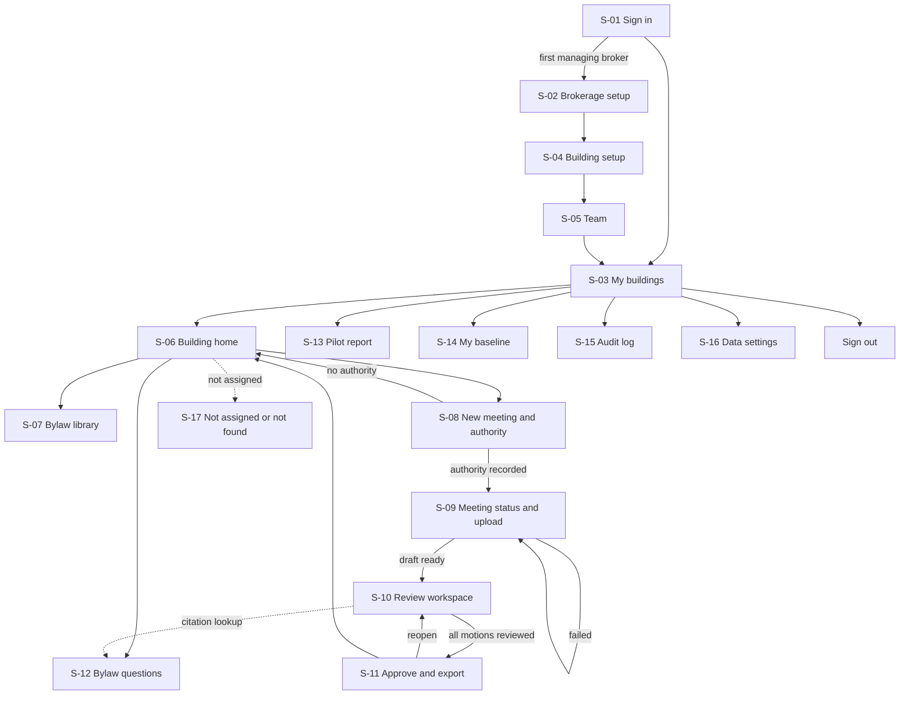

# App flow — StrataScribe BC

**Question this file answers:** how does each role complete or recover a task?

Roles, must-have IDs and number labels are defined in [PRD.md](PRD.md) and [Decision.md](Decision.md#how-numbers-are-labelled-used-in-all-ten-files). API paths are those in [TRD.md](TRD.md#api-contracts-proposed-apiv1). Examples are synthetic: Harbourline Strata Services Ltd.; buildings Strata Plan ZZS 9001 "Alder Court" and ZZS 9002 "Birch Landing"; managers Priya Nair and Daniel Okafor; managing broker Marta Lindqvist.

Every limit, interval and period on these screens is an author's proposal `[A]` unless it carries another label.

Roles in tables: **MB** = `managing_broker`, **SM** = `strata_manager`. "Assigned" means the strata manager has an active assignment to that building. **A managing broker can do everything an assigned strata manager can, in every building of their own brokerage**; wherever a screen says "manager", that includes the managing broker.

## Screen and route inventory

| ID | Route | Screen | Roles | Must-haves |
|---|---|---|---|---|
| S-01 | `/sign-in` | Sign in | Anyone | MH-01 |
| S-02 | `/onboarding` | Brokerage setup | MB (first user) | MH-01, MH-12 |
| S-03 | `/buildings` | My buildings | MB, SM | MH-02 |
| S-04 | `/buildings/new`, `/buildings/{id}/settings` | Building setup and assignments | MB | MH-02, MH-06 |
| S-05 | `/team` | Team | MB | MH-02 |
| S-06 | `/buildings/{id}` | Building home | MB, assigned SM | MH-02 |
| S-07 | `/buildings/{id}/bylaws`, `/buildings/{id}/bylaws/{docId}` | Bylaw library and clause confirmation | MB, assigned SM | MH-09 |
| S-08 | `/buildings/{id}/meetings/new` | New meeting and recording authority | MB, assigned SM | MH-03 |
| S-09 | `/meetings/{id}` | Meeting status and upload | MB, assigned SM | MH-04 |
| S-10 | `/meetings/{id}/review` | Review workspace | MB, assigned SM | MH-05, MH-06, MH-07 |
| S-11 | `/meetings/{id}/approve` | Approve and export | MB, assigned SM | MH-08, MH-13 |
| S-12 | `/buildings/{id}/ask` | Bylaw questions | MB, assigned SM | MH-10 |
| S-13 | `/pilot` | Pilot report | MB | MH-13 |
| S-14 | `/pilot/baseline` | My baseline timings | SM | MH-13 |
| S-15 | `/audit` | Audit log | MB | MH-11 |
| S-16 | `/settings/data` | Retention, export, deletion, support access | MB | MH-12 |
| S-17 | Any route | Not assigned (403), Not found (404), Signed out | Anyone | MH-01, MH-02 |

## Navigation

The global header on every signed-in screen shows the brokerage name, the current building (name and strata plan number) when inside one, and a user menu with Sign out.

## Screens

### S-01 Sign in — `/sign-in`

- **Story:** as an invited user I sign in without creating a password, with a second step that protects recordings if my email is compromised.
- **Entry:** not signed in, or session expired. A `?next=` parameter holds the page the user wanted.
- **Inputs:** work email; then, after opening the emailed link, the 6-digit code from an authenticator app. At first sign-in the user enrols the authenticator (a setup key shown as text and as a code to scan). There are no Microsoft or Google buttons in the pilot.
- **Visible data:** none about any brokerage.
- **Actions and destinations:** link sent → "Check your email" state on the same screen; link opened in the same browser → authenticator step → `next` or S-03; first user of a new brokerage → S-02.
- **States:** validation error (malformed email, message beside the field); unknown email gets the same "Check your email" message as a known one; expired (after 10 minutes) or used link → "This link has expired. Send a new one." with the email prefilled; link opened in a different browser → "Open the link in the browser where you asked for it, or send a new one."; wrong code → "That code did not match. Codes change every 30 seconds." (5 attempts, then a new link is needed); too many requests → "Too many sign-in requests. Try again in 20 minutes."; lost authenticator → the managing broker resets it from S-05 (for the last managing broker, the operator does, after an identity check by phone).
- **Acceptance checks:** the response for an unknown email is identical to that for a known one; no session exists until the code is accepted; `next` only accepts same-site paths; after sign-in the user lands on `next` if they are allowed to see it, otherwise S-03.

### S-02 Brokerage setup — `/onboarding`

- **Story:** as a managing broker I set up my brokerage once.
- **Entry:** first sign-in by the person named on the pilot agreement.
- **Inputs:** brokerage legal name; BCFSA brokerage licence number (free text, used as a label, not verified); privacy contact name and email; retention choices (prefilled defaults); whether the "express consent of all attendees" basis is enabled (default off); acceptance of the data-handling terms.
- **Visible data:** summary of what is stored, where, and for how long.
- **Actions:** Save → S-04 to add the first building.
- **States:** validation errors per field; partial save is kept if the user leaves and returns.
- **Acceptance checks:** cannot be completed without a privacy contact; choices are written to the audit log.

### S-03 My buildings — `/buildings`

- **Story:** as a manager I see only the buildings I manage and what needs my attention.
- **Entry:** signed in.
- **Visible data:** for SM, assigned buildings only; for MB, all buildings in the brokerage. Per building: name, strata plan number, meetings awaiting review, bylaws status (confirmed, needs confirmation, none).
- **Actions:** open a building → S-06; MB only: Add building → S-04, Team → S-05, Pilot → S-13, Audit → S-15, Data → S-16. SM: My baseline → S-14.
- **States:** empty for SM: "You have not been assigned to a building yet. Ask Marta Lindqvist (managing broker)." Empty for MB: "Add your first building." Loading: skeleton rows.
- **Acceptance checks:** a manager assigned to ZZS 9001 only sees one row; the page source, search box and API response contain no reference to ZZS 9002.

### S-04 Building setup — `/buildings/new`, `/buildings/{id}/settings`

- **Story:** as a managing broker I create a building and decide who may see it.
- **Inputs:** building name; strata plan number (unique within the brokerage); number of strata lots; total eligible votes; council size; quorum rules (defaults from the Act and Standard Bylaws, with an override that requires a bylaw clause reference); assigned managers (multi-select from team).
- **Visible data:** current assignments with who assigned and when.
- **Actions:** Save; Remove assignment (confirmation: "Daniel Okafor will lose access to Alder Court immediately, including drafts he is working on."); Move a meeting to another building (MB only, reason required).
- **States:** duplicate strata plan number → error naming the existing building; saving; saved.
- **Acceptance checks:** unassignment blocks the manager's very next request; every change appears in S-15.

### S-05 Team — `/team`

- **Story:** as a managing broker I invite managers and see what each can access.
- **Inputs:** name, email, role.
- **Visible data:** members, role, status (invited, active, deactivated), buildings assigned.
- **Actions:** Invite; Resend invitation; Reset a member's authenticator (they enrol again at next sign-in; audited); Deactivate (ends sessions at once); change role (a second MB is allowed; the last MB cannot be removed).
- **States:** invitation already pending → "Already invited on 3 Feb. Resend?"; email belongs to another brokerage → generic "This address cannot be invited" (no disclosure).
- **Acceptance checks:** a deactivated user's open tab fails on the next request and returns to S-01.

### S-06 Building home — `/buildings/{id}`

- **Story:** as a manager I see this building's meetings, bylaws and questions in one place.
- **Entry:** MB, or assigned SM. Otherwise S-17.
- **Visible data:** header with building name and strata plan number; tabs **Meetings** (date, type, state, draft or approved, audio deletion date), **Bylaws** (S-07), **Questions** (S-12).
- **Actions:** New meeting → S-08; open a meeting → S-09, S-10 or S-11 according to its state.
- **States:** empty: "No meetings yet. Create the next meeting before you upload a recording." Bylaws banner if none confirmed: "Bylaw answers are off until this building's bylaws are confirmed."
- **Acceptance checks:** the meeting list never mixes buildings; each meeting row shows a text state label, not colour alone.

### S-07 Bylaw library — `/buildings/{id}/bylaws`, `/buildings/{id}/bylaws/{docId}`

- **Story:** as a manager I load the registered bylaws and rules once and confirm the clauses the system will cite.
- **Inputs:** one or more files (PDF or Word); kind (bylaws, rules); land title filing reference; filing date; or a declaration "No amendments are filed; the Standard Bylaws apply", with the manager's name.
- **Visible data:** documents with status (processing, needs confirmation, current, superseded), filing date, last confirmed date and by whom. In the document view: source page beside the extracted clause list (number, heading, text).
- **Actions:** Upload; edit a clause's number or text; merge or split clauses; Confirm document; Mark superseded.
- **States:** processing (per file, with progress); **partial success** in a multi-file upload ("2 of 3 files processed. `Rules-2024.pdf` could not be read: the file is a scanned image. Upload a text PDF or retry.") with a per-file retry that does not re-process the successful files; scanned PDF with no text → explicit failure, not an empty clause list; duplicate file (same checksum) → "Already uploaded on 12 Jan."
- **Acceptance checks:** an unconfirmed or superseded document is never cited in S-12; confirming records who and when; a newer filing date supersedes the older document after confirmation and the older one remains readable.

### S-08 New meeting and recording authority — `/buildings/{id}/meetings/new`

- **Story:** as a manager I create the meeting and record why it may be recorded, before any audio exists in the system.
- **Entry:** assigned SM, or MB. The attestation is recorded under the name of whoever saves it.
- **Inputs, step 1:** meeting type (council, AGM, SGM); date; held in person, electronically, or both.
- **Inputs, step 2 — source and authority (one must be chosen):**
  1. **Recording — bylaw.** "This building's filed bylaws allow meetings to be recorded." Requires the clause reference (picked from confirmed bylaws in S-07, or typed).
  2. **Recording — express consent of everyone present.** Shown only if the brokerage enabled it in S-02. Requires confirmation that each attendee agreed and how (announced and no objection is **not** accepted; wording set after legal review, T-0.1.3).
  3. **Dictated notes.** "I will upload my own spoken notes made after the meeting. No attendee is recorded."
  4. **Not authorized.** Saves the meeting as "not recorded" so it is counted in the pilot report (metric M-11). No audio is accepted and no draft is produced; the manager writes these minutes the usual way.
- **Visible data:** the notice wording the manager should read at the start of the meeting, and a short explanation with a link to the privacy regulator's guidance.
- **Actions:** Save → S-09. Back keeps entered values.
- **States:** validation error if no basis chosen; if basis 1 is chosen and the building has no confirmed bylaws, a warning: "No confirmed bylaws on file. You can type the clause reference now and upload the recording, but the minutes cannot be approved until the bylaws are uploaded and this reference is linked to a confirmed clause."
- **Acceptance checks:** `POST /meetings/{id}/uploads` returns 409 for a meeting without basis 1, 2 or 3; the attestation shows the attesting user and time and cannot be edited after the first upload; approval is refused while a bylaw basis has no confirmed clause linked (test I-23), and S-06 and S-13 flag such meetings as "recording authority not yet evidenced".

### S-09 Meeting status and upload — `/meetings/{id}`

- **Story:** as a manager I upload the recording and can see, at any later time, exactly where it is.
- **Entry:** assigned SM or MB. Deep-linkable; the "draft ready" email links here.
- **Inputs:** one or more audio files (parts of one meeting, ordered by the user with Move up / Move down buttons): M4A or MP4 audio, MP3, WAV, FLAC, Ogg or WebM; up to 10 parts, 3 hours and 2.5 GB per meeting in total `[A]`.
- **Visible data:** building header; authority summary; a stepper with text labels: Uploaded → Transcribing → Drafting → Ready for review; started-at times; expected ready time ("by 7:00 a.m. tomorrow"); audio deletion date.
- **Actions:** Upload; Pause and Resume; Start processing; Retry (after failure); Open review → S-10 when ready; Remove a part, or replace it by removing and uploading again (only before review starts; the meeting returns to the upload state).
- **States:**
  - *Empty:* drop zone and file picker button.
  - *Uploading:* per-file progress; survives refresh (resumes from the last confirmed part).
  - *Refused file:* "`meeting.docx` is not an audio file we accept", "This recording is larger than 2.5 GB", or "This file did not pass our safety scan"; nothing is kept.
  - *Duplicate:* "This file was already uploaded for this meeting. Nothing was uploaded twice."
  - *Processing:* stepper; safe to close the tab; status polled every 15 seconds and announced politely to assistive technology.
  - *Partial success (multi-part audio):* "Part 2 of 3 failed to upload. Parts 1 and 3 are safe." Retry affects only part 2. Processing cannot start until all listed parts are present or the missing part is removed explicitly.
  - *Failed:* reason in plain words and an error reference; Retry reuses finished steps.
  - *Timeout:* if no progress for 2 hours, "This is taking longer than expected. We have been alerted. You do not need to re-upload."
  - *Permission denied:* S-17.
- **Acceptance checks:** refresh, Back and Forward never restart an upload or lose the stepper; pressing Start processing twice creates one job; uploading the same file twice creates one audio asset.

### S-10 Review workspace — `/meetings/{id}/review`

- **Story:** as a manager I check every motion, outcome and bylaw citation against the audio, correct what is wrong, and see what remains.
- **Entry:** state `ready_for_review` or `in_review`; assigned SM or MB.
- **Visible data:** left, the draft minutes as a list of items (attendance, quorum, motions, discussion, adjournment) each with a status chip: *Needs review*, *Reviewed*, *Blocked*; right, the transcript with an audio player; top, a "DRAFT" banner and a counter ("7 of 12 motions reviewed, 1 blocked").
- **Inputs per motion:** motion text; mover; seconder; then **"How was this decided?"**:
  - **Declared on a show of cards (no count).** The manager selects *Carried* or *Defeated* as the chair declared it. No numbers are asked for. This is preselected for general-meeting motions unless a count was heard.
  - **Counted** (precise count, secret ballot, or a council vote with numbers). Threshold (majority, 3/4, 80%, unanimous, council majority); counts for, against, abstained; for 80% and unanimous votes, total eligible votes (prefilled from the building); for council votes, members present. Optionally, what the chair declared.
  - If a counted majority vote is tied: "Did the president use a casting vote?" (not used, used in favour, used against). Not shown for a strata plan with 2 strata lots.
- **Quorum card (B1 build, B1-006; required by lead ruling):** every draft has one, and approval is impossible until it is reviewed. "How was quorum established?" *Counted* (enter votes or members present and eligible; the required number, the rule and the formula are shown), *Declared by the chair* (attested), or *Not recorded: attendance unknown* (attested; the minutes print "Quorum: not recorded. The number of votes present was not available to the manager who prepared these minutes."). The manager selects what the minutes record: *Quorum established* or *Not established*; a statement that contradicts the numbers blocks the card and approval.
- **Inputs on the attendance and quorum card:** votes present in person and by proxy (general meeting) or council members present; "This meeting was reconvened after an adjournment for lack of quorum" (checkbox); or "Quorum declared by the chair, no numbers".
- **Citations on an item:** where the meeting referred to a bylaw, the card shows "Suggested citation: Bylaw 3(4)" with the clause text. The manager chooses *Confirm*, *Replace* (clause picker limited to this building's confirmed bylaws and the statute set) or *Remove*, and can *Add citation* to any item, including from the lookup panel. Unconfirmed suggestions are not exported.
- **Actions:** select an item → transcript scrolls to its source and audio plays from 5 seconds before; edit a field; Mark reviewed; Add item; Delete item (reason required); Replace owner name with unit number (for flagged sensitive items); Look up a bylaw → S-12 in a side panel (time counted as lookup for this meeting); Continue to approval → S-11.
- **Read-only on the card:** for a counted motion, the calculated result with its formula ("9 in favour, 3 opposed; 3/4 vote needs 9 of 12 votes cast; CARRIED"); for a declared motion, "CARRIED — declared by the chair on a show of voting cards; no count recorded"; the quorum statement.
- **States:**
  - *Blocked item — discrepancy:* a count exists and disagrees with the declared outcome. The card offers three stored resolutions: "Correct the count", "Correct the threshold", "Record both as they happened" (a note is required; the minutes then state the chair's declaration and the count).
  - *Blocked item — incomplete:* method "Counted" with no numbers ("Enter the count, or switch to Declared"); a tie with no casting-vote answer; a declared motion with no outcome selected.
  - *Autosave:* a field saves when focus leaves it and every 5 seconds while typing; "Saved 10:42" indicator. On failure the user's focus is **not** moved: the field is marked invalid, "Not saved" with a Retry button appears beside it, the failure is announced once, the card's error list gains a link back to the field, and the typed value is kept in the page.
  - *Continue to approval with blockers or unreviewed motions:* focus moves to an error summary at the top ("3 motions still need attention") whose entries are links to the cards.
  - *Conflict:* "Daniel Okafor changed this motion at 10:40. Review his version or replace it with yours."
  - *Extraction failed:* transcript with an empty minutes template; the manager can still write minutes; the pilot report marks the meeting "draft unavailable".
  - *Source deleted:* after the audio retention date, evidence links show "Recording deleted on 24 Feb 2027".
  - *Unassigned while editing:* next save returns "You no longer have access to Alder Court. Your unsaved text is shown below so you can copy it." and no further data loads.
- **Reopening unfinished work:** returning to the URL restores scroll position and the last selected item. Time counts while the tab is visible and the user has typed, clicked, scrolled **or had audio playing** in the last 60 seconds.
- **Acceptance checks:** every motion, name and number has a working link to audio; a calculated result can never be typed in and a declared outcome is always the manager's selection, never prefilled as final; a motion decided on a show of cards can be reviewed with no numbers (test E-5); approval is impossible while any motion is *Needs review* or *Blocked*; every edit, including each citation change, creates a correction record with its category.

### S-11 Approve and export — `/meetings/{id}/approve`

- **Story:** as a manager I see exactly what I am approving, approve it, and take the file away.
- **Entry:** all motions reviewed, no blockers; assigned SM or MB.
- **What the user reviews before the irreversible step:** building name and strata plan number; meeting type and date; quorum statement; a table of every motion with mover, seconder, how it was decided, counts where there are any, and the outcome (calculated or declared); confirmed citations; the list of corrections made; any owner names remaining in sensitive items; the recording authority on file (with "not yet evidenced" in red text and words if a bylaw basis has no confirmed clause, which blocks approval); the date the audio will be deleted.
- **Actions:** checkbox "I have reviewed every motion and vote against my notes or the recording" then **Approve minutes**; after approval, Export Word, Export PDF; **Mark as sent** (date sent, "minutes spent on the file after export", and for the first two authorized meetings the stopwatch total), which feeds M-1 and M-2; Reopen (reason required) → S-10 with a new draft version.
- **States:** approving (button disabled, "Approving…"); server refuses because something changed since the page loaded → list of what changed and a link back to S-10; export generating; export failed → Retry. Downloads are served to the signed-in user by the application; there are no shareable links to expire.
- **Duplicate submission:** a second click or a repeated request returns the same approval; there is one approval record.
- **Acceptance checks:** approved text is identical in the screen, Word and PDF; a draft export has "DRAFT — not reviewed" on every page; an approved export shows approver and approval time in the footer; reopening leaves the earlier approved version readable and marks the new export "Amended".

### S-12 Bylaw questions — `/buildings/{id}/ask`

- **Story:** as a manager I ask a question about this building's bylaws and get the clause, or a clear "nothing found".
- **Entry:** MB or assigned SM; at least one confirmed bylaw document or a Standard Bylaws declaration.
- **Inputs:** question text (up to 500 characters `[A]`).
- **Visible data:** which documents will be searched, with filing and confirmation dates; previous questions for this building.
- **Result, answered:** short answer; under it, each cited clause quoted in full with document name, filing date, clause number, and "Open in bylaws"; where relevant, the Act section with a link to BC Laws and the reference set's "current to" date; the line "Information from the documents on file, not legal advice."
- **Result, refused:** "No supporting clause found in Alder Court's bylaws or rules." followed by "Closest passages (search results, not an answer)".
- **Actions:** Copy answer with citations; Copy clause only; Report a wrong answer (stores a flag for review).
- **States:** searching (up to about 15 seconds, announced); model unavailable → search results only with "Answers are temporarily unavailable; these are search results."; bylaws last confirmed more than 12 months ago `[A]` → notice "Bylaws last confirmed 14 months ago. Check for amendments filed since."
- **Acceptance checks:** no answer text is ever displayed without at least one citation whose quote matches the stored clause exactly; questions about one building never retrieve another building's clauses.

### S-13 Pilot report — `/pilot`

- **Story:** as a managing broker I see whether we saved time after corrections.
- **Visible data:** per meeting: building, manager, type, source (recorded or dictated), matched baseline minutes (marked "cross-type" where the baseline is from the other meeting type); setup, review, lookup, post-export and dictation minutes; stopwatch total where taken; net saved; corrections by category (motion, vote, citation, other); bylaw answers flagged wrong; business days from meeting to sent; within 3 business days (yes or no); recording authority evidenced (yes or no). Totals and medians per manager and overall, with the sample size stated beside every median.
- **Actions:** filter by manager, building, date; Export CSV; open a meeting read-only.
- **States:** empty: "No pilot meetings yet."; missing baseline: "No baseline for Priya Nair — net time saved cannot be calculated." with a link the manager can use (S-14).
- **Acceptance checks:** figures reproduce from the stored records; a meeting without a baseline is shown but excluded from medians, and the exclusion is stated.

### S-14 My baseline — `/pilot/baseline`

- **Story:** as a manager I record how long minutes took me for two meetings done the usual way.
- **Inputs:** building, meeting type, meeting length, minutes spent drafting (from first opening the notes to the file being ready to send), method (stopwatch sheet or estimate). The screen explains that only stopwatch entries are used for the time-saved figure and asks for two, ideally one council and one general meeting.
- **Acceptance checks:** estimates are labelled as estimates in S-13; a manager sees only their own entries.

### S-15 Audit log — `/audit`

- **Story:** as a managing broker I can answer "who saw or changed this?".
- **Visible data:** time, person, building, action, target, outcome (including denied). Filters by building, person, action, date. Export CSV.
- **States:** loading; empty filter result; more than 10,000 rows → export by date range.
- **Acceptance checks:** contains denied-access attempts and support grants; contains no meeting text.

### S-16 Data settings — `/settings/data`

- **Story:** as a managing broker I control how long recordings are kept and can take our data away.
- **Inputs:** days to keep audio after approval; days to keep transcripts after approval; privacy contact.
- **Actions:** Save retention (applies to existing audio from the next nightly run; the screen states how many recordings will be deleted earlier as a result); Export a building (zip of approved minutes, bylaws, corrections log); Delete a building; Close account; Grant support access to one meeting for 24 hours with a reason.
- **What the user reviews before deletion:** the building name typed in full; counts of meetings, recordings, bylaw documents and approved minutes that will be removed; a reminder that the strata corporation's own copies of minutes are the brokerage's responsibility and that an export is offered first; the date backups will no longer contain the data.
- **States:** export preparing → a notice by email with no content and no file link; the bundle is downloaded from this screen for 24 hours by a signed-in managing broker; a scheduled deletion can be cancelled here during its 48-hour window; a support grant can be revoked here at any time; deletion scheduled (48-hour cancel window `[A]`) → completed.
- **Acceptance checks:** deletion removes database rows and every object under the building's storage prefix; the audit event survives without content.

### S-17 Not assigned, Not found, Signed out

- **403 Not assigned** (same brokerage): "You are not assigned to this building. Ask your managing broker, Marta Lindqvist, to assign you." No building details shown.
- **404 Not found** (anything else, including other brokerages' IDs): "We could not find that page."
- **Signed out:** session cleared; Back shows S-01, not cached content (pages are served with no-store).

## Cross-cutting behaviour

| Behaviour | Rule |
|---|---|
| **Refresh** | Every screen rebuilds from the URL and server state. No task state lives only in memory. Uploads resume; review position is restored. |
| **Back and Forward** | Ordinary page navigation. Leaving S-10 with a field mid-edit triggers a save first; leaving with an unsaved failure shows a confirmation. Back after approval shows the approved, read-only state. |
| **Deep links** | Every screen has a stable URL. A link to a meeting opens the screen matching its current state. A link the user may not see leads to S-17, never to a partial page. |
| **Duplicate submission** | Buttons disable while pending; the server deduplicates by idempotency key for create, process, approve, export and delete. |
| **Batch actions** | Only two: multi-file audio upload (S-09) and multi-file bylaw upload (S-07). Both show per-file results, never a single overall success, and retry only failed files. |
| **Reopening unfinished work** | S-03 and S-06 list meetings by state. An upload begun on a phone can be continued on a desktop: the meeting shows which parts arrived. |
| **Session expiry** | Sessions end after 60 minutes without activity or 12 hours in total. Two minutes before either, a dialog offers "Stay signed in" (which extends the idle limit only). On expiry during review, unsaved field values stay in the page; after sign-in the user returns to the same item. |
| **Irreversible or external actions** | Approve (S-11), delete building or account (S-16), remove assignment (S-04), grant support access (S-16). Each has the review step described above. The product never emails owners. |
| **Sign-out** | From the user menu on any screen. |
