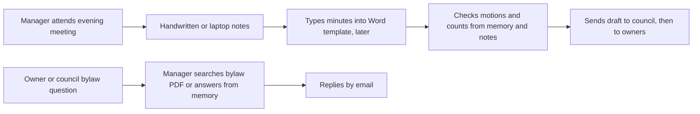
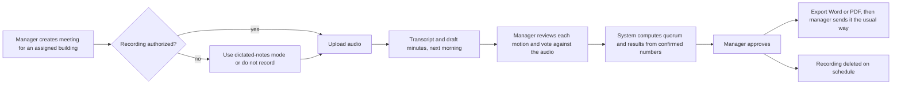

# PRD — StrataScribe BC

**Question this file answers:** what outcome does the user need?

Number labels (`[C]`, `[A-chat]`, `[A]`, `[S: …]`, `[D]`) are defined in [Decision.md](Decision.md#how-numbers-are-labelled-used-in-all-ten-files). Source IDs such as `SPA` and `OIPC-2022` point to [Decision.md, Sources and assumptions](Decision.md#13-sources-and-assumptions). Risks are cited by ID from [verification-report-fixing.md](verification-report-fixing.md#production-risk-register).

Method note: following the GitHub Spec Kit split `[S: SpecKit]`, this file states outcomes and acceptance criteria only. Technology choices are in [TRD.md](TRD.md).

## Overview

StrataScribe BC helps a licensed strata manager turn one authorized meeting recording (or the manager's own dictated notes) into a draft of the minutes in the form BC strata corporations use, and helps the manager answer bylaw questions by retrieving the exact clause from that building's own bylaws. A manager reviews, corrects and approves everything. The product is bought by the managing broker of a BC strata management brokerage.

**The one question the MVP must answer:** across two authorized meetings, does a manager spend measurably less time producing correct minutes with StrataScribe, counting all the time spent correcting motions, votes and bylaw citations, than without it?

## What the product does

1. Holds each building (strata corporation) in its own workspace inside the brokerage's account, visible only to the managers assigned to it and to the managing broker.
2. Refuses audio until someone records why this meeting may be recorded.
3. Transcribes the audio and drafts minutes: attendance, quorum, each motion with mover, seconder and vote counts, and discussion summaries.
4. Shows every drafted item next to the transcript passage and audio it came from.
5. Computes quorum and vote results by fixed rules from numbers the manager confirms.
6. Records every correction and the time spent reviewing.
7. Lets the manager approve and export to Word or PDF. Nothing is sent to owners by the product.
8. Stores each building's registered bylaws and rules, and answers questions only by quoting a clause with its number. If no clause supports an answer, it says so.
9. Deletes recordings on a schedule and can prove it.

## Why now

- A documented shortage of strata managers in BC `[S: GlobalNews]`, so administrative time limits how many buildings a manager can carry `[C]`.
- Speech-to-text and language models make a draft cheap: about CAD 0.20 per audio hour for transcription `[A-chat]`.
- No BC-specific tool was found by the chat's research `[C]`; vendor pages opened on 2026-11-10 show a general portal with an AI add-on and a BC portal without AI `[S: CondoControl]`, `[S: OpenStrata]`.

## Goals

| ID | Goal | How it is judged |
|---|---|---|
| GL-1 | Prove or disprove a net time saving after correction | Metric M-1 |
| GL-2 | Get minutes out within 3 business days of every pilot meeting `[C]` | Metric M-2 |
| GL-3 | Never let a wrong motion, vote result or citation reach approved minutes unreviewed | Metrics M-5, M-6 |
| GL-4 | Keep each building's recordings, minutes and bylaws away from people not assigned to it | Metric M-8 |
| GL-5 | Find out whether brokerages will pay CAD 299 for the pilot and continue afterwards `[C]` | Metrics M-3, M-4 |

## Problem statement

A BC strata manager attends evening council meetings and annual and special general meetings for several buildings, then writes the minutes by hand from notes and a Word template, and answers repeated bylaw questions from memory or by searching PDFs `[C]`. Minutes must record the results of votes `[S: SPA]` s. 35(1)(a), and under the Standard Bylaws council minutes go to owners within 2 weeks whether or not approved `[S: SPA-SB]` s. 19. The manager is accountable for the wording of motions and the vote counts. A draft that is quick to produce but slow or risky to correct does not solve the problem.

## Buyer

The managing broker (or director of strata operations) of a brokerage with 3–40 strata managers `[C]`. The buyer cares about buildings per manager, late-minutes complaints, and whether a new vendor endangers the brokerage's confidentiality duty to its strata clients `[S: RESR]` s. 30(e). The buyer signs the agreement, pays the invoice, assigns managers to buildings, and reads the pilot report.

## Users and roles

| Role | Who | Can do | Cannot do |
|---|---|---|---|
| `managing_broker` | The buyer, or a delegate named by them. In a small brokerage this person often manages buildings too. | **Everything a strata manager can do, for every building in their own brokerage without needing an assignment** (create meetings, record authority, upload, review, correct, approve, export, bylaws, questions), plus administration: create buildings, invite managers, assign and unassign, set retention, read the audit log and pilot report, request export or deletion, grant support access | See any other brokerage |
| `strata_manager` | Licensed manager | For **assigned buildings only**: create meetings, record authorization, upload audio, review, correct, approve, export, manage bylaws, ask bylaw questions; enter their own baseline timings | See or search unassigned buildings, even in the same brokerage; change assignments; read the brokerage audit log |
| `platform_operator` | Founder or support engineer | Operate the service; see job status, sizes, durations, error codes | Open recordings, transcripts, minutes or bylaws, except through a time-limited, reason-recorded support grant created by the brokerage's managing broker |
| Not a user | Council members, owners, tenants | — | No login in the MVP |

Why the managing broker can act in every building `[A]`: the Rules make the managing broker responsible for supervising managers and for the brokerage's records `[S: RESR]` s. 28, and in a 3-manager brokerage the managing broker commonly carries buildings personally. Every read and every action is written to the audit log under their name. A user has one role; a managing broker who manages buildings needs no second account.

## Current workflow

Time per meeting for step C–D is the baseline. It has never been measured; the chat's week-1 gate is that at least 6 of 11 interviewees say it exceeds 1 hour `[C]`.

## Proposed workflow

## Must-haves

Priority P0 = the pilot cannot run without it. P1 = needed to trust the pilot result.

| ID | Pri | User story | Observable acceptance criteria | Owner role |
|---|---|---|---|---|
| **MH-01** | P0 | As a managing broker, I want my brokerage's data separated from every other brokerage so I can meet my confidentiality duty. | A user of brokerage A requesting any record ID of brokerage B through any screen, API, export link or file URL receives "not found", and the attempt is logged. A background job for A cannot read B's rows or files. | Managing broker |
| **MH-02** | P0 | As a managing broker, I want to assign managers to specific buildings so a manager sees only the buildings they manage. | A manager assigned to building X and not Y sees no trace of Y in lists, search, Q&A, exports or file links; a direct link to Y's meeting returns "not assigned". Removing an assignment takes effect on the next request. Every assignment change is logged with who and when. | Managing broker |
| **MH-03** | P0 | As a manager, I must record why a meeting may be recorded before audio is accepted, so the brokerage does not collect recordings without authority. | No audio can be uploaded until one basis is saved: (a) the building's filed bylaw authorizes recording, with the clause reference; (b) express consent of all attendees, only if the brokerage has enabled this basis; or (c) dictated notes by the manager, no attendee audio. The record shows who attested and when, and cannot be edited after upload, only superseded. The notice wording used is stored with it. | Strata manager |
| **MH-04** | P0 | As a manager, I want to upload a long recording from the office or my phone and see what is happening to it. | A 3-hour file `[A]` uploads with resume after a dropped connection; the same file uploaded twice to one meeting is detected and not processed twice; the screen shows queued, transcribing, drafting, ready, or failed with a reason and a retry; the manager can leave and come back. | Strata manager |
| **MH-05** | P0 | As a manager, I want a draft in the BC minutes form so I start from structure, not a blank page. | The draft contains: building name and strata plan, meeting type, date, attendance, quorum statement, call to order, each motion with text, mover, seconder and votes, discussion summaries, adjournment. Every motion, name and number links to its transcript passage and plays the audio from that point. Items the system is unsure of are flagged, not silently filled. Where the meeting referred to a bylaw, the item carries a suggested citation to a clause of that building's confirmed bylaws, shown for the manager to confirm, replace or remove. Names of owners in sensitive items (bylaw contraventions, arrears) are flagged for replacement by unit or strata lot number `[S: OIPC-2022]`. | Strata manager |
| **MH-06** | P0 | As a manager, I want the outcome of every motion to be either what the chair declared, as I attest it, or computed by fixed rules from a count I confirm, so an AI guess never decides whether a motion carried and I never have to invent numbers. | For each motion the manager picks how it was decided. **Declared on a show of voting cards** (the default at general meetings under the Standard Bylaws `[S: SPA-SB]` s. 27(2)): the manager selects carried or defeated as the chair declared it; no numbers are asked for or stored. **Counted** (a requested precise count, a secret ballot, or a council vote with numbers): the manager confirms threshold and counts and the result is computed by the rules in [TRD.md](TRD.md#deterministic-rules) and shown with the formula. If a count exists and disagrees with the declared outcome, the item is blocked until the manager chooses a stored resolution: correct the count, correct the threshold, or record both as they happened with a note. Quorum is computed from numbers the manager confirms (votes or members present and eligible), stored with the result and rules version on the quorum item; the manager selects what the minutes record (established or not), and approval is refused while that statement contradicts the computed result. A quorum declared by the chair without numbers is attested by the manager. **Minutes cannot be approved without a reviewed quorum item** (lead ruling, 2026-11-11): every draft carries one; if attendance is genuinely unknown the manager records that explicitly, and the minutes then print "Quorum: not recorded. The number of votes present was not available to the manager who prepared these minutes." Quorum is never left out silently. No outcome is ever taken from the language model; what the model heard is shown only as a suggestion. | Strata manager |
| **MH-07** | P0 | As a manager, I want to correct any drafted item quickly, and as a managing broker I want those corrections and the time counted. | Every change to a motion, mover, seconder, outcome method, declared outcome, count, threshold or **bylaw citation on an item** is stored with old value, new value, category and author. Time is recorded per meeting for setup, review (typing or listening both count) and bylaw lookup, as defined under [How M-1 is captured](#how-m-1-is-captured). The manager can add an item the draft missed and delete one it invented. | Strata manager |
| **MH-08** | P0 | As a manager, I want to approve the minutes and export them, and be sure nobody mistakes a draft for the approved record. | Approval requires every motion and a quorum item to be reviewed and every blocker cleared (no approval without a reviewed quorum item); where the recording basis is a bylaw, approval also requires that basis to be linked to a confirmed clause of the building's bylaws (a typed reference alone is not enough). The approval screen lists what will be approved. Approved versions are immutable; reopening creates a new version. Exports of unapproved versions carry a visible "DRAFT — not reviewed" mark on every page. Export is Word and PDF. The product sends nothing to owners. | Strata manager |
| **MH-09** | P0 | As a manager, I want each building's registered bylaws and rules loaded once, with the filing date, so answers come from the right version. | Per building: upload bylaws and rules; record the land title filing reference and date; the system splits the text into numbered clauses; the manager confirms the split before the document can be cited. Uploading a newer filing supersedes the older one and it stops being cited. A building with no confirmed bylaws shows the Standard Bylaws only if the manager states that no amendments are filed. | Strata manager |
| **MH-10** | P0 | As a manager, I want answers to bylaw questions that quote the clause, so I can check before replying to an owner. | An answer is displayed only if it carries at least one citation whose quoted text matches the stored clause text exactly and is a meaningful span: at least 20 characters and 4 words `[A]`, starting and ending on word boundaries. A shorter or partial-word quote does not count, and the question is shown as unanswered. Otherwise the screen shows "No supporting clause found" and the closest clauses as search results, labelled as such. Each answer names the bylaw document, filing date, and clause number, and links to the Act section where one applies. Every answer carries "information, not legal advice". | Strata manager |
| **MH-11** | P1 | As a managing broker, I want a log of who opened, changed, approved, exported, asked and was refused, so I can supervise and answer a complaint. | The log shows actor, building, action, target, time and outcome. It includes **successful reads** (meeting opened, audio played, transcript read, export downloaded), denied access, and every access under a support grant. It contains no transcript text. It can be filtered by building and exported as CSV. Entries cannot be edited or deleted by any brokerage user. | Managing broker |
| **MH-12** | P0 | As a managing broker, I want recordings deleted on a schedule I set, and everything deleted or exported on request, so we hold owners' personal information no longer than needed. | Audio is deleted a set number of days after approval, with a hard limit after upload (defaults in [schema.md](schema.md#retention-and-deletion)); deletion removes the file and all derived copies and is recorded. A building or the whole account can be exported and then deleted. Deleted data disappears from backups when the backup window expires. | Managing broker |
| **MH-13** | P0 | As a managing broker, I want a pilot report showing time saved after correction for each meeting, so I can decide whether to keep paying. | For each pilot meeting: matched baseline minutes; setup, review, lookup, post-export editing and dictation minutes; the manager's stopwatch total where taken; corrections by category (motion, vote, citation, other); bylaw answers flagged wrong; business days from meeting to "sent"; and net time saved, computed as defined under [How M-1 is captured](#how-m-1-is-captured). Totals per manager and per building. The report states the sample size and which meetings were recorded versus dictated. | Managing broker |

### Should-haves (not required for the pilot)

Sign-in with the brokerage's Microsoft or Google account `[C]` suggestion (the pilot uses an emailed sign-in link plus an authenticator-app code; no OIDC is built for the pilot); the brokerage's own Word template applied on export (optional input, not stored in the MVP; the manager pastes the export into their template); speaker names learned across meetings of the same building.

## Non-goals

- Sending minutes or notices to owners, or any owner or council portal.
- Recording inside the product (live capture). The MVP accepts a file. This departs from the chat's MVP list, which says "Upload or record" `[C]`.
- Export to Microsoft 365 or Google Drive `[C]` suggestion. The MVP produces a file the manager saves.
- Searching for a person's name across minutes and transcripts. Access requests under PIPA are answered by the brokerage or strata corporation from their own exported records.
- Deciding whether recording is lawful. The product records the manager's attestation; it does not give legal advice.
- Answering legal questions beyond quoting the building's bylaws, the Standard Bylaws and the Act.
- Accounting, trust records, strata fees, or any record the brokerage must keep under the Rules `[S: RESR]` s. 88. StrataScribe is not the brokerage's or the strata corporation's system of record for minutes; the exported file is.
- The self-managed council plan, other provinces, the US and UAE `[C]` expansion ideas.
- Self-serve billing. Pilot invoices are issued by hand.
- An MCP server for bylaws `[C]` "optional later".

Any feature not traceable to a must-have is out (risk R-21).

## Dependencies

| Dependency | Needed for | Owner | Status |
|---|---|---|---|
| A brokerage willing to run two meetings | Everything | Founder | Not started |
| Buildings with recording authority, or acceptance of dictated notes | MH-03 | Managing broker | Unknown; see [Decision.md](Decision.md#11-missing-inputs) |
| Each building's filed bylaws and rules as PDF or Word | MH-09 | Strata manager | Per building |
| Timed baseline for two past meetings per manager | MH-13 | Strata manager | Before the first pilot meeting |
| Review by a BC strata lawyer of the authorization wording and the "not legal advice" boundary | MH-03, MH-10 | Founder | Not started |
| Canadian location for audio processing and storage confirmed | MH-04, MH-12 | Founder | Not decided in chat |
| Public text of the Act, Regulation and Standard Bylaws | MH-06, MH-10 | Founder | Available at BC Laws; licence terms for reuse not checked |

## Constraints

- **Recording authority.** Recordings of strata meetings are likely not authorized by PIPA without a bylaw `[S: OIPC-2022]`.
- **Personal information.** Recordings and transcripts contain owners' voices, names, unit numbers, and discussion of arrears and bylaw contraventions. Reasonable security is required `[S: PIPA]` s. 34; information no longer needed must be destroyed `[S: PIPA]` s. 35(2).
- **Responsibility chain.** The strata corporation remains responsible for personal information that is not in its custody `[S: PIPA]` s. 4(2); the brokerage owes confidentiality `[S: RESR]` s. 30(e). StrataScribe acts for the brokerage under written terms.
- **Canadian residency.** No residency rule was found in the PIPA text or Rules read `[S: PIPA]`, `[S: RESR]`. The chat set "data kept in Canada" as the compliance position `[C]`; this PRD treats it as a buyer expectation and a product commitment.
- **Minutes content.** Minutes should record decisions and need not include the exact discussion `[S: OIPC-2022]`.
- **Small team:** 1–3 developers `[C]`; the founder already has a VPS, domain and hosting `[C]`.
- **Language:** English only.

## Highest-cost user mistake

Three different "worst cases" appear in this repository and they are not in competition. The **commercial** one is that recording turns out not to be authorized at most buildings ([Decision.md](Decision.md#4-competitor-gap-supporting-evidence-counterargument)); it ends the recorded product. The **system** one is a manager reaching another building's recording ([TRD.md](TRD.md#6-runtime-view)); it is the worst thing the software can do on its own. The **user mistake** with the highest cost, which this section is about, is this:

**A manager approves minutes in which a motion's wording or vote result is wrong** (for example, a 3/4 vote resolution recorded as carried when it failed, or the wrong mover), and the exported minutes go to owners.

- **Cost:** the minutes are the strata corporation's record of its decisions `[S: SPA]` s. 35. An error can lead to spending without authority, an owner dispute, a correction at the next meeting, and embarrassment for the manager, which the chat names as the main churn trigger `[C]`.
- **Who reviews:** the strata manager reviews every motion before approval (MH-06, MH-07, MH-08). The council reviews the minutes afterwards in the ordinary way, outside the product. During the pilot the managing broker spot-checks one meeting per manager against the audio `[A]`.
- **How it is corrected:** the manager reopens the approved minutes, which creates a new version with a recorded reason; the new export is marked "Amended" with the date; the earlier version stays in history. The correction is counted in M-6.

Second-highest: uploading a recording to the wrong building. Prevented by showing the building name and strata plan on the upload screen and in the draft header, and corrected by "move meeting", which only a managing broker can do and which is logged.

## Success metrics

Baselines are unknown unless stated. All targets are proposals `[A]` unless tagged otherwise.

| ID | Type | Metric | Method | Denominator | Window | Source | Baseline | Target |
|---|---|---|---|---|---|---|---|---|
| M-1 | Workflow quality (decisive) | Net time saved per meeting = matched baseline minutes − after-correction minutes. Every term is defined under [How M-1 is captured](#how-m-1-is-captured). | Stopwatch sheet on both sides for the first two authorized meetings per brokerage; product timers plus manager-entered terms afterwards, with the stopwatch as cross-check | Authorized pilot meetings with a stopwatch baseline | First two authorized meetings per brokerage, then the 60-day pilot | Baseline entries; activity timers; time reports | Unknown; assumed saving is 90 minutes `[A-chat]` | First two meetings: each above 0 and their mean ≥ 45 minutes `[A]`. Whole pilot: median ≥ 45 minutes `[A]`. Threshold is a plain proposal; see [Decision.md](Decision.md#10-what-buyer-evidence-would-change-the-decision) |
| M-2 | Workflow quality | Share of meetings whose minutes are sent within 3 business days of the meeting | Meeting date versus the date the manager marks the minutes sent (the product does not send); if never marked, the first approved export; BC statutory holidays excluded | All pilot meetings | 60 days | Meeting and export records | Unknown | 100% `[C]` |
| M-3 | Commercial | Paid pilots: pilot agreement signed and CAD 299 invoice paid, for a pilot first delivered by hand | Signed agreements and paid invoices | 150 distinct brokerages contacted; 8 demos `[C]` | Day 60 from first contact; provisional memo closed by day 74 if a signed pilot is unpaid or a free test is still running `[A]` ([Decision.md](Decision.md#129-gtm-stop-rule)) | Founder's sales log | 0 | ≥ 2 `[C]` |
| M-4 | Commercial | Pilot brokerages that continue on a paid tier | Second invoice paid | Paid pilots | 30 days after pilot end | Invoices | 0 | Not decided in chat; 70% is the planning assumption `[A]` |
| M-5 | Workflow quality | Corrections per meeting, by category | Count of stored corrections | Per approved meeting | Pilot | Correction records | Unknown | Report only; no target until a baseline exists |
| M-6 | Failure | Motion or vote errors found **after** approval | Reopen events with reason "motion or vote error", plus managing-broker spot checks | Approved meetings | Pilot | Reopen records, spot-check sheet | Unknown | 0 |
| M-7 | Failure | Bylaw answers shown without a valid citation | Automated check on every answer; weekly sample of 20 reviewed by hand | Answers shown | Pilot | Q&A records | — | 0 |
| M-8 | Failure | Cross-building or cross-brokerage reads that succeed | Automated permission tests on every release; audit-log review | Test cases; denied events | Every release; weekly | Test results; audit log | — | 0 |
| M-9 | Failure | Recordings past their deletion date | Daily count of audio objects older than policy | Audio objects | Daily | Storage inventory versus database | — | 0 |
| M-10 | Workflow quality | Drafts needing under 20 minutes of edits | Active review minutes per meeting | Drafts reviewed | Pilot | Review-session records | Unknown | 4 of 5 `[C]` |
| M-11 | Failure | Meetings blocked for lack of recording authority | Count of meetings created with no valid basis | Meetings created | Pilot | Authorization records | Unknown | Report only; feeds the recording stop rule |
| M-12 | Workflow quality | Processing time from upload complete to draft ready | Timestamps | Uploaded meetings | Pilot | Job records | — | 95% ready by 07:00 next business day for uploads before 22:00 `[A]` |

### How M-1 is captured

M-1 is the pilot question in one number, so each term has one source. All rules here are proposals `[A]`.

**What is timed on both sides.** "Producing the minutes" starts when the manager first opens their notes or the draft after the meeting and ends when the file is ready to send. It includes listening back, typing, checking, formatting and looking up bylaws. It excludes the meeting itself and sending.

| Term | Hand-run phase (T-0.3.3, T-0.4.3) | In the application | Stored in |
|---|---|---|---|
| **Baseline** for a meeting | Stopwatch sheet, filled by the manager for meetings whose minutes they wrote the usual way | Same sheet, entered on S-14 | `baseline_measurements` |
| **Setup** (creating the meeting, recording authority, uploading or handing over the file) | Stopwatch sheet | Activity timer on S-08 and S-09 | `review_sessions` with activity `setup` |
| **Review and correction** (reading, **listening to audio**, editing) | Stopwatch sheet; edits made with tracked changes | Activity timer on S-10 and S-11. A minute counts when the tab is visible and there was keyboard, pointer or scroll input, or audio was playing, in the last 60 seconds | `review_sessions` with activity `review` |
| **Bylaw lookup** for this meeting | Stopwatch sheet | Activity timer on S-12 when opened from a meeting | `review_sessions` with activity `lookup` |
| **Post-export editing** (work on the Word file before sending, for example pasting into the brokerage's template) | Included in the stopwatch total | Asked when the manager marks the minutes sent: "Minutes spent on the file after export" | `meeting_time_reports.post_export_edit_minutes` |
| **Dictation** (dictated-notes arm only: speaking the notes) | Stopwatch sheet | Length of the dictated audio, plus any preparation the manager enters | `audio_assets.duration_seconds`, `meeting_time_reports.dictation_prep_minutes` |
| **Stopwatch total** (cross-check) | The primary figure | Required for the first two authorized meetings per brokerage; optional after | `meeting_time_reports.self_timed_total_minutes` |

**After-correction minutes** = setup + review and correction + lookup + post-export editing + dictation. For the first two authorized meetings per brokerage the **stopwatch total is the figure used**, so baseline and result come from the same instrument; the timers are reported beside it. After that the timer sum is used, and any meeting where timer and stopwatch differ by more than 20% is listed.

**Baseline matching rule.** A baseline is a manager's own stopwatch entry: meeting type (council, or general for AGM and SGM), meeting length, drafting minutes. For a pilot meeting, the matched baseline = (mean of drafting minutes ÷ meeting length over that manager's stopwatch baselines **of the same type**) × the pilot meeting's length. If the manager has no stopwatch baseline of that type, the other type is used and the row is marked "cross-type". Entries marked "estimate" are never used for M-1; such meetings are listed apart. Baselines from another manager are never used.

**What two meetings can and cannot show.** With two meetings per brokerage there is no meaningful median or variance. Two meetings can show: that the hand-run flow works end to end with real audio; a gross failure (net saving at or below zero in either meeting); and enough to justify, or not, a CAD 299 pilot. They cannot show that the average saving is 45 or 90 minutes, and they are exposed to the difference between one easy and one hard meeting. The 60-day pilot (up to about 24 hand-run meetings per brokerage) is the first sample from which a median is reported, always with its size.

**Known biases, stated in the report.** Managers who know they are being timed may work faster on both sides. The first meetings include learning time. Timers miss work done away from the screen, which is why the stopwatch is primary for the first two meetings.

Planned checks: I-13 (timer against a scripted session of known length), I-14 (business-day calculation), I-15 (report equals a hand calculation) in [execution-plan.md](execution-plan.md#planned-tests).

## Evidence that would justify expanding the MVP

| Evidence | Expansion it would justify |
|---|---|
| M-1 target met at two brokerages and M-6 = 0 | Build the should-haves; start a second outreach wave |
| Brokerages onboard 30 or more buildings | Building-count billing and admin tools for large accounts |
| Managers ask many more bylaw questions than they hold meetings | A standalone bylaw Q&A offer |
| Recording refused widely but dictated notes used and M-1 met in that arm | A dictation-first product; requires a new decision, not decided in chat |
| Councils of pilot buildings ask for access | Evaluate the council plan `[C]` |
| M-1 not met, or M-6 above zero twice | Stop; do not expand |
