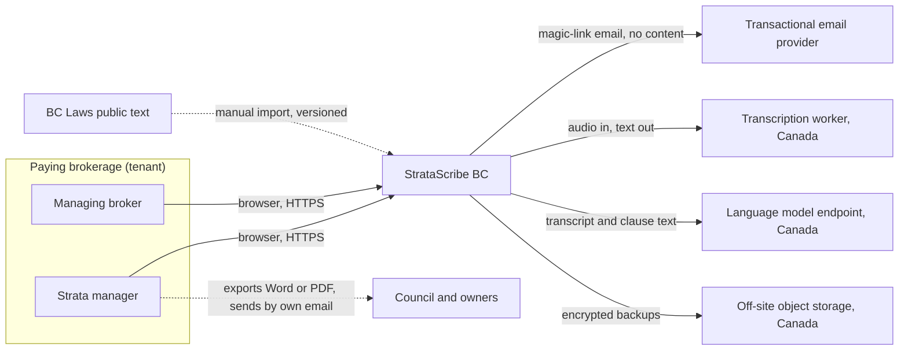
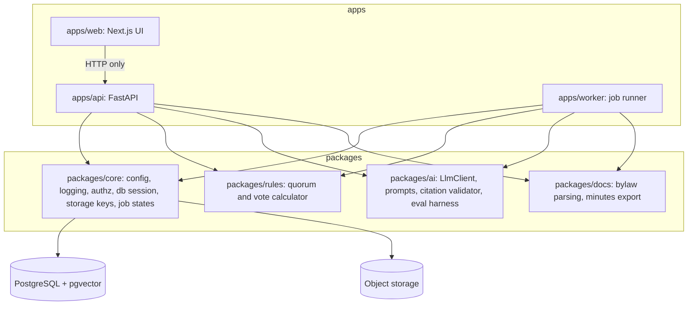
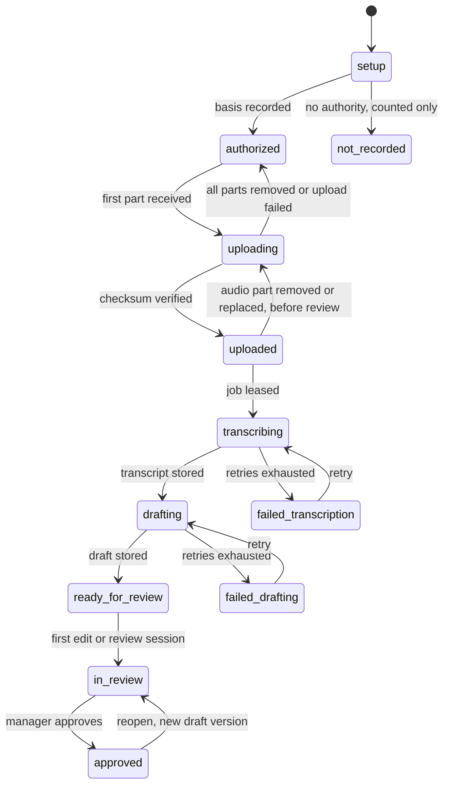
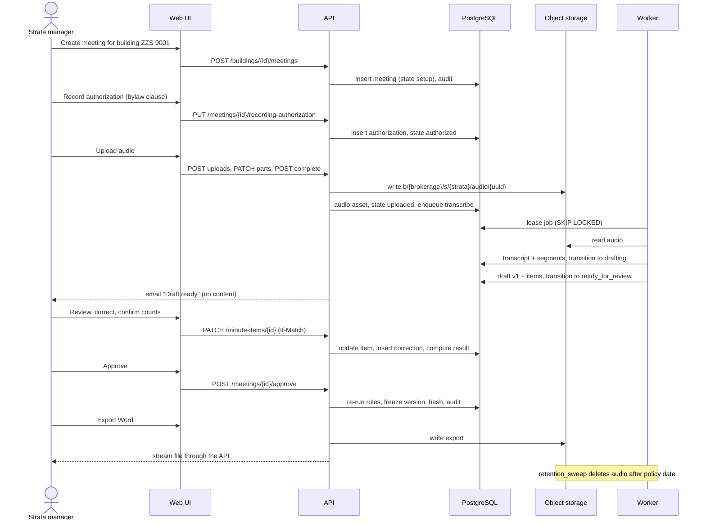
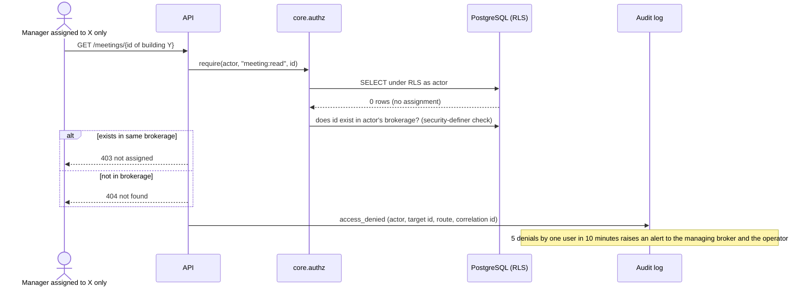
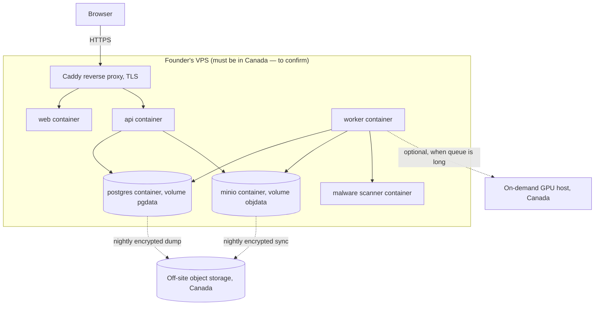

# TRD — StrataScribe BC

**Question this file answers:** how would the system meet the requirements in [PRD.md](PRD.md)?

Structure follows the twelve arc42 sections `[S: arc42]`. Number labels and source IDs are defined in [Decision.md](Decision.md#how-numbers-are-labelled-used-in-all-ten-files). Risks are cited by ID from the register in [verification-report-fixing.md](verification-report-fixing.md#production-risk-register). Nothing described here exists yet. Every command, path and target is **proposed**. Every numeric parameter in this file (timeouts, retry counts, thresholds, periods, sizes, targets) is an author's proposal `[A]` unless it carries another label.

## 1. Introduction and goals

The system exists to answer the pilot question: time saved across two authorized meetings after the manager corrects motions, votes and bylaw citations. Three quality goals outrank everything else:

1. **Isolation.** A brokerage never sees another brokerage; a manager never sees a building they are not assigned to (MH-01, MH-02).
2. **Reviewability.** Every drafted statement is traceable to audio; every result is computed by fixed rules; nothing is approved by a model (MH-05 to MH-08, MH-10).
3. **Accountable handling of recordings.** Authorized before upload, processed in Canada, deleted on schedule (MH-03, MH-12).

## 2. Constraints

| Constraint | Source |
|---|---|
| Recording needs a recorded authority before upload | `[S: OIPC-2022]`; MH-03 |
| Reasonable security; destroy when no longer needed | `[S: PIPA]` ss. 34, 35 |
| Audio, transcripts, minutes and bylaws stored and processed in Canada | Product commitment from the chat `[C]`; no residency rule was found in the texts read |
| Founder has a VPS, a domain and hosting | `[C]`; **location and size of the VPS are not decided in chat** and must be confirmed in T-1.1.3 |
| Team of 1–3 developers | `[C]` |
| Low variable cost: about CAD 0.20 per audio hour, CAD 12 AI per account per month | `[A-chat]` |
| Draft "the next morning" | `[C]`; allows batch processing instead of real time |

## 3. Context and scope

Outside the system: sending minutes to owners; the brokerage's document store and accounting system; the meeting itself; the recording device.

**External systems and contracts**

| System | Direction | Data crossing | Failure effect |
|---|---|---|---|
| Email provider | Out | Recipient address, sign-in link, "draft ready" notice with no meeting content | No new sign-ins until it recovers (existing sessions continue); notices delayed; status visible in app |
| Malware signature updates | In, to the scanner container only | Signature files | Scanner keeps the last signatures; alert after 48 hours without an update |
| Transcription worker | Internal network | Audio | Draft delayed; job retried |
| Language model endpoint | Out and back, or internal | Transcript text, clause text | Draft or answer delayed; no fallback to an unapproved provider |
| Off-site backup storage | Out | Encrypted database dumps and object copies | Backup alert |
| BC Laws | Manual download | Public statute text | Reference set stays at last version, shown with its "current to" date |

## 4. Solution strategy

| Area | Choice (proposed) | Why | Main tradeoff |
|---|---|---|---|
| Frontend | Next.js (React, TypeScript), server-rendered pages calling the API | Brief's suggestion `[C]`; URL-per-screen gives deep links and Back/refresh behaviour for free (R-18); large pool of developers | A second runtime (Node) beside Python |
| Backend API | Python 3.12, FastAPI, SQLAlchemy 2, Alembic | Same language as the transcription and extraction code, so one shared package holds configuration, access rules and logging for web and workers (R-03, R-06) | Python web stack is slower than some; irrelevant at pilot scale |
| Database | PostgreSQL 16 with row-level security and the `pgvector` extension | One store for relational data, clause embeddings and the job queue; row-level security makes tenant and building rules enforceable in one place (R-05) | Vector search is less tunable than a dedicated engine; a building has hundreds of clauses, not millions |
| Queue and workers | Postgres-backed job table processed by Python workers (`SELECT … FOR UPDATE SKIP LOCKED`) | No extra broker to run or lose; jobs are transactional with the state they change | Lower throughput than Redis or a message broker; not needed at tens of meetings per day |
| File storage | S3-compatible object store. Pilot: MinIO on the VPS on a dedicated persistent volume, with nightly encrypted copy off-site | Keeps audio on infrastructure the founder controls, in Canada if the VPS is; S3 API means a later move is a configuration change | The VPS disk is a single point of failure until off-site copies run (R-15) |
| Transcription | Open-weight Whisper large-v3 run with `faster-whisper`, in a worker container | Brief's suggestion `[C]`; audio is processed only on hosts the founder controls in Canada: the VPS by default and, only if AD-4 is triggered, a rented GPU host under the conditions in [File handling](#file-handling); cost assumption CAD 0.20 per audio hour `[A-chat]` | CPU-only speed on the VPS is unmeasured; see decision AD-4 |
| Language model | One model endpoint behind an internal `LlmClient` interface, with JSON-schema-constrained output | Extraction and question answering are the only jobs that need a language model | Provider and region are **not decided**; see AD-5 |
| Identity | Pilot: emailed single-use sign-in link **plus** a time-based code from an authenticator app; no passwords stored. OIDC with Microsoft Entra ID or Google (the brief's suggestion `[C]`) is **not built for the pilot** (decision AD-10) | Two factors for the most sensitive data without waiting for each brokerage's IT approval, which the chat lists as a dependency `[C]` | Managers must enrol an authenticator app; email remains one of the two factors |
| Export | Word via `python-docx`, PDF rendered from the same escaped HTML with WeasyPrint, with all resource fetching disabled ([File handling](#file-handling)) | Managers already work in Word templates `[C]` | The brokerage's own template is not applied in the MVP |
| Hosting | Docker Compose on the founder's VPS behind Caddy (automatic TLS) | Uses what the founder has `[C]`; one host is enough for a pilot | No high availability |
| CI and DevOps | GitHub Actions: lint, tests, migration checks, image build; deploy by pulling tagged images | Standard and cheap | — |
| Testing | pytest (unit, integration against a real Postgres), Playwright (end-to-end, accessibility with axe) | Permission tests must hit real row-level security, not mocks | Slower test runs |

**Where AI is justified:** speech-to-text; structuring a transcript into candidate minute items; ranking and quoting bylaw clauses. **Where it is not used:** access decisions, quorum, vote results, retention dates, billing, routing of jobs.

**Operating cost.** The chat assumes CAD 800 per month fixed and CAD 42.52 per account variable `[A-chat]`; the composition of the 800 is not decided in chat. A proposed split `[A]`: infrastructure and GPU reserve 300, insurance and ongoing legal 250, bookkeeping and miscellaneous 150, association memberships 100 = 800 `[D]`. Sales tools, event fees and travel are acquisition cost, not fixed cost, so they are not in this split; the mapping of every validation-month cost line to one bucket is in [Decision.md](Decision.md#76-cash-required-during-the-acquisition-ramp). The VPS itself is treated as already paid for `[C]`. Actual prices were not checked.

**Decisions that can wait:** GPU hosting (until transcription timing is measured); single sign-on (AD-10); the brokerage's own Word template; moving object storage off the VPS; any second region.

## 5. Building block view

Boundary rules (enforced by an import-lint check in CI, T-2.1.1):

- `apps/*` never import from another app. `apps/web` talks to `apps/api` over HTTP only (R-04).
- Configuration, logging, access checks, storage-key building and job-state transitions exist **only** in `packages/core`. Workers do not carry copies (R-03, R-06).
- `packages/core` imports no web framework, so the worker can start without FastAPI installed (R-07).
- Every database session is opened through `core.db.session_for(actor)`, which sets the tenant and user for row-level security. There is no other way to get a session (R-05).

### Identity and tenancy

- A user belongs to exactly one brokerage in the MVP and has one role.
- **Sign-in.** An emailed link: 32 random bytes, valid 10 minutes, single use, and redeemable only in the browser that requested it (a nonce cookie set at request time must match). After the link, the user enters a 6-digit time-based code from an authenticator app enrolled at first sign-in. The response to a sign-in request is the same whether or not the email exists.
- **Session.** Server-side session behind a cookie that is HttpOnly, Secure, SameSite=Lax. Idle expiry 60 minutes with a warning 2 minutes before; absolute lifetime 12 hours. Deactivation or a role change ends all of the user's sessions at once.
- **Request forgery.** Every state-changing route requires a JSON body and a custom request header that browsers do not send cross-site, and the server checks the `Origin` header against `PUBLIC_BASE_URL`. There are no state-changing `GET` routes.
- **Rate limits** (per user unless stated; exceeding returns 429 with a retry time): sign-in requests 5 per email per hour and 20 per IP address per hour; authenticator code attempts 5 per link; bylaw questions 30 per hour; upload initiations 20 per day; exports 30 per hour; any other mutating route 120 per minute.
- Each request resolves `actor = (user_id, brokerage_id, role)` from the session. The database session sets `app.brokerage_id`, `app.user_id` and `app.role`. Row-level security policies ([schema.md](schema.md#permissions-and-tenant-boundaries)) allow a row only if its `brokerage_id` matches, and, for building-scoped tables, only if the role is `managing_broker` or an active assignment exists for that user and building.
- **A managing broker has every strata-manager right in every building of their own brokerage** without an assignment (PRD roles). "Assigned" in the API table below therefore means "assigned strata manager, or managing broker of that brokerage".
- Workers receive `brokerage_id` and `strata_id` in the job row, never from the payload of an external message, and open their session with a service actor scoped to that one building.
- Object keys are built only by `core.storage.key(...)`: `b/{brokerage_id}/s/{strata_id}/{purpose}/{uuid}` where purpose is `audio`, `bylaw`, `export` or `tmp` (R-13).
- **Downloads and playback: one mechanism (decision AD-11).** The object store is never reachable from the internet and no signed or time-limited link to it is ever issued. Audio, exports, bylaw originals and data-export bundles are streamed **by the API** on routes that require the session cookie and pass `core.authz` on every request, including every range request of the audio player. A copied URL is useless without a session that is allowed to read that building. Responses carry `Cache-Control: no-store`. URLs shown or emailed to users are API or page URLs built from `PUBLIC_BASE_URL` (R-16).
- **Storage credentials.** Two credentials exist: one for the API, one for workers; a third, write-only, for backups. They are not per building. Inside a worker, `core.storage` refuses any key outside the job's `b/{brokerage_id}/s/{strata_id}/` prefix. This is an application-level guard, not a storage policy: **accepted risk for the pilot**, to be replaced by per-prefix credentials if a second worker type or third-party code is ever added.
- No application cache holds tenant data in the MVP. Introducing one would re-open R-05.
- Cross-brokerage requests return 404. Same-brokerage, unassigned-building requests by a strata manager return 403 with "not assigned" (the building list of one's own brokerage is not secret from its staff, and the message tells the manager whom to ask).

**Operators (the founder or a support engineer).** Operators are rows in `operators`, not `users`. They sign in on a separate path (`/operator`) with the same link-plus-authenticator method; the authenticator is mandatory and there is no fallback. An operator session has no brokerage and can call only `/api/v1/operator/*`: job status, counts, error codes. To see content, a managing broker must create a support grant for one meeting, naming a reason, valid 24 hours. The operator then opens that meeting through `/api/v1/operator/support-grants/{id}/…`; for those requests the database session is opened as the ordinary `app_user` role with `app.role = 'operator'`, `app.operator_id`, `app.brokerage_id` set to the grant's brokerage and `app.support_grant_id` set to the grant. The building policy admits such a session only to rows of the granted meeting while the grant is unexpired and unrevoked. No role that bypasses row-level security exists for this path. Each content request under a grant writes a `support.accessed` audit event visible to the managing broker.

### File handling

| Upload | Accepted | Limits | Checks before anything is parsed |
|---|---|---|---|
| Meeting audio (S-09) | AAC in M4A or MP4, MP3, WAV, FLAC, Ogg or WebM with Opus | 3 hours and 2.5 GB per meeting in total (a 3-hour 44.1 kHz stereo WAV is about 1.9 GB `[D]`); up to 10 parts | Extension and magic bytes agree with an accepted type; size; duration probe in the worker; malware scan |
| Bylaws and rules (S-07) | PDF with a text layer; DOCX. Not DOC, DOCM, or other macro-enabled formats | 25 MB per file; 10 files per upload. DOCX: at most 2,000 archive entries, 200 MB uncompressed, and a 100:1 expansion ratio | Magic bytes; archive limits checked while streaming, before extraction; malware scan |

- **Scan.** A ClamAV container scans every upload while it is still under `tmp/`; only clean files are moved to their final key. The scanner is the only container allowed to fetch signature updates. A scan cannot prove a file is safe, so the remaining rules still apply.
- **Parsing.** Audio decoding and document parsing run in the worker container with no outbound network access and no shell-out to user-supplied names. Uploaded content is never executed.
- **Serving originals back.** A bylaw original is offered only as a download with `Content-Disposition: attachment`, a content type set by the server from its own detection, and `X-Content-Type-Options: nosniff`. The "source page" shown beside clauses in S-07 is a page image rendered by the worker, not the uploaded file.
- **PDF and Word export.** Minutes text, whether from the model or typed by a user, is treated as plain text: HTML-escaped by the template engine before rendering. The PDF renderer is given a fetch hook that refuses every URL (fonts and styles are bundled), so no text in the minutes can make the server request anything (test U-17).
- **If AD-4 adds a GPU host.** "No outbound network" applies to the parsing and transcription containers on any host. A GPU host would be a machine in Canada rented and provisioned by the founder, joined to the VPS over a private encrypted tunnel; its worker pulls jobs and audio through that tunnel only, keeps audio on an ephemeral disk, deletes it when the job's result is stored, and the host is destroyed when the queue is empty. Its provider becomes a named subprocessor in the data-handling terms. Until then the statement to customers is "processed on our server in Canada", not "never leaves one machine".

### API contracts (proposed, `/api/v1`)

All bodies JSON unless noted. All mutating calls accept an `Idempotency-Key` header; a repeated key returns the first result. Errors use `{"error": {"code", "message", "correlation_id"}}`. In the Roles column, **Manager** means an assigned strata manager or the managing broker of that brokerage; **Broker** means the managing broker only.

| Method and path | Purpose | Roles | Notes |
|---|---|---|---|
| `POST /auth/magic-link`, `GET /auth/callback`, `POST /auth/totp/enrol`, `POST /auth/totp/verify`, `POST /auth/sign-out`, `GET /me` | Sign-in link, redemption, authenticator enrolment and check, session, current actor | Any | Same response whether or not the email exists; rate limited |
| `POST /brokerage`, `GET /brokerage`, `PATCH /brokerage` | Onboarding and settings | Broker | — |
| `GET /members`, `POST /invitations`, `POST /invitations/{id}/resend`, `PATCH /members/{id}` | Team | Broker | Deactivation ends sessions |
| `GET /buildings`, `POST /buildings`, `GET /buildings/{id}`, `PATCH /buildings/{id}` | Buildings | List and read: Manager. Create and edit: Broker | List returns assigned buildings only for a strata manager |
| `PUT /buildings/{id}/assignments/{user_id}`, `DELETE …` | Assign and unassign | Broker | Audited |
| `GET /buildings/{id}/bylaw-documents`, `POST …`, `GET /bylaw-documents/{id}`, `GET /bylaw-documents/{id}/pages/{n}`, `GET /bylaw-documents/{id}/original` | Bylaw library, page images, original as attachment | Manager | Upload is multipart; original is streamed by the API |
| `PATCH /bylaw-clauses/{id}`, `POST /bylaw-clauses/{id}/split`, `POST /bylaw-clauses/merge`, `POST /bylaw-documents/{id}/confirm`, `POST /bylaw-documents/{id}/supersede` | Edit, split, merge clauses; confirm; mark superseded | Manager | Confirm makes the document citable |
| `GET /buildings/{id}/meetings`, `POST …`, `GET /meetings/{id}` | Meetings | Manager | `GET /meetings/{id}` writes `meeting.opened` |
| `POST /meetings/{id}/move` | Move a meeting filed under the wrong building | Broker | Reason required; objects are re-keyed; audited |
| `PUT /meetings/{id}/recording-authorization` | Record the basis | Manager | Rejected after first upload; supersede instead |
| `POST /meetings/{id}/uploads`, `PATCH /uploads/{id}`, `POST /uploads/{id}/complete` | Resumable upload in parts | Manager | 409 if no valid authorization; `complete` verifies SHA-256, type and scan result |
| `DELETE /audio-assets/{id}` | Remove one audio part; "replace audio" is remove then upload | Manager | Only before review starts; returns the meeting to `authorized` or `uploading` |
| `GET /audio-assets/{id}/stream` | Audio for the evidence player, with range requests | Manager | Streamed by the API; access checked on every request; first request per session writes `audio.streamed` |
| `GET /meetings/{id}/transcript` | Transcript segments, paged | Manager | Writes `transcript.read` once per session |
| `POST /meetings/{id}/process`, `GET /meetings/{id}/status` | Start or retry processing; poll status | Manager | Status returns state, state version, step, error code |
| `GET /meetings/{id}/draft`, `POST /meetings/{id}/minute-items`, `PATCH /minute-items/{id}`, `DELETE /minute-items/{id}` | Review and correction, including outcome method, declared outcome, counts, casting vote and discrepancy resolution | Manager | `PATCH` requires `If-Match: <row_version>`; 409 on mismatch |
| `POST /minute-items/{id}/citations`, `DELETE /minute-item-citations/{id}` | Attach, replace or remove a bylaw citation on an item | Manager | Clause must belong to the same building's current confirmed document or the statute set; each change writes a `citation` correction |
| `POST /meetings/{id}/activity/heartbeat` | Activity time with `activity` = setup, review or lookup | Manager | Every 30 s while the tab is visible and there was input or audio playing in the last 60 s |
| `PUT /meetings/{id}/time-report` | Post-export editing minutes, dictation preparation, stopwatch total, date marked sent | Manager | Feeds M-1 and M-2 |
| `POST /meetings/{id}/approve`, `POST /meetings/{id}/reopen` | Approval and reopening | Manager | Approve re-runs all rules server-side and checks the recording authority is evidenced |
| `POST /meetings/{id}/exports`, `GET /exports/{id}/download` | Word and PDF | Manager | Draft exports are watermarked; download is streamed by the API and writes `export.downloaded` |
| `POST /buildings/{id}/questions`, `GET /buildings/{id}/questions`, `POST /questions/{id}/flag` | Bylaw questions, history, "report a wrong answer" | Manager | Returns `answered` or `refused`; rate limited |
| `GET /pilot/baselines`, `POST /pilot/baselines`, `GET /pilot/report` | Baseline entry and pilot report | Baselines: own. Report: Broker | — |
| `GET /audit-events` | Audit log | Broker | CSV with `Accept: text/csv` |
| `GET /settings/retention`, `PATCH …` | Retention settings | Broker | — |
| `POST /data-exports`, `GET /data-exports/{id}/download` | Building export bundle | Broker | Streamed by the API; available 24 hours |
| `POST /deletion-requests`, `DELETE /deletion-requests/{id}` | Schedule and cancel deletion of a building or the account | Broker | Typed confirmation; cancel allowed inside the 48-hour window |
| `POST /support-grants`, `DELETE /support-grants/{id}` | Grant and revoke operator access to one meeting | Broker | 24 hours; reason required |
| `POST /operator/auth/…`, `GET /operator/jobs`, `GET /operator/support-grants`, `GET /operator/support-grants/{id}/meeting`, `…/transcript`, `…/draft`, `…/audio/{asset_id}/stream` | Operator sign-in, job status, and content of one meeting under a grant | Operator | Content routes require an unexpired, unrevoked grant; each request writes `support.accessed` |
| `GET /healthz`, `GET /readyz` | Liveness; readiness (database, storage, queue age, configuration fingerprint of API and workers) | Public, no data | — |

### Configuration and secrets

- All configuration is read once by `core.config` from environment variables, validated at start; a missing or malformed value stops the process with a clear message.
- Key settings: `PUBLIC_BASE_URL`, `DATABASE_URL`, `OBJECT_STORE_*`, `LLM_ENDPOINT`, `LLM_MODEL_ID`, `ASR_MODEL_ID`, `SESSION_SECRET`, `TOTP_ENCRYPTION_KEY`, `EMAIL_*`, `RETENTION_DEFAULTS`.
- Secrets live in an environment file on the server readable only by the deploy user, and in GitHub Actions encrypted secrets for CI. None are committed. Rotation: session secret and storage keys every 90 days `[A]` and on any staff change.

### Jobs, retries, timeouts, idempotency

| Job | Trigger | Timeout | Retries | Idempotency |
|---|---|---|---|---|
| `transcribe` | Upload complete and processing requested | 4 × audio duration, minimum 30 minutes `[A]` | 3, backoff 1, 5, 15 minutes | Key = audio asset SHA-256 + model ID; a finished transcript for that key is reused |
| `draft_minutes` | Transcript stored | 15 minutes `[A]` | 3 | Key = transcript ID + prompt version + model ID |
| `index_bylaws` | Document uploaded | 10 minutes | 3 | Key = document SHA-256 + parser version |
| `export` | Export requested | 2 minutes | 2 | Key = draft version + format |
| `retention_sweep` | Daily 03:00 Pacific | 30 minutes | Next day | Deletes are safe to repeat |
| `reconcile` | Every 5 minutes | 1 minute | — | Re-queues or fails jobs whose lease expired; a run is recorded as a `jobs` row of kind `reconcile` |

Each worker writes a row to `worker_heartbeats` every 30 seconds with its configuration fingerprint (a hash of the validated, non-secret configuration). `/readyz` reports not-ready if a live worker's fingerprint differs from the API's (R-06, test I-21).

State changes go through one function, `core.jobs.transition(meeting_id, expected_version, new_state)`, which updates only if the stored `state_version` equals `expected_version`. A late or duplicate completion therefore cannot overwrite a newer state (R-01). A worker that finishes after its caller gave up still records its result under the idempotency key; the next status poll or the reconciler picks it up (R-02). Every job row carries `correlation_id`, copied from the request that created it and into every log line (R-12).

**Meeting state machine**

### Deterministic rules

`packages/rules` is pure code with no model and no network. Every result is returned with the rule name, the source reference and the inequality evaluated. Integer arithmetic only.

**How a motion gets its outcome.** The manager chooses one method per motion (`outcome_method`):

| Method | When | What is stored | What is computed |
|---|---|---|---|
| `declared` | A vote decided on a show of voting cards with no precise count requested, the default at general meetings `[S: SPA-SB]` s. 27(2) and (4); also a council decision minuted without numbers | `declared_outcome` (carried or defeated) as declared by the chair, attested by the manager (`outcome_attested_by`, `outcome_attested_at`). **No counts are asked for or stored.** | Nothing. `computed_result` stays empty. The final outcome is the declared outcome. |
| `counted` | A precise count was requested, a secret ballot was held `[S: SPA-SB]` s. 27(3), (4), (7), or a council vote was recorded with numbers | Threshold, votes for, against, abstained; for 80% and unanimous votes the eligible votes; for council votes the members present; optionally the outcome the chair declared | `computed_result` from the table below. The final outcome is the computed result unless a discrepancy resolution says otherwise. |

The model's reading of the audio ("carried", "12 in favour") only pre-selects a method and pre-fills a **suggestion**. Nothing is stored as an outcome or a count until the manager confirms it. A computed result can never be typed in; a declared outcome is selected by the manager, never by the model.

**Discrepancy.** If a `counted` motion also has a declared outcome and the two differ (the chair said "carried" but 8 for and 3 against does not reach a 3/4 vote), the item is blocked until the manager stores one resolution (`discrepancy_resolution`): `counts_corrected`, `threshold_corrected`, or `recorded_as_declared`. The last requires a note and makes the minutes state both the chair's declaration and the count as recorded; the product does not rule on which is legally effective.

**Counted-vote rules**

| Rule | Inputs | Passes when | Source |
|---|---|---|---|
| Majority vote | for, against (abstentions excluded) | for × 2 > for + against | `[S: SPA]` s. 1 |
| Tie on a majority vote at a general meeting | for = against | Result `tie`; the item is blocked until the manager records whether the president (or vice president) cast a second, deciding vote and which way. Not offered where the strata plan has only 2 strata lots; there a tie is defeated. No casting vote recorded as used: defeated. | `[S: SPA-SB]` s. 27(5)–(6) |
| 3/4 vote | for, against (abstentions excluded) | for × 4 ≥ 3 × (for + against) | `[S: SPA]` s. 1 |
| 80% vote | for, all eligible votes | for × 5 ≥ 4 × eligible | `[S: SPA]` s. 1 |
| Unanimous vote | for, all eligible votes | for = eligible | `[S: SPA]` s. 1 |
| Council decision | for, against, members present | for × 2 > members present. If for = against: `tie`, with the president's casting vote as above (not with only 2 strata lots) | `[S: SPA-SB]` s. 18(1)–(2) |

`counted` with zero votes for and zero against returns `no_result` and blocks the item with two choices: enter the count, or switch to `declared`.

**Quorum rules**

| Rule | Inputs | Met when | Source |
|---|---|---|---|
| General meeting, default | votes present in person or by proxy, eligible votes | present × 3 ≥ eligible | `[S: SPA]` s. 48(2)(a), subject to the bylaws |
| General meeting, small strata | as above, plus strata lot count and owner count | If lots < 4 or owners < 4: present × 3 ≥ 2 × eligible | `[S: SPA]` s. 48(2)(b) |
| General meeting, adjourned for lack of quorum | flag "reconvened after adjournment for no quorum" on the meeting | Those present in person or by proxy are a quorum | `[S: SPA]` s. 48(3), unless the bylaws provide otherwise |
| Council meeting | members present in person, council size | present ≥ 1 for a council of 1; ≥ 2 for 2, 3 or 4; ≥ 3 for 5 or 6; ≥ 4 for 7 | `[S: SPA-SB]` s. 16(1)–(2), unless amended |
| Building override | any of the above | As the building's own bylaw says, entered by the manager with a clause citation | The building's filed bylaws |

The quorum statement in the minutes is computed from the numbers the manager confirms on the attendance card. If the manager knows quorum was established but has no numbers (rare), they can attest "quorum declared by the chair" in the same way as a declared outcome.

The threshold for each counted motion is chosen by the manager from a list; the model may suggest one but the suggestion is shown as a suggestion. A rule set has a version; the version used is stored with each computed result. These rules were written from the author's reading of the sources on 2026-11-10 through a summarising tool and must be checked against the statute text by a second person in T-4.1.2 before any real minutes rely on them.

### AI functions

| Function | Model's responsibility | Not the model's responsibility | Human boundary | Fallback |
|---|---|---|---|---|
| Transcription (Whisper large-v3) | Audio to timestamped text segments | Speaker identity (labels are "Speaker 1…" until the manager names them) | Manager hears audio beside any item | Retry; then "transcription failed" with the option to re-upload or switch to dictated notes |
| Minutes extraction (language model, JSON schema) | Propose items: type, text, mover, seconder, spoken counts, spoken outcome, each with transcript segment IDs | Vote result, quorum, threshold, approval | Every motion must be marked reviewed by the manager | If output fails schema validation twice, show transcript with an empty template; the manager can still write minutes and time is still measured |
| Citation on a minute item (same retrieval and validator as answers) | Suggest the clause a motion or discussion referred to | Attaching it: a suggestion is stored only as a suggestion until the manager confirms, replaces or removes it | Manager confirms each citation; changes are `citation` corrections | No suggestion; the manager can attach one from the lookup panel |
| Bylaw answer (retrieval, then language model) | Select clauses and compose a short answer that quotes them | Deciding to show the answer | A validator shows the answer only if each quote is an exact substring of the stored clause and the clause belongs to this building's current confirmed document or the statute set; otherwise "No supporting clause found" (MH-10) | Search results only |

**Evaluation fixtures (synthetic, built in T-1.1.1).** Six scripted meetings recorded by volunteers: two council meetings, two AGMs, one SGM with a 3/4 vote that fails by one vote, one meeting with heavy cross-talk and a withdrawn motion. Each has a hand-made answer key (motions, movers, seconders, counts). One synthetic bylaw set of about 45 clauses and 30 questions: 20 answerable with a known clause, 10 with no supporting clause. Scores tracked per model version: motion recall and precision, exact-match rate on mover and seconder, count accuracy, citation validity (must be 100%), refusal rate on the 10 unanswerable questions (target 100% `[A]`).

**Provider or model change.** `ASR_MODEL_ID`, `LLM_MODEL_ID` and prompt version are stored with every transcript, draft and answer. Changing any of them requires a full run of the fixtures; a release is blocked if citation validity or refusal drops below 100%, or motion recall drops by more than 5 points from the recorded baseline `[A]`. Old drafts are never regenerated silently.

## 6. Runtime view

### Normal sequence: authorized meeting to approved minutes

### Highest-consequence failure: a manager reaches another building's recording

The worst credible failure is not downtime; it is a manager at brokerage A, assigned to building X, opening building Y's recording or minutes (same brokerage), or anything of brokerage B.

Recovery if isolation is ever found broken: disable sign-in for the affected brokerages, preserve logs, identify affected records from the read events in the audit log (`meeting.opened`, `audio.streamed`, `transcript.read`, `export.downloaded`, which are written for successful reads as well as denials, so reads that a broken rule wrongly allowed are still listed), notify the affected brokerages' managing brokers without delay so they can meet their own obligations, fix, run the full permission suite, and record the incident. Whether and when the Commissioner must be notified is a legal question for the brokerage and its strata clients; no notification rule was read on 2026-11-10 and none is asserted here.

### Other recovery paths

| Failure | Behaviour |
|---|---|
| Upload interrupted | Client resumes from the last acknowledged part; parts not completed within 24 hours are deleted by the sweep (R-14) |
| Worker crashes mid-transcription | Lease expires; reconciler re-queues; idempotency key prevents a duplicate transcript |
| Language model endpoint down | `draft_minutes` retries, then `failed_drafting`; the transcript is still available for manual minutes |
| Two tabs edit the same motion | Second save gets 409 with the current value; nothing is overwritten |
| Approval while a rule blocker exists | Server refuses with the list of blockers, even if the client button was enabled |
| VPS lost | Restore from off-site backup (section 7) |

## 7. Deployment view

| Aspect | Local | Staging | Production |
|---|---|---|---|
| Start | One proposed command, `make dev`, starts all containers with health checks (R-17) | Same Compose file, separate project name and volumes on the VPS | Compose with pinned image tags |
| Data | Synthetic fixtures only | Synthetic fixtures only; never a copy of production | Real, encrypted disk |
| Sign-in | Link captured locally; fixed test authenticator secret | Link plus authenticator, team addresses only | Link plus authenticator |
| Models | Small Whisper model; recorded language-model responses | Production models | Production models |
| Public URL | `http://localhost:3000` | `https://staging.<domain>` | `https://app.<domain>` |
| Email | Captured locally | Real provider, team recipients only | Real provider |

- **Persistent volumes:** `pgdata` and `objdata` are named volumes on the VPS data disk, declared in the Compose file; a start-up check refuses to run production if either is missing or empty when the database reports existing meetings (R-15).
- **Deployment (proposed):** CI builds images tagged with the commit; the operator runs `make deploy TAG=<sha>`, which takes a database dump, runs migrations, starts the new containers, and waits for `/readyz`.
- **Rollback:** `make rollback TAG=<previous sha>` restarts the previous images. Migrations are written expand-then-contract so the previous version runs against the new schema; a destructive migration ships only one release after the code stopped using the column.
- **Backup:** nightly `pg_dump` and object sync, encrypted before leaving the host, kept 35 days `[A]`. Proposed recovery point: 24 hours. Proposed recovery time: 4 hours.
- **Restore:** documented runbook; rehearsed before the pilot and quarterly (T-6.1.2). After any restore, the retention sweep runs before users are let in, so data deleted after the backup was taken is deleted again ([schema.md](schema.md#retention-and-deletion)).
- **Alert ownership:** the founder is on call during the pilot. Alerts: `/readyz` failing for 5 minutes; any job with no progress for 2 hours; backup not completed by 06:00; any audio object past its deletion date; 5 access denials by one user in 10 minutes; disk above 80%.
- **Incident response:** acknowledge within 1 business hour `[A]`; contain; tell affected managing brokers what is known; write a short incident record with timeline and correlation IDs; add a test that would have caught it.

## 8. Crosscutting concepts

- **Audit events.** Written by `core.audit.record(...)` in the same transaction as the action: sign-in, access denied, assignment change, authorization recorded, upload, processing start and end, item corrected, approval, reopen, export created, question asked and outcome, retention change, deletion, export of data, support grant created or revoked. **Successful reads are events too:** `meeting.opened`, `audio.streamed` and `transcript.read` (once per session per meeting, not per range request), `export.downloaded`, `bylaw.original_downloaded`, and `support.accessed` for every operator request under a grant. No transcript or minutes text in the event. See [schema.md](schema.md#audit_events).
- **Logging.** Structured JSON from `core.logging`, used by API and worker alike; fields: time, level, service, correlation ID, brokerage ID, strata ID, job ID, event. A redaction filter drops any field named `text`, `quote`, `question`, `answer`, `name`, `email` unless explicitly allow-listed. Transcript and bylaw text are never logged (R-12).
- **Idempotency.** Described in section 5. Duplicate form submissions are also blocked client-side by disabling the button while a request is pending.
- **Time.** Stored in UTC; displayed in America/Vancouver. "3 business days" uses BC statutory holidays from a maintained table.
- **Accessibility.** Server-rendered HTML first; see [design.md](design.md#accessibility).

### Security requirements targeted

The independent reviewer read OWASP ASVS **5.0.0** on 2026-11-10 and cited the requirement IDs below; the author has not opened ASVS, so the IDs are carried on the reviewer's reading. Proposed target `[A]`: Level 2 for authentication, session, access control and file handling. Nothing here is a claim of compliance.

| ASVS 5.0.0 (as cited in review) | Control in this plan | Planned test | Status |
|---|---|---|---|
| V6.1.1, V6.3.1, V2.4.1, V6.6.3 rate limiting and anti-automation | Rate-limit table in [Identity and tenancy](#identity-and-tenancy) | I-17 | Not run |
| V6.5.5, V6.6.2 out-of-band code lifetime, entropy, binding | 10 minutes, 32 random bytes, single use, bound to the requesting browser | I-18 | Not run |
| V6.3.3 multi-factor at Level 2 | Link plus authenticator code for users; mandatory for operators | I-18, P-4 | Not run |
| V6.3.6 (Level 3): email is not used as either a single-factor or multi-factor authentication mechanism (wording as quoted by the reviewer) | **Not met.** The emailed sign-in link is one of the pilot's two factors, for users and operators alike | — | **Accepted risk** for the pilot: a compromised mailbox leaves only the authenticator code between an attacker and recordings. Removing email as a factor means OIDC or passkeys (see AD-10) |
| V7.3.1, V7.3.2 idle and absolute session lifetime | 60 minutes idle, 12 hours absolute | I-20 | Not run |
| V7.4.1, V7.4.2 session termination | Sign-out; deactivation ends sessions | P-3, acceptance check of T-2.2.2 | Not run |
| V3.5.1 cross-site request forgery | SameSite=Lax, custom header, Origin check | I-19 | Not run |
| V8.1.1, V8.2.1, V8.2.2, V8.3.1, V8.4.1 access control | `core.authz`, forced row-level security, API-streamed files | P-1 to P-6, I-11 | Not run |
| V8.4.2 administrative access | Operator path with support grant | P-4 | Not run |
| V5.1.1, V5.2.1, V5.2.2, V5.2.3 upload types, size, archive limits | [File handling](#file-handling) | I-24, I-2, I-3 | Not run |
| V5.3.2 stored file names and paths | Generated keys only | U-8 | Not run |
| V5.4.1, V5.4.2, V4.1.1 serving files | Attachment disposition, server-set type, `nosniff`, page images | I-24 (extended in T-3.1.2) | Not run |
| V5.4.3 malware scan | ClamAV on every upload | I-24 | Not run |
| V1.3.6 server-side request from rendered content | Renderer fetch hook refuses all URLs | U-17 | Not run |
| V14.1.1, V14.2.1, V16.2.5, V16.4.2 sensitive data and logs | Sensitivity column per table, retention table, redaction, append-only audit | U-9, I-9, acceptance check of T-2.2.4 | Not run |
| V13.3.1 secrets management | Environment file readable by the deploy user only | — | **Accepted risk** for a single-host pilot; a secrets manager is deferred |
| V12.3.3, V14.2.4 protection in transit between components and at rest | TLS at the proxy; private Compose network; encrypted VPS disk (to be confirmed in T-6.1.1); encrypted backups | V-1, restore drill | Not run; disk encryption on the VPS is **unconfirmed** |

### Threat model (short)

| Asset | Sensitivity |
|---|---|
| Meeting audio and transcripts | Highest: voices, names, units, arrears, disputes |
| Draft and approved minutes | High before distribution; approved minutes are available to owners on request `[S: SPA]` s. 36 |
| Bylaws and rules | Low (available to owners and tenants) but tenant-private as a set |
| Building-assignment table | High: it is the access rule |
| Audit log | High: integrity |
| Session cookies, storage keys, model endpoint keys | High |

Trust boundaries: browser to API; API to database; API and worker to object storage; worker to language-model endpoint; host to off-site backup; operator to production.

| Abuse case | Proposed control | Check |
|---|---|---|
| Manager changes an ID in a URL to reach another building | Central `authz`, row-level security, 403/404, alert on repeated denials | Permission suite, T-5.2.1 |
| Former employee keeps access | Deactivation ends sessions immediately; assignments have `revoked_at` | Integration test |
| Guessable or shared file URL | No links to the object store exist (AD-11). Files are streamed by the API; the session and building access are checked on every request; `no-store` | P-1: a download or stream URL used by one user returns 403 when requested with another user's session, at any time |
| Malicious upload disguised as audio or a document; archive bomb in a DOCX | Accepted-type list, magic bytes, size and archive limits, malware scan, parsing in a worker container with no outbound network, originals served only as attachments ([File handling](#file-handling)) | I-24 |
| Minutes text that makes the PDF renderer fetch a URL | Text is escaped; renderer fetch hook refuses every URL | U-17 |
| Sign-in link guessed, replayed, forwarded or sprayed | 32 random bytes, 10 minutes, single use, bound to the requesting browser, second factor, rate limits | I-17, I-18 |
| Cross-site request with the user's cookie | SameSite=Lax, required custom header, Origin check, JSON only | I-19 |
| Text inside a bylaw PDF or spoken in a meeting instructs the model ("ignore the above…") | Model output is only ever data: schema-validated items and quotes that must match stored text; the model has no tools and cannot act | Fixture with an injected instruction; expected: no change in behaviour, answer refused or quoted normally |
| Operator browses customer recordings | No standing content access; separate sign-in with mandatory second factor; grant from the managing broker for one meeting and 24 hours; ordinary database role with grant-scoped session; every request audited | P-4 |
| Stolen database backup | Encrypted before leaving the host; key kept separately | Restore drill uses the key procedure |
| Recording uploaded without authority | Server-side gate; attestation stored | Integration test |

This is a plan. A planned control is not evidence of compliance.

## 9. Architecture decisions

| ID | Decision | Alternatives rejected | Revisit when |
|---|---|---|---|
| AD-1 | Row-level security in PostgreSQL plus one `authz` module | Checks scattered in handlers (R-05); one database per brokerage (too heavy for a pilot) | A brokerage requires physical separation |
| AD-2 | Postgres job table, no broker | Redis or RabbitMQ: more to run; jobs not transactional with state | Queue age target missed at real volume |
| AD-3 | Objects on the VPS (MinIO) with off-site encrypted copies | The brief's suggestion of AWS ca-central-1 with a GPU spot instance `[C]`: not chosen for the pilot because the founder already has a VPS `[C]` and a cloud account adds fixed cost before any revenue. It remains the first alternative. | Disk above 60%, or the VPS turns out not to be in Canada (T-1.1.3), or first paying brokerage beyond the pilot |
| AD-4 | Start transcription on the VPS CPU overnight; add an on-demand Canadian GPU only if needed | GPU from day one: fixed cost before any revenue | Measured in T-3.2.1: if a 2-hour recording takes more than 6 hours `[A]`, or the M-12 target is missed |
| AD-5 | **Open.** Language model is reached through `LlmClient`. Candidates: (a) a hosted model offered in a Canadian cloud region; (b) an open-weight model run on the same Canadian GPU host as Whisper. **Whether any hosted model is available with processing and storage confined to Canada was not verified on 2026-11-10: unverified, no source consulted.** The brief suggested "a low-cost hosted LLM" `[C]`; that is candidate (a) and is not adopted until T-1.1.3 confirms Canadian processing in the provider's own terms. Until then the plan assumes (b) for real customer data, and **the hand-run phase uses only models run locally on the founder's machine** (protocol in T-0.3.2). | Sending transcripts to any provider without a stated Canadian region | T-1.1.3 |
| AD-6 | Numbers and outcomes are computed in `packages/rules`, never taken from the model | Trusting the model's "CARRIED" | Never |
| AD-7 | 403 for unassigned buildings in the same brokerage, 404 across brokerages | 404 everywhere: hides a fixable assignment problem from the manager | A brokerage asks for building existence to be hidden between teams |
| AD-8 | The product exports; it does not send to owners | Built-in distribution: an irreversible external action and a new consent surface | Pilot evidence that export friction dominates M-2 |
| AD-9 | Two apps in one repository sharing Python packages; Next.js UI separate | Single Python app with server templates: weaker interactive review screen | Team has no TypeScript capacity |
| AD-10 | Pilot sign-in is an emailed link plus an authenticator-app code. OIDC is not built for the pilot. | OIDC with Microsoft Entra ID or Google `[C]`: needs each brokerage's IT approval, which the chat lists as a dependency; link alone: single factor for the most sensitive data | A pilot brokerage requires single sign-on, or managers refuse the authenticator step |
| AD-11 | All file bytes are streamed by the API under the user's session; no signed or expiring links | Signed links to the object store: a bearer link can be forwarded and is not tied to the building check at the time of use | Audio streaming through the API measurably hurts playback |
| AD-12 | A motion's outcome is either declared by the chair and attested by the manager, or computed from a confirmed count; counts are never required | Always requiring counts: forces invented numbers where the Standard Bylaws record none | Never |

## 10. Quality requirements

All targets are **proposed** `[A]` and unverified until the named task runs.

| Attribute | Workload | Target | Future verification |
|---|---|---|---|
| Isolation | Full permission matrix: 2 brokerages, 3 buildings, 4 users plus a managing broker and an operator, every route including stream and download routes | 0 unauthorized successes | Automated suite on every build, T-5.2.1 |
| Draft latency | One 2-hour recording uploaded by 22:00 | Draft ready by 07:00 next business day, 95% of uploads | Timed runs on the production host, T-3.2.1 |
| Queue age | 6 two-hour recordings queued in one evening (3 managers × 2 meetings) | All six drafts ready by 07:00, which needs about 1.5 hours of processing per recording or the GPU of AD-4; alert when any job shows no progress for 2 hours | Load run with fixture audio, T-5.2.2 |
| Concurrent uploads | 3 simultaneous 300 MB uploads over a 10 Mbit/s link | All complete; any interruption resumes without restart | Playwright with network throttling, T-5.2.2 |
| Interactive response | Review screen, 40 minute items, 3 users | p95 under 500 ms for item save; under 2 s for screen load | API timing in CI and staging, T-5.2.2 |
| Bylaw answer time | 45-clause building, one question | p95 under 15 s | Fixture run, T-4.2.1 |
| Citation validity | 30 fixture questions | 100% of shown answers pass the validator; 10 of 10 unanswerable questions refused | Eval harness, T-4.2.1 |
| Data loss | Loss of the VPS | At most 24 hours of data | Restore drill, T-6.1.2 |
| Restore time | Full restore to a new host | Under 4 hours | Restore drill, T-6.1.2 |
| Deletion | 10 audio assets past policy date | 0 remaining objects after the next sweep; deletion events present | Integration test, T-5.1.1 |
| Availability | Business hours, one host | 99% monthly; planned maintenance outside 07:00–22:00 Pacific | Uptime check |

## 11. Risks and technical debt

The 22 production risks are registered once, in [verification-report-fixing.md](verification-report-fixing.md#production-risk-register). Product-specific technical risks:

| Risk | Consequence | Mitigation |
|---|---|---|
| Common-room audio: echo, cross-talk, distant speakers `[C]` | Draft quality too low to save time | Measure on real recordings in Phase 0 before building; recording tips sheet; dictated-notes arm |
| Wrong speaker attribution `[C]` | Wrong mover or seconder | Speakers are unlabeled until named by the manager; mover and seconder always need confirmation |
| Outdated bylaws uploaded `[C]` | Confident answer from a superseded clause | Filing date required; "last confirmed" age shown on every answer; reminder after each AGM |
| CPU transcription too slow | Misses next-morning promise | AD-4 trigger |
| No Canadian hosted model | Higher cost or lower quality with a self-hosted model | AD-5 |
| Single host | Outage loses a morning | Backups, restore drill; accepted for the pilot |
| Statute text changes | Stale Act links and rules | Reference set stores its "current to" date; quarterly check task |

Accepted debt for the pilot: single host; manual invoicing; one brokerage per user; no template fidelity; no speaker recognition.

## 12. Glossary

| Term | Meaning |
|---|---|
| Brokerage | The licensed strata management company; the paying account and tenant |
| Managing broker | The licensee responsible for the brokerage and for supervising managers |
| Strata manager | Licensed individual who manages buildings for the brokerage |
| Building | One strata corporation, identified by its strata plan number |
| Council meeting | Meeting of the elected strata council |
| AGM, SGM | Annual and special general meetings of owners |
| Motion | A proposal put to a vote; has a mover and usually a seconder |
| Majority vote, 3/4 vote, 80% vote, unanimous vote | Thresholds defined in s. 1 of the Act |
| Standard Bylaws | The schedule of default bylaws that apply unless a strata files different ones |
| Recording authority | The recorded basis on which a meeting may be recorded |
| Draft, approved | A minutes version before and after a manager's approval |
| Correction | A stored change by a manager to a drafted item |
| Active review time | Time with the review screen focused and the user interacting |
