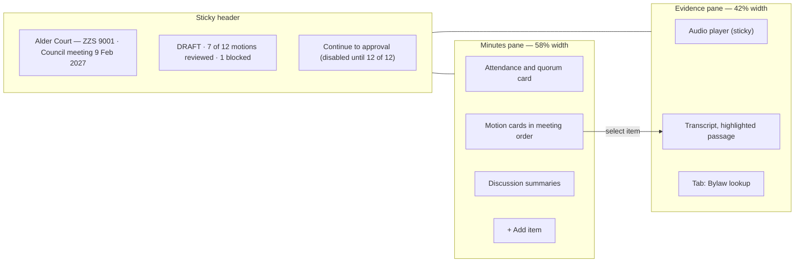

# Design brief — StrataScribe BC

**Question this file answers:** what should each screen look and feel like?

Screen IDs (S-01 to S-17) are defined in [App-flow.md](App-flow.md#screen-and-route-inventory); must-haves in [PRD.md](PRD.md#must-haves). All sizes, colours and timings here are proposals `[A]`. Example names and strata plan numbers are synthetic.

## Who we are designing for

A strata manager at 9:30 p.m. after a two-hour council meeting, or at 7:30 the next morning with coffee, checking a draft against what they remember. They are accountable for every motion's wording. They are not looking for a clever tool; they are looking for a careful one. The managing broker looks at the product a few times a month, to assign people and to read one report.

Three design principles follow from the pilot question (time saved **after** correction):

1. **Correction is the main task, not an exception.** The review screen is the product. Everything else is a form.
2. **The system shows its evidence and its arithmetic.** Each drafted item is one click from its audio; each result shows the numbers and the rule.
3. **Draft and approved must never be confused,** on screen, in print, or in a forwarded file.

## Visual hierarchy and layout

- **Global frame:** a 56 px header with the product name, then the brokerage name, then, inside a building, a persistent **building bar**: "Alder Court — Strata Plan ZZS 9001". The building bar is the main defence against working in the wrong building; it is never hidden on scroll.
- **Content width:** forms and lists in a single 720 px column; the review workspace uses the full width in two panes.
- **One primary action per screen,** bottom-right of the content on desktop, full-width at the bottom on phones. Destructive actions are never primary and never adjacent to the primary action.
- **Density:** comfortable in lists (48 px rows); compact inside the review pane (the manager needs to see several motions at once).

## Typography

| Use | Face | Size / line height | Weight |
|---|---|---|---|
| Interface text | System sans-serif stack (no web font to load) | 16 / 24 px | 400 |
| Screen title | Same | 24 / 32 px | 600 |
| Section and item titles | Same | 18 / 28 px | 600 |
| Minutes text in review and approval | Serif system stack, to match how minutes look in Word | 17 / 28 px | 400 |
| Transcript | Sans-serif | 15 / 24 px | 400 |
| Numbers in vote tables | Tabular figures | 16 / 24 px | 600 |

Text never goes below 14 px. Line length is held to about 70 characters in the minutes pane.

## Colour

| Token | Light value | Use |
|---|---|---|
| `ink` | #1B1F24 | Body text |
| `muted` | #5B6470 | Secondary text (contrast at least 4.5:1 on white) |
| `surface` | #FFFFFF | Page |
| `panel` | #F4F6F8 | Transcript pane, table headers |
| `brand` | #0B5A6E (deep teal) | Primary buttons, links, focus ring |
| `draft` | #8A5A00 on #FFF4D6 | Draft banner and "Needs review" chip |
| `approved` | #1E6B3A on #E3F4E8 | Approved banner and "Reviewed" chip |
| `blocked` | #A32020 on #FCE8E8 | Blocked chip, errors |
| `evidence` | #FFE98A | Highlight of the transcript passage linked to the selected item |

Colour is never the only signal: every state also has a word and an icon with a text alternative ("Needs review", "Reviewed", "Blocked", "DRAFT", "APPROVED"). Contrast targets: 4.5:1 for text, 3:1 for control boundaries and focus indicators. The stated hex pairs are proposals and must be measured, not assumed, in T-5.2.2.

## Components

| Component | Behaviour |
|---|---|
| **Building bar** | Building name and strata plan number; present on S-06 to S-12 and on every export preview |
| **State chip** | Word + icon + colour; used for meeting state and item review state |
| **Stepper** (S-09) | Four labelled steps; the current step has `aria-current="step"`; completed steps show the time they finished |
| **Minute item card** (S-10) | Title (for example "Motion 4"), text, mover, seconder, outcome control, outcome line, citations row, chip, "Play source" button, and an error list that appears only when something on the card failed |
| **Outcome control** | A radio group "How was this decided?": *Declared on a show of cards (no count)* reveals two radios, Carried and Defeated; *Counted* reveals a threshold select and number inputs (For, Against, Abstained, and where needed Eligible votes or Members present). Below it a non-editable outcome line: the formula and result for a counted motion, or "declared by the chair; no count recorded" for a declared one. The whole control is a `fieldset` whose legend is "Motion 4 vote"; every input's accessible name starts with the motion number, for example "Motion 4: votes in favour" |
| **Citation row** | "Suggested citation: Bylaw 3(4)" with the clause text in a citation block and three buttons: Confirm, Replace, Remove; "Add citation" when there is none |
| **Evidence player** | Play/pause, back 5 s, forward 5 s, speed 1× / 1.25× / 1.5×, current time; keyboard operable; no autoplay on page load |
| **Citation block** (S-12) | Quoted clause in a bordered block, with document name, filing date, clause number, "Open in bylaws" |
| **Correction marker** | A small "edited" mark on changed fields, next to a button "Show original suggestion". The button toggles a panel under the field; it opens on click, Enter or Space, stays open until closed, and closes with Escape or the button. Nothing is revealed on hover or focus alone |
| **Confirm dialog** | Used only for the four irreversible actions listed in [App-flow.md](App-flow.md#cross-cutting-behaviour); focus moves to the dialog title; Escape cancels; the destructive button is not the default |
| **Toast / status region** | One polite live region for "Saved", "Draft ready"; one assertive region for errors that block progress |
| **File row** | File name, size, per-file progress or result, per-file retry |

## Principal screens (enough to sketch)

### S-03 My buildings

A plain list. Each row: building name (bold), strata plan number, then two short status phrases: "2 meetings to review" and "Bylaws confirmed 3 Mar 2026". The row is one link. Above the list, for the managing broker only, a row of secondary links: Add building, Team, Pilot report, Audit log, Data. Empty state is one sentence and one action.

### S-08 New meeting and recording authority

Two steps on one page, the second revealed after the first is valid.

- Step 1: three fields (type, date, format).
- Step 2: heading "How will these minutes be drafted?" with four radio cards, each with a one-line consequence:
  - "From a recording — our bylaws allow recording" → reveals a clause picker.
  - "From a recording — everyone present has agreed" (only if enabled).
  - "From my own dictated notes" → "No one else is recorded."
  - "This meeting will not be recorded" → "We will count it in your pilot report."
- A grey information panel on the right: "Why we ask" in three sentences, the notice wording to read aloud, and a link to the privacy regulator's guidance. The panel is information, not a legal opinion, and says so.

### S-09 Meeting status and upload

Building bar; meeting title ("Council meeting, 9 Feb 2027"); authority summary line with a "View" link. Then a large drop zone with a visible "Choose files" button (drag and drop is never the only way). After upload, the stepper replaces the drop zone. Under the stepper: "You can close this page. We will email you when the draft is ready, usually by 7:00 a.m." and "Recording will be deleted 14 days after you approve the minutes."

### S-10 Review workspace (the core screen)

- The **DRAFT** banner spans the header in the `draft` colours with the word "DRAFT" in capitals.
- A motion card, read top to bottom: "Motion 4 — Needs review"; motion text (editable, serif); "Moved by" and "Seconded by" (text inputs with suggestions from the attendance list); the outcome control ("How was this decided?"); the outcome line; the citation row; "Play source (1:02:14)"; "Mark reviewed". For a general-meeting motion with no count heard, "Declared on a show of cards" is preselected but neither Carried nor Defeated is: the manager must choose.
- Unsure items carry a line in plain words: "We could not hear who seconded this motion." No confidence percentages; they invite false precision.
- A sensitive-item notice appears on cards that name an owner in connection with arrears or a contravention: "Consider using the unit number instead of the name." with a one-click replace.
- The outcome line is visually distinct from inputs (no border, tabular figures, a small "calculated" or "declared" label) so it cannot be mistaken for an editable field. It is a status message: when it changes, or when a card becomes or stops being Blocked, the change is announced politely ("Motion 6: defeated, 8 of 11. Blocked: differs from the chair's declaration.") without moving focus.
- Keyboard: `J` / `K` next and previous item, `P` play or pause, `R` mark reviewed. Single-key shortcuts act **only** when focus is on the page body or on a card container, never while focus is in a text field, select, radio, button, link or the player. Space and Enter are never shortcuts; they keep their native meaning on every control. Shortcuts are listed behind a "Keyboard shortcuts" button and can be turned off there.
- Errors and focus: a failed autosave never moves focus. The field is marked invalid with "Not saved" and a Retry button beside it, the card's error list links back to the field, and the failure is announced once. Activating "Continue to approval" while motions are blocked or unreviewed moves focus to an error summary heading at the top; each entry is a link that moves focus to that card's heading.
- Below 1024 px wide, and at 400% zoom, the panes stack: minutes first, with the player docked at the bottom of the viewport and the transcript passage shown in an expandable strip under the selected card. The outcome control's inputs stack vertically with their labels. S-07 stacks the same way: clause list first, page image under the selected clause.

### S-11 Approve and export

A single column that reads like a cover sheet: building, meeting, quorum statement, then a table of motions (number, short text, mover, seconder, for, against, abstained, result). Below, "You changed 9 items" with a link to the list. Then the checkbox and the primary button "Approve minutes". After approval the banner turns to the `approved` colours with "APPROVED by Priya Nair, 10 Feb 2027, 8:14 a.m.", and two buttons appear: "Download Word" and "Download PDF".

### S-12 Bylaw questions

A question box at the top with the scope stated under it: "Searching: Bylaws filed 14 Jun 2024 (confirmed by Daniel Okafor, 3 Mar 2026); Rules, 2025." Answers appear as: one short paragraph, then one or more citation blocks. A refusal is styled as neutral information, not as an error: a grey panel, "No supporting clause found", then "Closest passages" as a plain list with a "search results, not an answer" label on the list itself.

### S-13 Pilot report

A table first, charts never required to read it. One headline sentence generated from the data and nothing else: "Across 6 meetings with a baseline, median net time saved was 52 minutes (range 18 to 95)." Sample size is in the sentence. Meetings without a baseline are listed underneath in their own table.

## Responsive behaviour

| Width | Behaviour |
|---|---|
| ≥ 1024 px | Two-pane review; tables as tables |
| 600–1023 px | Review panes stack; player docked; tables scroll horizontally inside their own container with a visible scroll cue |
| < 600 px | Upload (S-09), status, bylaw questions (S-12) and approval reading are fully usable. Detailed review on a phone is possible but the screen suggests continuing on a larger display. Nothing requires horizontal scrolling of the page at 320 px. |

Uploading from a phone straight after the meeting is an expected path; reviewing on a phone is not.

## Interaction feedback and microcopy

**Pending operation (S-09):**

> **Transcribing the recording** — started 9:52 p.m.
> This usually finishes overnight. You can close this page; we will email priya.nair@harbourline.example when the draft is ready.
> The recording will be deleted 14 days after you approve the minutes.

**Recoverable error (S-09, upload):**

> **Part 2 of 3 did not finish uploading.**
> Your connection dropped at 61%. Parts 1 and 3 are safe. Nothing has been uploaded twice.
> [Resume part 2]  [Remove part 2]
> Reference: UPL-7F3K

**Recoverable error (S-10, blocked motion):**

> **Motion 6: the count and the declaration differ.**
> You recorded that the chair declared this motion carried, but 8 in favour and 3 opposed does not reach a 3/4 vote (9 of 11 votes cast are needed).
> ( ) Correct the count  ( ) Correct the threshold  ( ) Record both as they happened
> If you record both, add a note. The minutes will state the chair's declaration and the count. We do not decide which one stands.

**Declared motion, no count (S-10, not an error):**

> **Motion 3 — CARRIED**
> Declared by the chair on a show of voting cards. No count was requested, so none is recorded.

**Human approval (S-11):**

> **Approve these minutes?**
> You are approving the minutes of the council meeting of Alder Court (Strata Plan ZZS 9001) held 9 February 2027: 12 motions, 11 carried, 1 defeated.
> After approval the text is locked. If you find a mistake later you can reopen the minutes, and the new version will be marked "Amended".
> ☐ I have reviewed every motion and vote against my notes or the recording.
> [Approve minutes]  [Back to review]

**Refusal (S-12):**

> **No supporting clause found.**
> Nothing in Alder Court's bylaws (filed 14 June 2024) or rules answers this directly. The closest passages are below. They are search results, not an answer.

Other feedback: field saves show "Saved 10:42" next to the field group; buttons show a verb in progress ("Approving…") and are disabled while pending; nothing times out silently.

## Inspecting evidence, correcting, and telling drafts from approved results

| Need | How the design meets it |
|---|---|
| **Inspect source evidence** | Selecting any item highlights its transcript passage and cues the audio 5 seconds earlier. Names and numbers inside the item are individually linked when they came from different moments. A bylaw answer shows the full quoted clause and opens the clause in the library with the original page beside it. |
| **Correct a suggestion** | Every drafted field is an ordinary input. The original suggestion stays available behind the "edited" mark. Deleting an invented item needs a short reason (a pick-list: "not a motion", "duplicate", "did not happen", "other"). Adding a missed item starts from an empty card and lets the manager attach it to a point in the audio. |
| **Distinguish draft from approved** | Word in capitals + colour + icon in the sticky header; a watermark on every page of a draft export; an approval footer on every page of an approved export; different file names (`ZZS9001-council-2027-02-09-DRAFT.docx` versus `…-approved-v1.docx`). An amended version says "Amended" and its date. |
| **See what the system calculated** | Result lines carry a "calculated" label and the formula; they are never inputs. |

## Accessibility

Target: WCAG 2.2 level AA. The independent reviewer read the criteria in the W3C Recommendation on 2026-11-10 and confirmed the numbers, names and levels used here; the author did not open the standard. All checks below are planned and **Not run**. Check IDs `A-1` to `A-11` are the same IDs as in [execution-plan.md](execution-plan.md#accessibility-and-human-review), where each has a fixture and expected result. Screen reader and browser pairs for every manual check: NVDA with Firefox on Windows, VoiceOver with Safari on macOS.

| Criterion | Where it matters here | Manual check | Check ID |
|---|---|---|---|
| 1.3.1 Info and relationships | Outcome control, motions table in S-11, report table in S-13 | Each number is announced with its group or its column and row header | A-2, A-10 |
| 1.4.1 Use of colour | Draft, approved, blocked, reviewed states; "not yet evidenced" on S-11 | View in greyscale: every state still readable from its word and icon | A-1 |
| 1.4.3 Contrast (minimum); 1.4.11 Non-text contrast | All text; chips; input borders; focus ring | Measure each token pair; 4.5:1 text, 3:1 boundaries | A-3 |
| 1.4.2 Audio control | Evidence player | Nothing plays without a user action; pause is reachable by keyboard at all times | A-1 |
| 1.4.10 Reflow | S-07, S-09, S-10, S-11, S-12 | 320 CSS px wide and 400% zoom: no page-level horizontal scroll; panes and vote inputs stack | A-9 |
| 1.4.13 Content on hover or focus | "Show original suggestion" | Nothing appears on hover or focus alone; the panel is toggled, persistent and dismissible | A-8 |
| 2.1.1 Keyboard; 2.1.2 No keyboard trap | Upload (button alternative to drag and drop), player, review cards, outcome control, citation row, dialogs | Complete upload → review → approve → export using the keyboard only; Space and Enter activate every native control | A-1, A-7 |
| 2.1.4 Character key shortcuts | `J`, `K`, `P`, `R` in S-10 | Shortcuts can be turned off; they do nothing while focus is on any form control, button, link or the player | A-7 |
| 2.2.1 Timing adjustable | Session expiry during a long review | Dialog 2 minutes before expiry with "Stay signed in"; unsaved text survives re-sign-in | A-11 |
| 2.4.3 Focus order; 2.4.7 Focus visible; 2.4.11 Focus not obscured | Sticky header and docked player in S-10; focus after errors | The focused control is never hidden behind the sticky header or player; a failed autosave leaves focus where the user put it; the error summary receives focus only when the user asked to continue | A-1, A-4, A-5 |
| 2.5.7 Dragging movements | Ordering audio parts in S-09; splitting clauses in S-07 | "Move up / Move down" and "Split here" buttons achieve the same result as dragging | A-1 |
| 2.5.8 Target size (minimum) | Player buttons, chips that act as buttons, per-file retry, citation buttons | Each target at least 24 × 24 CSS px | A-3 |
| 3.2.2 On input | "How was this decided?" radios and the threshold select | Changing them reveals inputs and recalculates the outcome line but does not move focus or submit | A-6 |
| 3.3.1 Error identification; 3.3.3 Error suggestion | S-08 authority, S-10 autosave failure, blocked motions, S-04 duplicate plan number | Each error names the motion and field, says how to fix it, and is reachable from an error list or summary | A-4, A-5 |
| 3.3.2 Labels or instructions; 4.1.2 Name, role, value | Twelve motions with the same inputs; chips; stepper; custom player | Every vote input has a unique accessible name ("Motion 4: votes in favour") inside a group "Motion 4 vote"; chips and steps expose their state | A-10 |
| 3.3.4 Error prevention (legal, financial, data) | Approval in S-11; deletion in S-16 | Review step present; approval reversible by reopening; deletion has a cancel window | A-1 |
| 3.3.7 Redundant entry | Building, meeting type and eligible votes prefilled in S-10 and S-11 | No value typed in S-04 or S-08 is asked for again | A-1 |
| 3.3.8 Accessible authentication (minimum) | S-01 | The emailed link needs no memorised secret; the authenticator code can be pasted or filled by a password manager, and the field does not block paste | A-1 |
| 4.1.3 Status messages | "Saved", upload progress, processing steps, "Searching…", "Draft ready", **the recalculated outcome line, and a card becoming or ceasing to be Blocked** | Each is announced without moving focus; progress at 25% steps, not continuously | A-2, A-6 |

Asynchronous announcements in detail: S-09 uses one polite live region that announces step changes ("Transcribing finished. Drafting started."); errors that stop progress use an assertive region and place focus on the error heading only if the user triggered the action. In S-10, autosave success is polite; autosave failure is assertive, is announced once with the motion and field name, and does not move focus; outcome and Blocked changes are polite.

Review time for keyboard and screen-reader users is part of M-1 like anyone else's; the report does not separate it, and any accessibility defect that slows review is a defect in the pilot measurement as well.

## Content rules

- Say "building" in navigation and "strata corporation" or "Strata Plan ZZS 9001" in minutes and exports.
- Say "draft" for anything not approved. Never "final" before approval.
- Never say the system "decided", "determined" or "approved" anything. It "drafted", "calculated" or "found".
- Bylaw answers always end with "Information from the documents on file, not legal advice."
- Dates: "9 Feb 2027" in lists; "9 February 2027" in minutes. Times in Pacific time with a.m./p.m.
- Error messages: what happened, what is safe, what to do next, and a reference code. No internal host names or stack traces.
