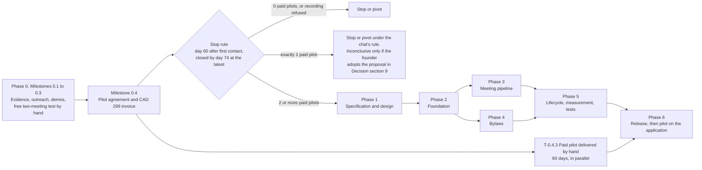

# Execution plan — StrataScribe BC

**Question this file answers:** what is the sequence from validation to pilot?

Structure: **phase → milestone → task → subtask**. Task IDs are `T-<phase>.<milestone>.<task>`. Must-haves (MH) are in [PRD.md](PRD.md#must-haves); risks (R) in [verification-report-fixing.md](verification-report-fixing.md#production-risk-register); screens (S) in [App-flow.md](App-flow.md#screen-and-route-inventory). Number labels are defined in [Decision.md](Decision.md#how-numbers-are-labelled-used-in-all-ten-files). All estimates are the author's assumptions `[A]` in working hours. Every script and command named here is **proposed**; none exists.

Method note `[S: SpecKit]`: each task has one deliverable and one acceptance check that a person who did not do the task can run.

Owner roles: **Founder** (sales, product, operations), **Developer**, **Second reviewer** (another developer or the founder when not the author), **Lawyer** (external BC strata lawyer).

## Phase map

**Order of events (the answer to "when is the CAD 299 paid and for what?").** Nothing in Phases 1–6 starts before the stop rule is evaluated. The stop rule counts paid pilots. A paid pilot therefore has to be sellable and deliverable **before the application exists**, and it is: the 60-day pilot is first delivered as a hand-run service (T-0.4.3), described in [Decision.md](Decision.md#5-offer-channel-pilot). The 60 days start on the date of the first pilot meeting after the invoice is paid. If the application is released during or after those 60 days, pilot and subscribing brokerages move onto it in Milestone 6.2.

**Critical path:** T-0.1.1 → T-0.1.3 → T-0.2.1 → T-0.2.2 → T-0.3.2 → T-0.3.3 → T-0.3.4 → T-0.4.1 → T-0.4.2 → T-1.1.1 → T-1.1.3 → T-2.1.1 → T-2.1.2 → T-2.2.1 → T-2.2.3 → T-3.1.3 → T-3.2.1 → T-3.2.2 → T-3.2.3 → T-4.1.1 → T-3.3.1 → T-3.3.2 → T-5.1.2 → T-5.2.1 → T-6.1.1 → T-6.1.2 → T-6.2.1 → T-6.2.2.

Why these are on the path: T-1.1.1 supplies the fixtures every later acceptance check uses; T-1.1.3 decides AD-5, without which T-3.2.2 cannot touch real text; T-2.1.1 and T-2.1.2 are the skeleton and stack everything else runs in; T-3.2.3 supplies the results the review screen shows; T-4.1.1 supplies the clauses that citations on minute items point to (the pilot question counts citation corrections). T-1.1.2, T-2.1.3, T-2.1.4, T-2.2.2, T-2.2.4, T-2.2.5, T-3.1.1, T-3.1.2, T-3.3.3, T-4.1.2, T-4.2.x, T-5.1.1, T-5.1.3, T-5.2.2 and T-6.1.3 are required but have slack because they can run beside a path task.

**Parallel work:** T-0.4.3 (hand-run paid pilot) runs beside Phases 1–5. Phase 4 can run beside Phase 3 once Phase 2 is done. Within Phase 2, T-2.1.3, T-2.1.4 and T-2.2.2 are independent of T-2.2.1. T-1.1.3 (hosting facts) can start during Phase 0.

**External dependencies**

| Dependency | Blocks | Type |
|---|---|---|
| Brokerages agreeing to the free two-meeting test | T-0.3.3 | Buyer decision |
| Buildings with a recording bylaw, or acceptance of dictated notes | T-0.3.3, T-0.4.3, T-6.2.2 | Permission |
| Written agreement to hand-run processing (who must sign: T-0.3.2) | T-0.3.3 | Permission |
| Lawyer's review of authority wording and of who must agree | T-0.1.3, T-0.3.2, T-3.1.1 | External |
| Lawyer's written answer to question 6 (outreach and anti-spam law) | T-0.2.1 | External |
| Pilot agreement signed and CAD 299 invoice paid | T-0.4.2, T-0.4.3 | Payment |
| Stop-rule result on day 60 after the first contact (day 74 at the latest if the memo is provisional) | Phases 1–6 | Buyer decision |
| Bylaws and rules for each pilot building | T-0.4.3, T-6.2.1 | Sample data |
| Stopwatch baseline timings from each pilot manager | T-0.3.3, T-0.4.3, T-6.2.2 | Sample data |
| VPS location confirmed in Canada | T-6.1.1 | Infrastructure |

## Phase 0 — Validation by hand (no application)

Everything in this phase is done with a spreadsheet, a stopwatch sheet, Word, and models run on the founder's own machine. No application code is written.

The go-to-market plan in [Decision.md](Decision.md#12-go-to-market-plan) is carried out by these tasks, all before any build task (the first is T-2.1.1): list building T-0.1.1; outreach T-0.2.1; discovery calls T-0.1.2 (interviews) and T-0.2.2 (demos with a qualification record); free test T-0.3.2 to T-0.3.4; pilot agreement and invoice T-0.4.1; stop-rule memo T-0.4.2; pilot delivery and the step to a recurring account T-0.4.3. Each task's owner is in its row; exit criteria are stated per milestone.

### Milestone 0.1 — Market and recording-authority evidence

- **Entry conditions:** none. This is the first milestone and needs no software.
- **Dependencies:** web access to the BCFSA licence search from an ordinary browser.
- **Owner:** Founder.
- **Measurable outcome:** a counted list of distinct brokerages; 11 interviews; an authority pack reviewed by a lawyer.
- **Exit criteria:** the count is recorded in `Decision.md`; at least 6 of 11 interviewees say minutes take more than 1 hour per meeting `[C]`; the lawyer has answered the questions in T-0.1.3. If most interviewees say under 30 minutes, stop `[C]`.

| ID | Links | Owner | Est. h | Deliverable | Acceptance check |
|---|---|---|---|---|---|
| T-0.1.1 | Decision §8, §12.3; M-3 | Founder | 6–10 | Spreadsheet of distinct BC brokerages licensed for strata management, keyed by BCFSA licence number, with region and source | A second person picks 10 rows at random and finds each in the BCFSA search; no licence number appears twice; every email address has its publication record or the row is marked "phone or visit only"; total is written into `Decision.md` with the date |
| T-0.1.2 | PRD problem statement; M-1 baseline | Founder | 16–24 | Notes from 8 managers and 3 managing brokers `[C]` using the discovery questions below | 11 dated notes; a one-page tally of minutes time, recording policy, bylaw-question volume |
| T-0.1.3 | MH-03, MH-10; Decision §4 | Founder, Lawyer | 8–12 plus external fee (not estimated) | Authority pack: notice wording, consent wording, checklist for finding a recording bylaw, "not legal advice" wording, and written answers to the six questions below | Lawyer's written comments received; each of the three recording bases is marked acceptable, acceptable with changes, or not acceptable; each question has an answer |

Subtasks:
- **T-0.1.1:** (a) export or copy the BCFSA search results for the strata category by region; (b) remove branch offices of the same legal entity; (c) match PAMA, CHOA and CCI Vancouver listings to add a named contact, and for each email address record the page on which the recipient or their brokerage published it, the date seen, and that no statement refusing unsolicited messages was beside it; (d) mark which meet "10 or more strata corporations" where public; (e) record the count and the method; (f) mark every brokerage without such a record "phone or visit only".
- **T-0.1.2:** (a) book interviews; (b) ask the discovery questions; (c) ask each manager to time two real sets of minutes with the baseline sheet from T-0.3.1; (d) tally; (e) compare with the week-1 gate.
- **T-0.1.3:** (a) draft from the OIPC guidance `[S: OIPC-2022]`; (b) send to the lawyer with the questions; (c) revise; (d) fix the wording version label used later in `recording_authorizations.notice_text_version`.

**Discovery questions for T-0.1.2.** The first five are the chat's `[C]`, quoted; the last two are added `[A]`.

1. How many stratas does each manager carry and how many evening meetings is that a month?
2. How long after a meeting do minutes go out and who writes them?
3. Do you record meetings today and what is your policy on it?
4. How many bylaw questions does a manager answer in a week?
5. What portal or accounting system do you use and where do minutes get stored?
6. Which of your buildings have a filed bylaw that allows meetings to be recorded? `[A]`
7. Will you time your next two sets of minutes with our sheet? `[A]`

**Questions for the lawyer in T-0.1.3** `[A]`. Question 6 is asked first and its answer is the entry condition of Milestone 0.2:

1. Is a filed recording bylaw sufficient authority to record a council meeting and a general meeting, and what must the bylaw say?
2. Without such a bylaw, is the documented express consent of every person present sufficient?
3. Do a manager's own dictated notes, made after the meeting, need any authority beyond the Act's authority to keep minutes?
4. Who must agree in writing before a recording is processed by an outside service: the strata corporation (through its council), the brokerage as its agent, or both? What must the brokerage's service agreement with the strata say?
5. Does quoting a bylaw clause in answer to a manager's question risk being treated as legal advice, and what wording avoids that?
6. Outreach under Canada's anti-spam legislation, on the author's reading in [Decision.md](Decision.md#124-channel-and-sequence): (a) may a first-touch email be sent to a managing broker on implied consent where the address is published on the brokerage's own website with no refusal statement, and does a listing in an association's member directory count as published by the recipient; (b) is the sender and unsubscribe block in the draft messages sufficient; (c) is a LinkedIn connection request with a note a commercial electronic message, and can it be sent; (d) do any telemarketing rules apply to a phone call to a brokerage?

### Milestone 0.2 — Outreach and demos

- **Entry conditions:** the lawyer's written answer to question 6 of T-0.1.3 is received, and the T-0.1.1 list exists with its publication records. No first touch by any channel is made before both. (Outreach can start on the first 60 rows while the rest of the list is completed.)
- **Dependencies:** the lawyer's answer to question 6 (external).
- **Owner:** Founder.
- **Measurable outcome:** 150 distinct brokerages contacted; demos held; every reply, demo and refusal logged.
- **Exit criteria:** the sales log shows 150 distinct licence numbers contacted, the number of replies and the number of demos held; each demoed brokerage's recording policy and recording-bylaw count is recorded; the channel check is recorded as passed or failed.

| ID | Links | Owner | Est. h | Deliverable | Acceptance check |
|---|---|---|---|---|---|
| T-0.2.1 | Decision §8, §12.4, §12.5; M-3 | Founder | 20–30 | Outreach to 150 distinct brokerages `[C]` (60 in week 1 `[C]`, 90 in week 4 `[A]`; the chat's plan said week 3 `[C]`) offering the free two-meeting test; sales log keyed by licence number, with a suppression list | Log has 150 distinct licence numbers with date, channel, contact role, minutes spent and outcome; no brokerage counted twice; every email sent has a publication record in the T-0.1.1 list and carries the sender and unsubscribe block; nobody on the suppression list was contacted again |
| T-0.2.2 | Decision §5, §9, §12.7; M-3, M-11 | Founder | 12–16 | Demos to managing brokers (the chat expects 7–8 `[C]`), each ending with a qualification record | For every demo: buildings managed, who writes minutes, recording policy, number of buildings with a recording bylaw, two candidate meetings named or "none", decision on the free test |

Subtasks:
- **T-0.2.1:** (a) first-touch email, follow-up and call script taken from [Decision.md](Decision.md#125-message) and the buying triggers, changed as the lawyer's answer to question 6 requires; email only to addresses with a publication record, phone for the rest, no LinkedIn messages; (b) contact the first 60 in week 1; (c) log replies, declines and unsubscribe requests, and act on each request the same day; (d) contact the remaining 90 in week 4, after the message check; (e) follow up once after 5 business days; (f) on day 21 (message check) and day 40 (channel check), compare the reply count with [Decision.md](Decision.md#129-gtm-stop-rule) and write the result in the sales log.
- **T-0.2.2:** (a) demo using a synthetic recording and its hand-made draft; (b) show the correction step and the stopwatch sheet; (c) ask the qualification questions; (d) record recording refusals in the exact words used; (e) book the free test.

### Milestone 0.3 — Free two-meeting test by hand (the decisive measurement)

- **Entry conditions:** at least one brokerage accepted the free test; T-0.1.3 answered; written agreements required by T-0.3.2 signed.
- **Dependencies:** a machine in Canada controlled by the founder that can run Whisper and a local language model.
- **Owner:** Founder.
- **Measurable outcome:** for each test brokerage, two authorized meetings with stopwatch baseline, stopwatch correction time, and error counts.
- **Exit criteria:** the measurement table of T-0.3.4 exists for every tested brokerage and has been shown to its managing broker.

| ID | Links | Owner | Est. h | Deliverable | Acceptance check |
|---|---|---|---|---|---|
| T-0.3.1 | MH-13; M-1 | Founder | 3–5 | Stopwatch sheet for baseline and for correction time; correction log sheet | A manager can fill it for one meeting in under 2 minutes; its fields are the M-1 terms in [PRD.md](PRD.md#how-m-1-is-captured) and `corrections.category` in [schema.md](schema.md) |
| T-0.3.2 | MH-03, MH-12; TRD AD-5 | Founder | 4–6 | Hand-run processing protocol (below) and the one-page agreement the brokerage signs | Protocol names the models, the machine, where files sit, who can open them and when they are deleted; a second person can follow it; the agreement lists the same facts |
| T-0.3.3 | MH-05, MH-06, MH-07; pilot question | Founder | 20–30 | For each of up to 5 brokerages `[C]`: two drafts made by hand and delivered the next business morning | Each draft is delivered with a list of motions and the audio time of each; every step of the protocol is ticked on the hand-run log for that meeting |
| T-0.3.4 | M-1, M-5, M-6 | Founder | 3–5 | Measurement table per brokerage | Per meeting: baseline minutes, setup, listening and editing minutes, corrections by category (motion, vote, citation, other), errors the manager found, net time saved; totals reproduce from the sheets |

Subtasks:
- **T-0.3.1:** (a) list the M-1 terms; (b) lay out the sheet; (c) try it on one synthetic meeting; (d) fix unclear fields.
- **T-0.3.2:** (a) write the protocol; (b) add the lawyer's answer on who must agree; (c) draft the agreement; (d) dry-run with a synthetic recording, including deletion.
- **T-0.3.3:** (a) confirm the authority basis per meeting and file the evidence; (b) receive the file as the protocol says; (c) transcribe; (d) draft with the local model and the standard BC format; (e) apply the outcome rules in [TRD.md](TRD.md#deterministic-rules) by hand from what the manager recorded; (f) deliver in Word; (g) the manager corrects with tracked changes and the stopwatch sheet; (h) delete on schedule and confirm deletion in writing.
- **T-0.3.4:** (a) compute net time saved per meeting; (b) classify each tracked change; (c) list every motion, vote and citation error and whether the manager caught it; (d) show the table to the managing broker.

**Hand-run processing protocol (content of T-0.3.2)** `[A]`:

| Point | Rule |
|---|---|
| Models | Whisper large-v3 and an open-weight language model, both run locally on the founder's machine. **No hosted model, chatbot or transcription service is used for any real recording, transcript or minutes text in Phase 0.** A hosted provider may be used only after AD-5 in [TRD.md](TRD.md#9-architecture-decisions) records that provider's own Canadian-processing terms. |
| Whose agreement | (1) Recording authority at the building, as in MH-03: a filed recording bylaw, or the other bases only if the lawyer accepted them. The brokerage cannot supply this on the building's behalf. (2) The brokerage's managing broker signs the hand-run agreement, confirming that its service agreement with the strata corporation permits a service provider to process the recording. (3) Whether the council must also acknowledge in writing follows the lawyer's answer to question 4; until answered, the council's written acknowledgement is required. |
| Transfer | The manager uploads over HTTPS to a single-purpose folder on the founder's VPS, or hands over a device in person. No email attachments, no consumer file-sharing links. |
| Storage | One encrypted volume on the founder's machine, full-disk encryption on, in Canada. Files are named by a random ID; a separate sheet maps ID to building. |
| Access | The founder only. No copies on other devices or in backups to a consumer cloud. |
| Deletion | Audio: 14 days after the manager accepts the minutes, and never more than 60 days after receipt. Transcript and drafts: 90 days after acceptance. Each deletion is written on the hand-run log and confirmed by email to the managing broker without attaching content. |
| Log | Per meeting: received, authority evidence seen, transcribed, drafted, delivered, accepted, deleted, with dates. |

### Milestone 0.4 — Paid pilot agreement and stop rule

- **Entry conditions:** at least one brokerage has seen its T-0.3.4 table.
- **Dependencies:** pilot agreement and data-handling terms (drafted in T-0.4.1); payment.
- **Owner:** Founder.
- **Measurable outcome:** number of pilot agreements signed and CAD 299 invoices paid by day 60 after first contact (by day 74 where the memo is provisional).
- **Exit criteria:** the stop-rule memo (T-0.4.2) is written on day 60 after the first contact (marked provisional and closed by day 74 if a signed pilot is unpaid or a free test is still running and could change the outcome `[A]`) and states one of the three outcomes in [Decision.md](Decision.md#9-stop-rule-checked-against-conversions-sample-size-and-sales-cycle).

| ID | Links | Owner | Est. h | Deliverable | Acceptance check |
|---|---|---|---|---|---|
| T-0.4.1 | Decision §5, §12.6; M-3 | Founder | 5–8 | Pilot agreement (60 days, 3 managers, CAD 299 total `[C]`, hand-run delivery, what is measured), data-handling terms, invoice | Agreement states what is delivered, the start date rule, the meeting cap, and deletion terms; a paid pilot is counted only when the agreement is signed **and** the invoice is paid |
| T-0.4.2 | Stop rule (Decision §9, §12.9); M-3 | Founder | 2–4 | Stop-rule memo on day 60 after the first contact; if provisional, closed by day 74 `[A]` | Memo states contacts (distinct), replies, demos, paid pilots, recording refusals, cash spent since the start of preparation against the cap of CAD 4,125 without founder pay (CAD 3,725 counted from the first contact; [Decision.md](Decision.md#76-cash-required-during-the-acquisition-ramp)), the result of the channel check, and the outcome under the chat's rule and under the proposal |
| T-0.4.3 | MH-05, MH-06, MH-07, MH-13; M-1, M-2 | Founder | 24–40 per pilot brokerage | The 60-day paid pilot delivered by hand under the T-0.3.2 protocol: next-business-morning drafts, quoted-clause answers to bylaw questions within 1 business day, weekly measurement table | Every pilot meeting has a row in the measurement table; M-2 is computed for each; the managing broker receives the table weekly |

Subtasks:
- **T-0.4.1:** (a) draft the agreement from the lawyer-reviewed pack; (b) agree which upcoming meetings have recording authority; (c) collect bylaws for those buildings; (d) issue the invoice; (e) record the payment date.
- **T-0.4.2:** (a) count from the sales log, listing separately any signed-but-unpaid pilot and any free test still running; (b) apply the rule, or mark the memo provisional and close it by day 74; (c) record what was spent; (d) update the assumptions in `Decision.md` that now have evidence.
- **T-0.4.3:** (a) weekly schedule of pilot meetings; (b) per meeting, the T-0.3.3 steps; (c) answer bylaw questions by quoting the clause from the supplied bylaws or saying none was found; (d) weekly table; (e) end-of-pilot summary and conversion conversation in the last week: building count, tier, signed monthly subscription order, first monthly invoice at the end of the pilot, as set out in [Decision.md](Decision.md#126-pilot-offer-and-conversion); the account counts as recurring when that invoice is paid.

Hand-run capacity `[A]`: one person can deliver about 12 meetings per brokerage per month and at most 2 pilot brokerages at once. The pilot agreement states this cap. The chat set no cap; it is a proposal.

## Phase 1 — Specification and design

### Milestone 1.1 — Buildable specification

- **Entry conditions:** the T-0.4.2 memo records 2 or more paid pilots and no recording stop. With exactly 1 paid pilot the chat's rule says stop or pivot; this milestone may start in that case only if the founder has adopted, in writing, the proposal in [Decision.md](Decision.md#9-stop-rule-checked-against-conversions-sample-size-and-sales-cycle).
- **Dependencies:** recordings and corrected minutes from Phase 0 (with permission) to shape the format; otherwise synthetic only.
- **Owner:** Founder with Developer.
- **Measurable outcome:** a minutes format specification, a fixture set with answer keys, reviewed wireframes, and confirmed hosting facts.
- **Exit criteria:** two managers have walked through the wireframes of S-08, S-10, S-11 and S-12 and their objections are recorded; AD-4 and AD-5 in the TRD are updated with facts.

| ID | Links | Owner | Est. h | Deliverable | Acceptance check |
|---|---|---|---|---|---|
| T-1.1.1 | MH-05, MH-10 | Founder | 8–12 | Minutes format spec; top-20 bylaw questions `[C]`; synthetic fixtures: 6 scripted meeting recordings with answer keys, 1 bylaw set of about 45 clauses, 30 questions (20 answerable, 10 not) | A second person can score a draft against an answer key without asking the author |
| T-1.1.2 | MH-03, MH-07, MH-08; R-20 | Founder | 8–12 | Clickable wireframes of S-08, S-09, S-10, S-11, S-12 | Two managers complete "create meeting → review → approve" on the wireframe unaided; every label they misread is listed and fixed |
| T-1.1.3 | TRD AD-4, AD-5; MH-12 | Developer | 4–6 | Written facts: VPS country, disk, CPU; a Canadian GPU option; whether a hosted language model offers Canada-only processing, quoted from the provider's own terms with date | Each fact has a source and date; AD-5 is changed from "open" to a decision |

Subtasks:
- **T-1.1.1:** (a) write the format from real examples; (b) script and record six meetings with volunteers; (c) write answer keys; (d) write the bylaw set and questions.
- **T-1.1.2:** (a) draw; (b) test with two managers; (c) record label and flow problems; (d) update [App-flow.md](App-flow.md) and [design.md](design.md).
- **T-1.1.3:** (a) check the VPS; (b) time Whisper large-v3 on it for a 30-minute fixture; (c) read provider terms; (d) update the TRD and `Decision.md` sources.

## Phase 2 — Foundation

### Milestone 2.1 — Environment

- **Entry conditions:** Milestone 1.1 complete.
- **Dependencies:** none external.
- **Owner:** Developer.
- **Measurable outcome:** a new developer goes from clone to a running local stack with one command.
- **Exit criteria:** `make dev` (proposed) starts every service and all health checks pass within 3 minutes on a clean machine; CI runs on every push.

| ID | Links | Owner | Est. h | Deliverable | Acceptance check |
|---|---|---|---|---|---|
| T-2.1.1 | R-03, R-04, R-06 | Developer | 5–8 | Repository skeleton: `apps/web`, `apps/api`, `apps/worker`, `packages/core`, `packages/rules`, `packages/ai`, `packages/docs`; import-boundary lint rule | A test commit that imports `apps/api` from `apps/worker`, or defines a second config loader, fails CI; tests U-16 (a second writer of `computed_result` fails the static check) and I-21 (API and worker report the same configuration fingerprint) pass |
| T-2.1.2 | R-17 | Developer | 4–6 | Compose file with health checks; `make dev`, `make test`, `make seed` | Clean checkout → `make dev` → `/readyz` returns ready; stopping the database turns `/readyz` not-ready within 30 s |
| T-2.1.3 | R-08, R-10, R-22 | Developer | 4–6 | CI: lint, unit and integration tests, single-migration-head check, ORM-versus-migration comparison, Markdown link check, branch protection on `main` | A branch with two migration heads fails; a model index missing from migrations fails |
| T-2.1.4 | R-07, R-12 | Developer | 3–5 | `core.logging` with correlation IDs and redaction, used by API and worker | Worker container starts with no web framework installed; a log line for a job contains the request's correlation ID; a test that logs a field named `text` finds it redacted |

Subtasks:
- **T-2.1.1:** (a) create packages; (b) add the lint rule; (c) add a failing example to the test suite; (d) document boundaries.
- **T-2.1.2:** (a) Compose services and named volumes; (b) health endpoints; (c) Makefile targets; (d) time a cold start.
- **T-2.1.3:** (a) CI workflow; (b) migration checks; (c) link checker; (d) branch naming rule (`feat/…`, `fix/…`, `docs/…`) and stale-branch report.
- **T-2.1.4:** (a) logger; (b) redaction filter and allow-list; (c) correlation ID middleware and job propagation; (d) import test for the worker.

### Milestone 2.2 — Schema, identity, tenancy

- **Entry conditions:** T-2.1.2 complete.
- **Dependencies:** [schema.md](schema.md).
- **Owner:** Developer.
- **Measurable outcome:** two brokerages, three buildings and four users exist in fixtures, and no user can read what they should not.
- **Exit criteria:** the denial tests in T-2.2.3 pass in CI against a real PostgreSQL.

| ID | Links | Owner | Est. h | Deliverable | Acceptance check |
|---|---|---|---|---|---|
| T-2.2.1 | MH-01, MH-02; R-05 | Developer | 8–12 | Migrations for tenancy tables, row-level security policies, database roles | As `app_user` with no session variables, `SELECT count(*)` on every tenant table returns 0 |
| T-2.2.2 | MH-01; S-01, S-02, S-05 | Developer | 8–12 | Magic link plus authenticator-app code (no OIDC in the pilot), sessions with idle and absolute lifetimes, request-origin check, rate limits, invitations, deactivation | Deactivated user's next request returns 401; unknown and known emails get identical responses; tests I-17 to I-20 pass |
| T-2.2.3 | MH-01, MH-02; R-05 | Developer | 8–12 | `core.authz` single policy point; building assignments; 403/404 behaviour; denial audit and alert; operator sign-in and support-grant path; read events | Fixture: Priya assigned to ZZS 9001 only. Every route and file link for ZZS 9002 returns 403; every ID from the second brokerage returns 404; each attempt has an `access.denied` audit row; tests P-4, P-6, I-25 pass |
| T-2.2.4 | MH-11 | Developer | 3–5 | `core.audit.record` and the append-only table | `UPDATE` and `DELETE` on `audit_events` as `app_user` are refused by the database |
| T-2.2.5 | R-09, R-11 | Developer | 3–5 | Migration runbook; `lock_timeout`; concurrent-index pattern; resumable backfill helper | Test: a backfill killed halfway resumes and finishes with no row processed twice; an index migration on a table under write load completes without blocking writes for more than 5 s |

Subtasks:
- **T-2.2.1:** (a) tables in the order given in [schema.md](schema.md#migrations); (b) policies; (c) roles and grants; (d) policy-listing test.
- **T-2.2.3:** (a) policy functions; (b) session wrapper `session_for(actor)`; (c) error mapping; (d) repeated-denial alert; (e) lint rule forbidding raw sessions; (f) operator sign-in, grant-scoped session and `support.accessed` events; (g) read events for meeting, audio, transcript and export.
- **T-2.2.2:** (a) magic-link issue, 10-minute single-use redemption bound to the requesting browser; (b) authenticator-app enrolment and check; (c) server-side sessions with idle and absolute expiry; rate limits; origin check; (d) invitation and deactivation flows; (e) identical-response test for unknown emails.
- **T-2.2.4:** (a) table and grants; (b) `record()` inside the caller's transaction; (c) allow-list of `details` keys; (d) refusal test for UPDATE and DELETE.
- **T-2.2.5:** (a) runbook text; (b) helper; (c) kill-and-resume test; (d) lock test.

## Phase 3 — Meeting pipeline

### Milestone 3.1 — Authority gate and upload

- **Entry conditions:** Milestone 2.2 complete; authority wording from T-0.1.3.
- **Owner:** Developer.
- **Measurable outcome:** an authorized meeting's audio is stored under the right building; an unauthorized one cannot be uploaded.
- **Exit criteria:** tests I-1 to I-4 below pass.

| ID | Links | Owner | Est. h | Deliverable | Acceptance check |
|---|---|---|---|---|---|
| T-3.1.1 | MH-03; S-08 | Developer | 5–8 | Meeting creation, authority record, server-side gate | Upload init for a meeting with no authority returns 409; authority cannot be edited after upload |
| T-3.1.2 | MH-04; S-09; R-13, R-19 | Developer | 8–12 | Resumable multi-part upload; `core.storage.key`; checksum duplicate detection; per-file results; accepted-type, size and archive limits; malware scan; remove or replace a part | Kill the connection at 60%: resume completes without re-sending finished parts; same file twice → one asset; keys match `b/{brokerage}/s/{strata}/audio/{uuid}`; test I-24 passes |
| T-3.1.3 | MH-04; R-01, R-02 | Developer | 6–10 | Job table, leases, compare-and-set transitions, reconciler | A stale completion arriving after a retry's completion does not change state; a job whose caller timed out is picked up by the next status poll |

Subtasks:
- **T-3.1.1:** (a) meeting form and uniqueness check; (b) authority record with the wording version from T-0.1.3; (c) server-side gate on upload init; (d) supersede flow; (e) "not recorded" path.
- **T-3.1.2:** (a) upload endpoints; (b) client resume; (c) accepted-type, magic-byte, size and archive-expansion checks; malware scan; (d) per-part status for multi-part meetings; (e) `tmp/` cleanup hook.
- **T-3.1.3:** (a) job schema and lease query; (b) `transition()`; (c) reconciler; (d) out-of-order and duplicate event tests.

### Milestone 3.2 — Transcription and draft

- **Entry conditions:** Milestone 3.1 complete; fixtures from T-1.1.1; AD-5 decided.
- **Owner:** Developer.
- **Measurable outcome:** a fixture recording becomes a draft with evidence links and computed results.
- **Exit criteria:** eval scores recorded as the baseline for the chosen model versions; a 2-hour fixture timed on the production host.

| ID | Links | Owner | Est. h | Deliverable | Acceptance check |
|---|---|---|---|---|---|
| T-3.2.1 | MH-04, MH-05; M-12; AD-4 | Developer | 8–12 | Transcription worker; chunking; timing report | Six fixtures transcribed; wall-clock time per audio hour recorded; AD-4 trigger evaluated in writing |
| T-3.2.2 | MH-05 | Developer | 10–16 | Extraction with schema-constrained output, evidence segment IDs, sensitive-item flag; `make eval` (proposed) | Every extracted item has at least one valid segment ID; scores per fixture stored; invalid model output twice → empty-template fallback |
| T-3.2.3 | MH-06; AD-6 | Developer | 6–9 | `packages/rules` with unit tests and a rules version: counted votes, declared outcomes, ties and casting votes, general and council quorum including the small-strata and adjourned-meeting cases | Tests U-1 to U-6 and U-10 to U-15 below pass; no code path writes `computed_result` except this package (U-16) |

Subtasks:
- **T-3.2.1:** (a) worker container with the model baked in and no outbound network; (b) chunking with overlap and timestamp stitching across audio parts; (c) timing harness on the production host; (d) write the AD-4 evaluation into the TRD.
- **T-3.2.2:** (a) prompt and schema; (b) validator; (c) evidence mapping; (d) eval harness and score file; (e) prompt-injection fixture.
- **T-3.2.3:** (a) counted-vote rules; (b) declared-outcome path with attestation; (c) tie and casting-vote handling; (d) quorum rules: default, small strata, adjourned meeting, council table, per-building overrides; (e) formula text; (f) discrepancy detection between declared outcome and counts, with the stored resolutions.

### Milestone 3.3 — Review, approval, export

- **Entry conditions:** Milestone 3.2 complete; wireframe feedback from T-1.1.2.
- **Owner:** Developer.
- **Measurable outcome:** a manager can take a fixture draft to an approved Word file using only the keyboard.
- **Exit criteria:** end-to-end test E-1 passes; a manager from a pilot brokerage completes it on staging with synthetic data.

| ID | Links | Owner | Est. h | Deliverable | Acceptance check |
|---|---|---|---|---|---|
| T-3.3.1 | MH-05, MH-07; S-10 | Developer | 15–22 | Review workspace: item cards, evidence player, outcome method (declared or counted), citations on items, autosave with conflict handling, correction records, activity timer for setup, review and lookup | Each edit creates one correction row; two-tab conflict yields 409 and no lost text; tests I-13 (timer accuracy) and I-16 (citation correction) pass |
| T-3.3.2 | MH-08; S-11 | Developer | 6–10 | Approval with server-side re-check; immutable versions; reopen; Word and PDF export with draft watermark | Approving twice creates one approval; an UPDATE on an approved item is refused by the database; draft export has the watermark on every page; tests I-23 (recording authority evidenced before approval), U-17 (renderer fetches nothing) and E-5 pass |
| T-3.3.3 | R-18; S-09, S-10, S-11 | Developer | 3–5 | URL-driven state, scroll and selection restore, Back/Forward and refresh behaviour | Refresh in the middle of review returns to the same item; Back after approval shows the approved read-only state |

Subtasks:
- **T-3.3.1:** (a) item cards and vote table; (b) evidence player and transcript highlight; (c) autosave with `If-Match`; (d) correction categories; (e) activity timer (input or audio playback counts as activity); (f) add and delete item; (g) sensitive-name replacement; (h) citations on items: confirm, replace, remove.
- **T-3.3.2:** (a) approval summary; (b) server re-check and content hash; (c) immutability trigger; (d) reopen with reason; (e) Word and PDF renderers from one source; (f) watermark and footer.
- **T-3.3.3:** (a) item ID in the URL fragment; (b) state-to-screen redirect for meeting links; (c) no-store headers; (d) session-expiry text preservation.

## Phase 4 — Bylaws

### Milestone 4.1 — Bylaw library

- **Entry conditions:** Milestone 2.2 complete.
- **Owner:** Developer.
- **Measurable outcome:** the synthetic bylaw set is uploaded, split into clauses and confirmed.
- **Exit criteria:** at least 95% of the 45 fixture clauses are split with the correct number without manual edits `[A]`; the rest are fixable in S-07.

| ID | Links | Owner | Est. h | Deliverable | Acceptance check |
|---|---|---|---|---|---|
| T-4.1.1 | MH-09; S-07; R-19 | Developer | 8–12 | Upload, text extraction, clause segmentation, confirm, supersede, embeddings | Scanned PDF fails with a clear message; three-file upload with one bad file shows 2 succeeded, 1 failed, and retry touches only the failed file |
| T-4.1.2 | MH-06, MH-10 | Developer | 4–6 | `import_statutes` (proposed): Act, Regulation and Standard Bylaws sections with source URL and "current to" date; council quorum table transcribed from the source | Imported set shows its "current to" date in S-12; re-import with a new date keeps the old version marked superseded |

Subtasks:
- **T-4.1.1:** (a) multi-file upload with per-file jobs; (b) text extraction and scanned-file detection; (c) clause splitter with numbering patterns; (d) side-by-side confirmation screen with merge and split; (e) supersede logic; (f) embeddings.
- **T-4.1.2:** (a) download the three instruments and note the "current to" date; (b) parse to sections; (c) transcribe the council quorum table and check it against the source by a second person; (d) versioned import; (e) quarterly re-check reminder.

### Milestone 4.2 — Cited questions and answers

- **Entry conditions:** Milestone 4.1 complete; AD-5 decided.
- **Owner:** Developer.
- **Measurable outcome:** fixture questions answered with valid citations or refused.
- **Exit criteria:** 100% citation validity; 10 of 10 unanswerable questions refused.

| ID | Links | Owner | Est. h | Deliverable | Acceptance check |
|---|---|---|---|---|---|
| T-4.2.1 | MH-10; M-7 | Developer | 8–12 | Retrieval filtered by building and current document; answer composer; exact-quote validator; refusal | Tests I-7 and I-8 below pass; an answer with an altered quote is never returned by the API |
| T-4.2.2 | MH-10, MH-11; S-12 | Developer | 4–6 | Question screen, history, "report a wrong answer", audit events | Question about ZZS 9001 never shows a ZZS 9002 clause; refusal is rendered as information, not an error |

Subtasks:
- **T-4.2.1:** (a) hybrid retrieval (vector and keyword) with building and status filters in the query itself; (b) answer prompt that must quote; (c) exact-substring validator; (d) refusal and "closest passages"; (e) eval run on the 30 questions.
- **T-4.2.2:** (a) question form and scope line; (b) citation blocks and "Open in bylaws"; (c) refusal panel; (d) flag endpoint; (e) stale-confirmation notice.

## Phase 5 — Lifecycle, measurement, tests

### Milestone 5.1 — Data lifecycle and pilot measurement

- **Entry conditions:** Milestones 3.3 and 4.2 complete.
- **Owner:** Developer.
- **Measurable outcome:** recordings disappear on schedule and the pilot report reproduces from stored records.
- **Exit criteria:** tests I-9, I-10 pass; the report for the fixture data matches a hand calculation.

| ID | Links | Owner | Est. h | Deliverable | Acceptance check |
|---|---|---|---|---|---|
| T-5.1.1 | MH-12; S-16; R-14 | Developer | 6–10 | Retention sweep, building and account deletion, export, prefix-empty proof, deletion ledger | After the sweep, no object exists for assets past `delete_after`; after building deletion, listing the building's prefix returns nothing |
| T-5.1.2 | MH-13; S-13, S-14 | Developer | 6–10 | Baseline entry; per-meeting time report (post-export editing, dictation, stopwatch total, sent date); pilot report with every M-1 term, sample sizes, CSV | Tests I-14 (3 business days across a BC holiday) and I-15 (report equals a hand calculation for three fixture meetings) pass |
| T-5.1.3 | MH-02, MH-11; S-03, S-04, S-05, S-15 | Developer | 5–8 | Building setup, assignments, team and audit screens | Unassigning a manager blocks their next request; the change is visible in S-15 |

Subtasks:
- **T-5.1.1:** (a) `delete_after` calculation at upload and approval; (b) nightly sweep with per-object result; (c) inventory comparison of store versus database (metric M-9); (d) building export bundle; (e) deletion request with cancel window; (f) deletion ledger kept apart from backups.
- **T-5.1.2:** (a) baseline form; (b) time-report prompt after export; (c) baseline matching rule; (d) report query with all M-1 terms; (e) business-day calendar with BC holidays; (f) CSV; (g) hand-calculation check.
- **T-5.1.3:** (a) building form with quorum overrides; (b) assignment controls with confirmation; (c) team list and invitations; (d) audit list with filters and CSV.

### Milestone 5.2 — Test suites

- **Entry conditions:** all feature tasks complete.
- **Owner:** Developer; Second reviewer runs the manual checks.
- **Measurable outcome:** all planned tests in this file exist and pass on staging.
- **Exit criteria:** zero failing permission tests; accessibility checks in [design.md](design.md#accessibility) recorded with results.

| ID | Links | Owner | Est. h | Deliverable | Acceptance check |
|---|---|---|---|---|---|
| T-5.2.1 | MH-01, MH-02; M-8; R-05 | Developer | 5–8 | Permission matrix suite: every route × every role × own, other building, other brokerage; direct SQL checks; file-link replay | Suite enumerates routes from the API schema so a new route without a test fails the build |
| T-5.2.2 | R-18, R-20; TRD §10 | Developer, Second reviewer | 8–12 | End-to-end, accessibility (automated and manual), concurrency, recovery and network-throttling tests | Results table filled in [verification-report-fixing.md](verification-report-fixing.md) with dates |

Subtasks:
- **T-5.2.1:** (a) route enumeration from the API schema; (b) actor matrix fixtures; (c) SQL-level checks; (d) file-link replay; (e) worker-scope checks.
- **T-5.2.2:** (a) Playwright flows E-1 to E-4; (b) axe scan and manual keyboard and screen-reader passes; (c) contrast measurement of colour tokens; (d) concurrency and throttling runs; (e) label and link review of every screen against [App-flow.md](App-flow.md); (f) record results.

## Phase 6 — Release and paid pilot

### Milestone 6.1 — Production readiness

- **Entry conditions:** Milestone 5.2 complete; VPS confirmed in Canada (T-1.1.3).
- **Owner:** Developer.
- **Measurable outcome:** production runs on the VPS, survives a container rebuild, and has been restored once from backup.
- **Exit criteria:** restore drill completed within the proposed 4 hours; rollback rehearsed.

| ID | Links | Owner | Est. h | Deliverable | Acceptance check |
|---|---|---|---|---|---|
| T-6.1.1 | R-15, R-16; TRD §7 | Developer | 5–8 | Production Compose, named volumes, Caddy TLS, `PUBLIC_BASE_URL`, start-up volume check, `make deploy` | Recreate all containers: data intact; every generated link begins with the public base URL; no `localhost` or container name appears in any response |
| T-6.1.2 | TRD §7; MH-12 | Developer | 5–8 | `backup` and `restore` (proposed), encrypted off-site copies, restore drill, `make rollback` rehearsal | New host restored from last night's backup; deletion ledger replayed; a deployed bad release rolled back in under 10 minutes |
| T-6.1.3 | TRD §7 | Developer | 3–5 | Uptime check, alerts listed in the TRD, one-page incident runbook | Each alert fired once on purpose and received |

Subtasks:
- **T-6.1.1:** (a) confirm VPS country and disk encryption; (b) Compose with named volumes on the data disk; (c) proxy and TLS; (d) start-up volume check; (e) link-host test.
- **T-6.1.2:** (a) backup job and encryption key handling; (b) off-site destination in Canada; (c) restore to a scratch host with ledger replay; (d) rollback rehearsal; (e) record timings.
- **T-6.1.3:** (a) uptime probe on `/readyz`; (b) alert rules; (c) test-fire each alert; (d) runbook.

### Milestone 6.2 — Pilot on the application

- **Entry conditions:** Milestone 6.1 complete; at least one brokerage is in a paid pilot or has continued on a paid tier (agreement and data-handling terms were signed in T-0.4.1; no new CAD 299 invoice is issued here).
- **Dependencies:** bylaws per building; stopwatch baselines per manager; recording authority per meeting.
- **Owner:** Founder.
- **Measurable outcome:** M-1 and M-2 measured in the application for every meeting of each moved brokerage, for the rest of its 60 days `[C]` or its first two subscribed months, with at least two authorized meetings per brokerage also timed by stopwatch.
- **Exit criteria:** decision memo delivered to the managing broker and filed; conversion decision recorded; hand-run and in-application results shown side by side.

| ID | Links | Owner | Est. h | Deliverable | Acceptance check |
|---|---|---|---|---|---|
| T-6.2.1 | MH-02, MH-03, MH-09 | Founder | 4–6 per brokerage | Brokerage moved from the hand-run service to the application: buildings created, managers assigned, bylaws confirmed, baselines entered | Each manager sees only their buildings; each pilot building has confirmed bylaws or a Standard Bylaws declaration; hand-run files for that brokerage are deleted per the T-0.3.2 protocol |
| T-6.2.2 | MH-13; M-1, M-2, M-5, M-6 | Founder | 16–24 (2–3 per week for 8 weeks) | Weekly measurement note; managing-broker spot check of one meeting per manager; stopwatch cross-check on the first two authorized meetings | Every meeting appears in the report; each spot check is recorded with result; timer and stopwatch totals are both shown |
| T-6.2.3 | R-21, R-22; Decision §10 | Founder, Developer | 3–5 | Decision memo; scope audit; branch clean-up | Every shipped feature maps to an MH; no unmerged branch older than 14 days without an owner note |

Subtasks:
- **T-6.2.1:** (a) create buildings and assignments with the managing broker; (b) load and confirm bylaws with each manager; (c) enter stopwatch baselines; (d) agree which meetings have recording authority; (e) delete hand-run copies and confirm in writing.
- **T-6.2.2:** (a) weekly check of the pilot report; (b) follow up every meeting not marked sent within 3 business days; (c) spot checks; (d) stopwatch cross-check; (e) log every support request and its time.
- **T-6.2.3:** (a) write the memo from the report; (b) list shipped features against MH IDs and remove or justify extras; (c) delete merged branches, note owners of open ones; (d) update `Decision.md` with measured values.

## Effort summary

All ranges `[A]`, summed from the task tables above `[D]`.

| Phase | Hours (low–high) |
|---|---|
| 0 Validation up to the stop-rule memo (T-0.1.1 to T-0.4.2) | 99–150 |
| 0 Hand-run paid pilot (T-0.4.3), per pilot brokerage | 24–40 |
| 1 Specification and design | 20–30 |
| 2 Foundation | 46–71 |
| 3 Meeting pipeline | 67–104 |
| 4 Bylaws | 24–36 |
| 5 Lifecycle, measurement, tests | 30–48 |
| 6.1 Production readiness | 13–21 |
| 6.2 Pilot on the application (one brokerage) | 23–35 |
| **Build only (Phases 2–5 and 6.1)** | **180–280** |

The chat's development estimate is 130 hours / 17 days `[A-chat]`. The build range here is 38% to 115% higher `[D]`. The difference is mostly isolation tests, authentication hardening, retention and deletion, restore drill and the review workspace. This is not reconciled; the 130-hour figure should not be used for planning until one of the two is revised.

The chat plans 70 founder hours for the first month `[C]`. The validation tasks up to the stop-rule memo sum to 99–150 hours over about 60 days from the first contact plus a preparation period of about 14 days `[D]`, `[A]`, also not reconciled; the effect on loaded acquisition cost is shown in [Decision.md](Decision.md#74-acquisition-cost-including-founder-time).

## Proposed scripts

None of these exist. Names are proposals.

| Script | Purpose | Inputs | Outputs | Failure behaviour |
|---|---|---|---|---|
| `make dev` | Start the full local stack | Compose file, `.env.local` | Running services; health summary | Exits non-zero naming the unhealthy service |
| `make seed` | Load synthetic fixtures (2 brokerages, 3 buildings, 4 users, 6 meetings, 1 bylaw set) | Fixture directory | Rows and objects | Refuses to run unless the environment is local or staging |
| `make test` | Unit and integration tests against a real PostgreSQL | — | Report | Non-zero on any failure |
| `make eval` | Run AI fixtures and write scores with model and prompt versions | Fixtures, model IDs | Score file | Non-zero if citation validity or refusal is below 100% |
| `check_migrations` | One head; ORM parity; no blocking index creation | Migrations, models | Pass or a diff | Non-zero with the diff |
| `import_statutes` | Load Act, Regulation and Standard Bylaws sections | Downloaded text, "current to" date | New version rows | Aborts without changes if section count drops by more than 5% |
| `retention_sweep` | Delete expired audio, transcripts, temporary parts, exports | Policy, clock | Deletion events; count | Continues past a single failure, reports it, exits non-zero; safe to re-run |
| `backup` | Encrypted database dump and object sync off-site | Keys, destination | Dated backup; success marker | Alerts if no success marker by 06:00 |
| `restore` | Rebuild on a new host from a backup, then replay the deletion ledger and sweep | Backup date | Running system, restore report | Stops before opening sign-in if the ledger replay fails |
| `make deploy TAG=` | Dump, migrate, start new images, wait for readiness | Image tag | New release | On failed readiness, restarts previous images and reports |
| `make rollback TAG=` | Return to a previous image tag | Image tag | Previous release | Refuses if the previous tag predates a contract-phase migration |

## Planned tests

All **Not run**. Fixture people and buildings are synthetic. "Priya" is assigned to ZZS 9001 only; "Daniel" to ZZS 9001 and ZZS 9002; "Marta" is managing broker of Harbourline; "Omar" is a manager at a second brokerage, Tidewater Strata Management Inc.

### Unit

| ID | Fixture | Action | Expected |
|---|---|---|---|
| U-1 | for 9, against 3, threshold 3/4 | compute | carried; formula "9 × 4 ≥ 3 × 12" |
| U-2 | for 8, against 3, threshold 3/4 | compute | defeated (32 < 33) |
| U-3 | General meeting, counted vote: for 6, against 6, majority, no casting vote recorded | compute | `tie`; item blocked with "record whether the president used a casting vote"; with "not used" recorded → defeated |
| U-4 | for 40, eligible 50, 80% vote; then for 39 | compute | carried (200 ≥ 200); defeated (195 < 200) |
| U-5 | present 17 votes, eligible 50, default quorum; then present 16 | compute | quorum (51 ≥ 50); no quorum (48 < 50) |
| U-6 | Outcome method "counted" with for 0, against 0 | compute | `no_result`; item blocked with the choice "enter the count" or "switch to declared on a show of cards" |
| U-7 | Answer with quote differing from the clause by one character | validate | rejected |
| U-8 | `core.storage.key` with brokerage, building, purpose | build | Key matches the pattern; any other construction path fails lint |
| U-9 | Log record with fields `text`, `email` | emit | Both redacted |
| U-10 | Motion decided on a show of voting cards: method "declared", outcome "carried" attested by the manager, no counts | validate for review | Reviewable and approvable; `computed_result` stays empty; final outcome = declared outcome; minutes read "CARRIED" with no numbers |
| U-11 | Method "counted": for 8, against 3, 3/4 vote; chair declared "carried" | compute, then apply each resolution | Computed `defeated`; item blocked; resolution "counts corrected" recomputes; resolution "recorded as declared by the chair" requires a note, stores both the declared outcome and the count, and unblocks |
| U-12 | Adjourned general meeting flag set; present 5 votes, eligible 50 | compute quorum | Quorum met under s. 48(3) (those present), unless the building's override says otherwise |
| U-13 | Building with 3 strata lots; present 1 of 3 votes, then 2 of 3 | compute quorum | No quorum (1 × 3 < 2 × 3); quorum (2 × 3 ≥ 2 × 3) under the 2/3 rule of s. 48(2)(b) |
| U-14 | General meeting: for 6, against 6, majority, casting vote "used, in favour" by the president; then the same in a 2-lot strata | compute | Carried by casting vote; in the 2-lot strata the casting vote is not offered and the motion is defeated |
| U-15 | Council sizes 1, 3, 4, 5, 6, 7 with members present 1, 1, 2, 2, 3, 4; then council votes with 4 present: for 3 against 1; for 2 against 2; for 2 against 1 abstained 1 | compute | Quorum: yes, no, yes, no, yes, yes. Votes: carried (6 > 4); `tie` with casting-vote prompt; defeated (4 is not > 4) |
| U-16 | Source tree with a seeded assignment to `computed_result` outside `packages/rules` | run static check | Check fails and names the file |
| U-17 | Minutes text containing `` and a `<link>` tag | render PDF | Tags appear as literal text; the renderer's fetch hook records zero requests |

### Integration (real PostgreSQL and object store)

| ID | Fixture | Action | Expected |
|---|---|---|---|
| I-1 | Meeting with no authority | Init upload | 409; no object created |
| I-2 | Authorized meeting; 200 MB file | Drop connection at 60%, resume | Completes; finished parts not re-sent; checksum matches |
| I-3 | Same file uploaded twice | Complete both | One asset; second returns the first's ID |
| I-4 | Job completes after its retry already succeeded | Late completion arrives | State unchanged; late result stored, not applied |
| I-5 | Caller times out; worker finishes later | Poll status | Shows ready; no second job |
| I-6 | Approved version | UPDATE an item as `app_user` | Refused by trigger |
| I-7 | 20 answerable fixture questions | Ask | Each shown answer has ≥ 1 validated citation from ZZS 9001's current document |
| I-8 | 10 unanswerable questions; 1 with an injected instruction in a bylaw clause | Ask | 10 refusals; injected text has no effect |
| I-9 | 10 audio assets past `delete_after`; one object already missing | Run sweep twice | 0 objects remain; 10 deletion events; second run is a no-op |
| I-10 | Building with meetings, audio, bylaws | Delete building after the cancel window | Rows gone; prefix listing empty; audit event remains without content |
| I-11 | No session variables | `SELECT` on each tenant table as `app_user` | 0 rows from every table |
| I-12 | Three-file bylaw upload, one scanned image | Upload; retry failed file with a text PDF | 2 processed, 1 failed with reason; retry processes only that file |
| I-13 | Scripted 10-minute browser session on one meeting: 2 minutes on S-09, 3 minutes typing in S-10, 3 minutes only listening to audio, 2 minutes with the tab in the background | Read stored activity | Setup 2 min, review 6 min (typing + listening), background time 0; each within ±15 seconds |
| I-14 | Meeting held Thursday 24 December 2026; holiday table containing 25 December; marked sent Wednesday 30 December, then Thursday 31 December | Compute business days | 3 business days (28, 29, 30 December), within target; 4 business days, outside target. The real holiday table is to be taken from the BC government list in T-5.1.2; it was not looked up for this document |
| I-15 | Three fixture meetings with stopwatch baselines, timer data and time reports | Open pilot report | Every M-1 term and the net figure equal a hand calculation; a meeting whose baseline is an estimate is listed apart |
| I-16 | Draft with an AI-suggested citation to clause 3(4) on a motion; manager replaces it with 3(5), removes another, adds one from the lookup panel | Save | Three `corrections` rows with category `citation`; every stored citation points to a clause of ZZS 9001's current confirmed document; a clause of ZZS 9002 is refused |
| I-17 | Six magic-link requests for one email in an hour; 31 bylaw questions by one user in an hour | Send | Sixth and thirty-first receive 429 with a retry time; earlier ones unaffected |
| I-18 | Magic link issued | Redeem after 11 minutes; redeem twice; redeem in a different browser; redeem correctly without the authenticator code | First three refused; fourth creates no session until the code is given |
| I-19 | Signed-in session | Cross-origin form POST and a JSON POST without the required header to a mutating route | Both refused; no state change |
| I-20 | Session created | Stay active for 12 hours 1 minute; separately, stay idle 61 minutes | Both sessions ended; next request returns 401 |
| I-21 | API and one worker started from the same environment; then the worker restarted with a different retention default | Compare the configuration fingerprint in `/readyz` and in `worker_heartbeats` | Equal in the first case; `/readyz` reports not-ready with "configuration mismatch" in the second |
| I-22 | An upload abandoned after 2 of 5 parts and an object under `tmp/`, both 25 hours old | Run sweep | Parts and `tmp/` object deleted; the audio row is marked failed; deletion events written |
| I-23 | Meeting whose recording basis is "bylaw" with only a typed reference | Approve | Refused with "recording authority not evidenced"; after a confirmed clause is linked, approval succeeds |
| I-24 | Uploads: `.exe` renamed `.m4a`; 2.6 GB audio; DOCX expanding to 300 MB; DOCX with 3,000 entries; the EICAR test file inside a PDF | Upload each | Each refused with a specific reason before parsing; nothing stored beyond `tmp/` |
| I-25 | Priya opens a meeting, plays audio, reads the transcript, downloads an export | Read `audit_events` | `meeting.opened`, `audio.streamed`, `transcript.read`, `export.downloaded` rows with actor, building and target and no content |

### End-to-end (Playwright, staging, synthetic data)

| ID | Fixture | Action | Expected |
|---|---|---|---|
| E-1 | Fixture council meeting for ZZS 9001 | Priya: create meeting → authority by bylaw → upload → wait → review 12 motions → correct 3 → approve → export Word | Approved file contains the corrected motions; 3 correction rows; one approval; audio `delete_after` = approval + 14 days |
| E-2 | Same, with the 3/4 vote that fails by one | Priya tries to approve with "carried" heard in audio | Motion blocked; approval impossible until the count or outcome is resolved |
| E-3 | Meeting in review | Refresh, Back, Forward, open deep link in a new tab, sign out and in | Same item selected each time; no data loss; no duplicate job |
| E-4 | Bylaw question with and without a supporting clause | Ask both | One cited answer; one "No supporting clause found" with search results |
| E-5 | Fixture AGM with 5 motions decided on a show of cards and 1 by requested precise count | Priya reviews: confirms 5 declared outcomes, enters 1 count, approves | Approval succeeds with no numbers on the 5 declared motions; the exported minutes show counts only for the counted motion |

### Permission

| ID | Fixture | Action | Expected |
|---|---|---|---|
| P-1 | Priya (ZZS 9001 only) | Open every ZZS 9002 URL and API route; request, with her own session, the audio-stream and export-download URLs that Daniel used for ZZS 9002 | 403 each; no ZZS 9002 data in any response body. There are no bearer links: a download URL works only with a session that passes the access check at the time of the request |
| P-2 | Omar (other brokerage) | Request every Harbourline ID | 404 each; `access.denied` logged for Harbourline's managing broker to see |
| P-3 | Priya unassigned from ZZS 9001 while editing | Save a field | 403; no further data returned |
| P-4 | Operator signed in through the operator sign-in; one support grant from Marta for one ZZS 9001 meeting | Read that meeting's transcript without the grant, with it, a second meeting with it, and the first again after expiry | Denied; allowed with a `support.accessed` event; denied; denied. The database role used is `app_user`, never a bypass role |
| P-5 | Worker job for ZZS 9001 | Attempt to read ZZS 9002 rows and a ZZS 9002 audio key | Rows denied by row-level security; the key is refused by `core.storage` because it is outside the job's building prefix. (The object store itself has one worker credential, not one per building; see the accepted risk in the TRD.) |
| P-6 | Marta (managing broker) who also manages ZZS 9002 | Create a meeting, record authority, upload, review, approve for ZZS 9002; then request any Tidewater ID | All allowed and audited under her name; Tidewater IDs return 404 |

### Concurrency

| ID | Fixture | Action | Expected |
|---|---|---|---|
| C-1 | Two tabs on the same motion | Save different text in each | Second save 409 with current value |
| C-2 | Approve clicked twice within 100 ms | — | One approval row |
| C-3 | Two workers | Lease the same job | One wins; the other gets nothing |
| C-4 | Three simultaneous uploads, throttled network | — | All complete |

### Migration

| ID | Fixture | Action | Expected |
|---|---|---|---|
| G-1 | Two branches each adding a migration | Merge | CI fails on two heads |
| G-2 | Model with an index absent from migrations | Run parity check | Fails with the difference |
| G-3 | Backfill over 5,000 rows | Kill at 2,300; restart | Resumes after the last recorded ID; totals correct |
| G-4 | Index migration during a write loop | Run | Writes continue; no lock wait over 5 s |

### Recovery and networking

| ID | Fixture | Action | Expected |
|---|---|---|---|
| V-1 | Production-like stack | Recreate all containers | Data and files intact |
| V-2 | Backup from last night; a building deleted this morning | Restore to a new host | Building absent after ledger replay, before sign-in opens |
| V-3 | App behind the proxy | Generate export and data-export links | All start with `PUBLIC_BASE_URL` |
| V-4 | Language model endpoint blocked | Process a meeting | `failed_drafting` after retries; transcript available; retry succeeds when unblocked |

### Accessibility and human review

Screen reader and browser pairs for all manual checks `[A]`: NVDA with Firefox on Windows, and VoiceOver with Safari on macOS. Manual check IDs are the same as in [design.md](design.md#accessibility).

| ID | Fixture | Action | Expected |
|---|---|---|---|
| A-1 | E-1 flow | Keyboard only | Completed; focus always visible and never hidden |
| A-2 | E-1 flow on S-08 to S-11 | Both screen reader pairs | Step changes, "Saved", errors, recalculated results and "Blocked" are announced |
| A-3 | All screens | Automated axe scan | No serious or critical violations |
| A-4 | S-10, autosave made to fail on "Moved by" for Motion 4 | Tab away from the field | Focus stays where the user moved it; the error is announced once, names the motion and field, and appears in the card's error list with a link back to the field; Retry works from the keyboard |
| A-5 | S-10 with one blocked motion | Activate "Continue to approval" | Focus moves to an error summary heading; each blocked motion is a link that moves focus to its card |
| A-6 | S-10 | Change a count and the threshold | The result line and any change to or from "Blocked" are announced without moving focus |
| A-7 | S-10 | Press `J`, `K`, `R`, `P` with focus on a text field, a select, a button, the player, and the page body | Shortcuts act only from the page body or a card container; Space and Enter keep their native meaning everywhere; shortcuts can be switched off |
| A-8 | S-10 edited field | Open "Show original suggestion" by keyboard | Opens on Enter or Space, stays open until closed, closes with Escape, content is selectable; nothing appears on hover alone |
| A-9 | S-10 and S-07 | 320 CSS px wide and 400% zoom | No page-level horizontal scroll; panes stack; vote inputs become stacked labelled fields |
| A-10 | S-10 with 12 motions | List form fields with each screen reader | Every vote input has a unique name such as "Motion 4: votes in favour" inside a group named "Motion 4 vote" |
| A-11 | Any screen, session 2 minutes from idle expiry | Wait | A dialog offers "Stay signed in"; it is announced; choosing it extends the session; ignoring it signs out and keeps unsaved text for after sign-in |
| H-1 | 6 fixture meetings | A person who did not write the answer keys reviews each draft and times it | Every seeded error (wrong mover, wrong count, invented motion, wrong citation) is either flagged by the system or visible at the evidence link; review times recorded |
| H-2 | 20 answers | Hand check against the bylaw set | 20 of 20 quotes exact; clause numbers correct |
