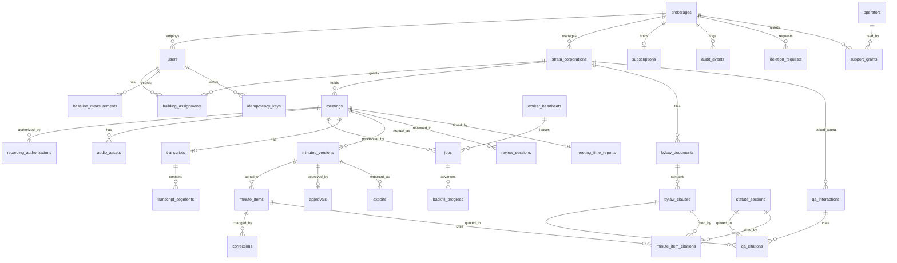

# Schema — StrataScribe BC

**Question this file answers:** what data exists, who owns it, and how does it change?

Proposed PostgreSQL 16 schema. Nothing has been created. Technology choices are explained in [TRD.md](TRD.md#4-solution-strategy); screens in [App-flow.md](App-flow.md); must-haves in [PRD.md](PRD.md#must-haves). Number labels are defined in [Decision.md](Decision.md#how-numbers-are-labelled-used-in-all-ten-files). Sample values are synthetic. Every default, limit and retention period in this file is an author's proposal `[A]` unless it carries another label.

## Ownership in one paragraph

A **brokerage** is the tenant and the paying account. A **strata corporation** (a "building") belongs to exactly one brokerage and owns its meetings, recordings, transcripts, minutes, bylaws and questions. A **user** belongs to one brokerage and reaches a building only through an active **building assignment**, unless the user is a managing broker. Everything a building owns carries both `brokerage_id` and `strata_id`, so both boundaries can be enforced on every row without a join.

## Entity-relationship diagram

## Conventions

- Primary keys: `id uuid` generated by the application (UUID version 7, so keys sort by creation time). No sequential IDs appear in URLs.
- Every table has `created_at timestamptz not null default now()`. Mutable tables also have `updated_at timestamptz not null` and `row_version integer not null default 1`, incremented on every update and used for `If-Match`.
- Tenant-owned tables have `brokerage_id uuid not null`. Building-owned tables also have `strata_id uuid not null`, with a composite foreign key `(strata_id, brokerage_id)` to `strata_corporations (id, brokerage_id)` so a row can never point at a building in a different brokerage.
- Text enumerations are `text` with a `CHECK` constraint, not database enum types, so adding a value is a cheap migration.
- "Sens." column in the dictionary: **H** = contains or reveals owners' personal information; **M** = business-confidential; **L** = low.

## Data dictionary

### brokerages

| Field | Type | Null | Default | Notes |
|---|---|---|---|---|
| id | uuid | no | — | PK |
| legal_name | text | no | — | — |
| licence_label | text | yes | — | BCFSA brokerage licence number as typed; not verified |
| privacy_contact_name, privacy_contact_email | text | no | — | Required at onboarding |
| allow_express_consent_basis | boolean | no | false | Enables authority basis 2 |
| audio_retention_days_after_approval | integer | no | 14 | CHECK 1–60 |
| audio_max_days_after_upload | integer | no | 60 | CHECK 7–90 |
| transcript_retention_days_after_approval | integer | no | 90 | CHECK 1–365 |
| status | text | no | 'active' | active, closing, closed |

Sens. M. Unique: `lower(legal_name)` is **not** unique (two brokerages may share a trade name).

### users

| Field | Type | Null | Default | Notes |
|---|---|---|---|---|
| id | uuid | no | — | PK |
| brokerage_id | uuid | no | — | FK brokerages |
| email | citext | no | — | Unique across the whole system (one brokerage per user in the MVP) |
| full_name | text | no | — | — |
| role | text | no | — | CHECK in ('managing_broker','strata_manager') |
| status | text | no | 'invited' | invited, active, deactivated |
| last_sign_in_at | timestamptz | yes | — | — |

`totp_secret_encrypted bytea` (null until enrolled) and `totp_enrolled_at` complete the row. Sens. M. Constraint: a trigger refuses to deactivate or demote the last active managing broker of a brokerage. Platform operators are **not** rows in this table; see `operators` below.

### operators

| Field | Type | Null | Default | Notes |
|---|---|---|---|---|
| id | uuid | no | — | PK |
| email | citext | no | — | Unique; must not exist in `users` |
| full_name | text | no | — | — |
| status | text | no | 'active' | active, deactivated |
| totp_secret_encrypted | bytea | no | — | Second factor is mandatory |
| last_sign_in_at | timestamptz | yes | — | — |

Not tenant-owned. Readable only by the operator sign-in code path; no brokerage role can read it. Sens. M.

### strata_corporations

| Field | Type | Null | Default | Notes |
|---|---|---|---|---|
| id | uuid | no | — | PK; also UNIQUE (id, brokerage_id) for composite FKs |
| brokerage_id | uuid | no | — | FK |
| name | text | no | — | "Alder Court" |
| strata_plan_number | text | no | — | "ZZS 9001"; UNIQUE (brokerage_id, upper(strata_plan_number)) |
| strata_lot_count | integer | yes | — | CHECK > 0 |
| owner_count | integer | yes | — | With `strata_lot_count`, selects the 2/3 quorum rule when either is under 4; a plan with exactly 2 lots has no casting vote |
| eligible_votes_total | integer | yes | — | Default for 80% and unanimous votes |
| council_size | integer | yes | — | — |
| general_quorum_rule | jsonb | no | `{"type":"act_default"}` | `act_default` applies s. 48(2)(a) or (b) from the lot and owner counts and s. 48(3) for a reconvened meeting; an override (`{"type":"fraction",…}` or `{"adjourned_rule":…}`) needs `source_clause` |
| council_quorum_rule | jsonb | no | `{"type":"standard_bylaw_16"}` | — |
| standard_bylaws_declared_by, standard_bylaws_declared_at | uuid, timestamptz | yes | — | "No amendments filed" declaration |
| status | text | no | 'active' | active, deleting, deleted |

Sens. M. Uniqueness is scoped to the brokerage: two brokerages may both hold "ZZS 9001" (for example after a building changes brokerage) without learning of each other.

### building_assignments

| Field | Type | Null | Default | Notes |
|---|---|---|---|---|
| id | uuid | no | — | PK |
| brokerage_id, strata_id | uuid | no | — | Composite FK |
| user_id | uuid | no | — | Composite FK `(user_id, brokerage_id)` to `users (id, brokerage_id)`, so the user's brokerage must equal `brokerage_id` (B1: declarative FK instead of the trigger first proposed) |
| assigned_by | uuid | no | — | FK users |
| assigned_at | timestamptz | no | now() | — |
| revoked_at, revoked_by | timestamptz, uuid | yes | — | Never deleted; history is the audit trail |

Unique partial index on `(strata_id, user_id) WHERE revoked_at IS NULL`. Sens. H for integrity: this table is the access rule.

### subscriptions

`id`, `brokerage_id` (unique), `plan` (pilot, starter, pro, business), `building_allowance` integer, `price_cad_cents` integer, `period_start`, `period_end`, `status` (pilot, active, past_due, cancelled). Invoices are issued by hand in the pilot; no payment data is stored. Sens. M.

### meetings

| Field | Type | Null | Default | Notes |
|---|---|---|---|---|
| id | uuid | no | — | PK |
| brokerage_id, strata_id | uuid | no | — | Composite FK |
| meeting_type | text | no | — | council, agm, sgm |
| held_on | date | no | — | — |
| format | text | no | — | in_person, electronic, hybrid |
| source_type | text | no | — | recording, dictated_notes, not_recorded |
| state | text | no | 'setup' | States in [TRD.md](TRD.md#jobs-retries-timeouts-idempotency) |
| state_version | integer | no | 0 | Incremented by every transition; compare-and-set |
| created_by | uuid | no | — | FK users |
| sequence | smallint | no | 1 | 2 for a second meeting of the same type on the same date |
| length_minutes | integer | yes | — | Meeting length; from audio duration for recordings, entered by the manager otherwise; used by the baseline matching rule |
| reconvened_after_adjournment | boolean | no | false | General meeting reconvened after adjournment for lack of quorum (s. 48(3)) |
| ended_at_local | timestamptz | yes | — | For "3 business days" |

Unique `(strata_id, meeting_type, held_on, sequence)`: creating a second meeting of the same type on the same date asks the user to confirm and sets `sequence = 2`. Sens. M.

### recording_authorizations

| Field | Type | Null | Default | Notes |
|---|---|---|---|---|
| id | uuid | no | — | PK |
| brokerage_id, strata_id, meeting_id | uuid | no | — | — |
| basis | text | no | — | bylaw, express_consent_all, dictated_notes |
| bylaw_clause_id | uuid | yes | — | FK bylaw_clauses; required or `bylaw_reference_text` required when basis = bylaw (CHECK) |
| bylaw_reference_text | text | yes | — | — |
| notice_text_version | text | no | — | Which notice wording was shown |
| attested_by | uuid | no | — | FK users |
| attested_at | timestamptz | no | now() | — |
| superseded_by | uuid | yes | — | Self-reference; rows are never updated otherwise |

Append-only (no UPDATE except `superseded_by`, enforced by trigger; no DELETE). At most one current row per meeting: partial unique index on `meeting_id WHERE superseded_by IS NULL`; the `superseded_by` foreign key is DEFERRABLE INITIALLY DEFERRED so the old row is pointed at the new one before the new row is inserted (B1). `bylaw_clause_id` has a composite FK with `strata_id`, so it can only name a clause of the same building. Sens. M. A typed `bylaw_reference_text` is enough to open the upload gate, but **approval is refused** while the current authorization has basis `bylaw` and `bylaw_clause_id` is null or points to a clause of an unconfirmed document (checked in the approval transaction; test I-23). Linking the clause later creates a superseding row.

### audio_assets

| Field | Type | Null | Default | Notes |
|---|---|---|---|---|
| id | uuid | no | — | PK |
| brokerage_id, strata_id, meeting_id | uuid | no | — | — |
| part_number | integer | no | 1 | Order within the meeting |
| storage_key | text | no | — | `b/{brokerage_id}/s/{strata_id}/audio/{id}`; UNIQUE |
| sha256 | bytea | no | — | Declared by the client at upload start, verified at completion. UNIQUE (meeting_id, sha256): the same file twice in one meeting returns the first asset (I-3) |
| received_bytes | bigint | no | 0 | Bytes stored so far under `tmp/`; a resumed upload continues from here (I-2). Added in B1 |
| byte_size | bigint | no | — | — |
| duration_seconds | integer | yes | — | Set by the worker |
| upload_state | text | no | 'receiving' | receiving, complete, failed |
| authorization_id | uuid | no | — | FK recording_authorizations: no audio row without an authority |
| delete_after | timestamptz | yes | — | Set at upload (hard limit) and reset at approval |
| deleted_at | timestamptz | yes | — | Row is kept as a tombstone without the key's object |

Sens. **H**.

### jobs

| Field | Type | Null | Default | Notes |
|---|---|---|---|---|
| id | uuid | no | — | PK |
| brokerage_id, strata_id | uuid | yes | — | Tenant context for the worker. CHECK: not null except for the system kinds `retention_sweep` and `reconcile` (B1) |
| max_attempts, run_after | integer, timestamptz | no | 3, now() | Retry budget and backoff (B1) |
| meeting_id / bylaw_document_id | uuid | yes | — | One is set, by kind |
| kind | text | no | — | transcribe, draft_minutes, index_bylaws, export, retention_sweep, reconcile |
| idempotency_key | text | no | — | UNIQUE (kind, idempotency_key) |
| status | text | no | 'queued' | queued, leased, succeeded, failed |
| attempt | integer | no | 0 | — |
| leased_until | timestamptz | yes | — | Expired leases are re-queued by the reconciler |
| leased_by | text | yes | — | `worker_heartbeats.worker_id` of the worker holding the lease |
| correlation_id | uuid | no | — | From the originating request |
| error_code | text | yes | — | No free text from content |
| result_ref | uuid | yes | — | The transcript, version or export produced |

Sens. L.

### transcripts and transcript_segments

`transcripts`: `id`, `brokerage_id`, `strata_id`, `meeting_id` (unique), `asr_model_id`, `asr_params_hash`, `language`, `delete_after`, `deleted_at`.

`transcript_segments`: `id`, `brokerage_id`, `strata_id`, `transcript_id`, `seq` integer, `audio_asset_id`, `start_ms`, `end_ms`, `speaker_label` text ("Speaker 3"), `speaker_name` text null (set by the manager), `text`. Unique `(transcript_id, seq)`. Sens. **H**.

### minutes_versions

| Field | Type | Null | Default | Notes |
|---|---|---|---|---|
| id | uuid | no | — | PK |
| brokerage_id, strata_id, meeting_id | uuid | no | — | — |
| version | integer | no | — | UNIQUE (meeting_id, version) |
| status | text | no | 'draft' | draft, approved, superseded |
| llm_model_id, prompt_version, rules_version, template_version | text | yes/no | — | Provenance of the draft; `rules_version` not null |
| reopened_from | uuid | yes | — | Previous approved version |
| reopen_reason | text | yes | — | Required when `reopened_from` is set |
| content_hash | bytea | yes | — | Set at approval over the canonical rendering |

A trigger rejects any UPDATE to an approved version or its items, with one exception: `status` may change from `approved` to `superseded` (and nothing else in the row) when a reopened version is approved. Sens. **H**.

### minute_items

| Field | Type | Null | Default | Notes |
|---|---|---|---|---|
| id | uuid | no | — | PK |
| brokerage_id, strata_id, minutes_version_id | uuid | no | — | — |
| position | integer | no | — | Order in the minutes |
| item_type | text | no | — | attendance, quorum, call_to_order, motion, discussion, adjournment, other |
| body_text | text | no | '' | — |
| mover, seconder | text | yes | — | — |
| outcome_method | text | yes | — | declared, counted; required for a reviewed motion |
| declared_outcome | text | yes | — | carried, defeated: what the chair declared, selected by the manager |
| outcome_attested_by, outcome_attested_at | uuid, timestamptz | yes | — | Set when the manager confirms a declared outcome |
| threshold | text | yes | — | majority, three_quarter, eighty_percent, unanimous, council_majority |
| votes_for, votes_against, votes_abstained, eligible_votes, members_present | integer | yes | — | CHECK ≥ 0; all optional when `outcome_method = 'declared'`; `members_present` for council votes |
| casting_vote | text | yes | — | not_used, used_for, used_against; only when the computed result is a tie |
| computed_result | text | yes | — | carried, defeated, tie, no_result; written only by the rules package; null for declared motions |
| computed_formula | text | yes | — | Human-readable inequality |
| discrepancy_resolution | text | yes | — | counts_corrected, threshold_corrected, recorded_as_declared |
| discrepancy_note | text | yes | — | Required with recorded_as_declared |
| final_outcome | text | yes | — | carried, defeated; generated: the declared outcome for `declared`; for `counted` the computed result (after any casting vote) unless `recorded_as_declared` |
| spoken_outcome | text | yes | — | What the model heard; shown only as a suggestion |
| ai_suggestion | jsonb | yes | — | The original draft values, immutable |
| source_segment_ids | uuid[] | no | '{}' | Evidence links |
| origin | text | no | — | ai, manager_added |
| review_status | text | no | 'needs_review' | needs_review, reviewed, blocked |
| blocked_reason | text | yes | — | — |
| sensitive_flag | boolean | no | false | Owner named in an arrears or contravention item |
| deleted_at, delete_reason | timestamptz, text | yes | — | Soft delete so the correction history stays intact |

CHECK: when `item_type = 'motion'` and `review_status = 'reviewed'`, then `final_outcome` is not null and either (a) `outcome_method = 'declared'` with `declared_outcome`, `outcome_attested_by` and `outcome_attested_at` not null, or (b) `outcome_method = 'counted'` with `threshold`, `votes_for`, `votes_against` not null and `computed_result` in ('carried','defeated'), or `computed_result = 'tie'` with `casting_vote` not null. For a reviewed counted motion with a declared outcome, the declared outcome must equal the counted outcome (computed result after any casting vote) or `discrepancy_resolution = 'recorded_as_declared'` (B1 change: the earlier wording "if `declared_outcome` and `computed_result` differ, `discrepancy_resolution` is not null" applied to every row, which made the blocked state the TRD requires unstorable, and compared against `tie` rather than the outcome after the casting vote). `recorded_as_declared` requires a non-blank `discrepancy_note` (CHECK). `casting_vote` is allowed only when `computed_result = 'tie'`; a declared motion has no `computed_result`. `rules_version` (text, null) stores the rules version used for the computed result, added in B1 per "Provenance" below. `final_outcome` is a stored generated column. Counts are never required for a declared motion. Sens. **H**.

### minute_item_citations

| Field | Type | Null | Default | Notes |
|---|---|---|---|---|
| id | uuid | no | — | PK |
| brokerage_id, strata_id, minute_item_id | uuid | no | — | — |
| bylaw_clause_id | uuid | yes | — | Exactly one of this and `statute_section_id` (CHECK) |
| statute_section_id | uuid | yes | — | — |
| quoted_text | text | yes | — | Must be an exact substring of the clause when present |
| origin | text | no | — | ai_suggested, manager_added |
| status | text | no | 'suggested' | suggested, confirmed, removed |
| confirmed_by, confirmed_at | uuid, timestamptz | yes | — | — |

A trigger requires `bylaw_clause_id` to belong to the same `strata_id` and to a document that is `current`. Every confirm, replace or remove writes a `corrections` row with category `citation`. Unconfirmed suggestions are not exported. Sens. M.

### corrections

`id`, `brokerage_id`, `strata_id`, `minute_item_id`, `field` text, `old_value` text, `new_value` text, `category` (motion_text, mover_seconder, outcome, vote_count, threshold, citation, attendance, other, item_added, item_deleted), `made_by`, `made_at`. Append-only. Sens. **H**. Feeds metrics M-1, M-5.

### review_sessions

`id`, `brokerage_id`, `strata_id`, `meeting_id`, `user_id`, `activity` (setup, review, lookup), `started_at`, `last_heartbeat_at`, `active_seconds` integer. A heartbeat is sent every 30 seconds only if the tab is visible and there was keyboard, pointer or scroll input **or audio playing** in the last 60 seconds; each accepted heartbeat adds 30 seconds. A session closes after 2 minutes without a heartbeat. Sens. L.

### meeting_time_reports

| Field | Type | Null | Default | Notes |
|---|---|---|---|---|
| meeting_id | uuid | no | — | PK; one row per meeting |
| brokerage_id, strata_id | uuid | no | — | — |
| post_export_edit_minutes | integer | yes | — | Asked when the manager marks the minutes sent |
| dictation_prep_minutes | integer | yes | — | Dictated-notes arm only |
| self_timed_total_minutes | integer | yes | — | Manager's stopwatch total; required for the first two authorized meetings per brokerage (enforced in the report, not by constraint) |
| marked_sent_on | date | yes | — | Used by M-2 |
| entered_by, entered_at | uuid, timestamptz | no | — | — |

Sens. L. Terms are defined in [PRD.md](PRD.md#how-m-1-is-captured).

### approvals

`id`, `brokerage_id`, `strata_id`, `minutes_version_id` (unique), `approved_by`, `approved_at`, `content_hash`, `attestation_text_version`. Append-only. Sens. M.

### exports

`id`, `brokerage_id`, `strata_id`, `minutes_version_id`, `format` (docx, pdf), `is_draft` boolean, `storage_key` (`…/export/{id}`), `created_by`, `expires_at` (object deleted after 7 days `[A]`; it can be regenerated). Sens. **H**.

### bylaw_documents

| Field | Type | Null | Default | Notes |
|---|---|---|---|---|
| id | uuid | no | — | PK |
| brokerage_id, strata_id | uuid | no | — | — |
| kind | text | no | — | bylaws, rules |
| filing_reference | text | yes | — | Land title filing number as typed |
| filed_on | date | yes | — | Required for kind = bylaws before confirmation (CHECK with status) |
| storage_key | text | no | — | `…/bylaw/{id}` |
| sha256 | bytea | no | — | UNIQUE (strata_id, sha256) |
| parser_version | text | no | — | — |
| status | text | no | 'processing' | processing, needs_confirmation, current, superseded, failed |
| confirmed_by, confirmed_at | uuid, timestamptz | yes | — | — |

Partial unique index `(strata_id, kind) WHERE status = 'current'`: one current bylaw set and one current rule set per building. Sens. L–M.

### bylaw_clauses

`id`, `brokerage_id`, `strata_id`, `bylaw_document_id`, `clause_number` text ("3(4)(b)"), `heading` text null, `body_text` text, `page_from`, `page_to` integer, `position` integer, `embedding vector(1024)` null, `embedding_model_id` text, `edited_by` null. Unique `(bylaw_document_id, position)`. Sens. L–M. The vector dimension depends on the embedding model chosen in T-4.1.1 and is a placeholder. **B1 gap:** pgvector is not available on the PostgreSQL 16 used for B1, so `embedding` (and the HNSW index) is not created; clause search runs behind `ai.search.ClauseSearch` with a full-text implementation filtered by building and current document in the query.

### statute_sections (global, not tenant-owned)

`id`, `instrument` (spa, regulation, standard_bylaws), `section_number`, `heading`, `body_text`, `source_url`, `current_to` date, `version_label`, `embedding`, `superseded_at` null. Read-only to all tenants; written only by the operator's import task. Unique `(instrument, section_number, version_label)`.

### qa_interactions and qa_citations

`qa_interactions`: `id`, `brokerage_id`, `strata_id`, `asked_by`, `question_text`, `outcome` (answered, refused, unavailable), `answer_text` null, `llm_model_id`, `prompt_version`, `retrieval_params_hash`, `flagged_wrong` boolean default false, `created_at`. CHECK: `outcome = 'answered'` requires `answer_text` not null. A deferred constraint trigger additionally requires at least one `qa_citations` row for an answered interaction at commit.

`qa_citations`: `id`, `brokerage_id`, `strata_id`, `qa_interaction_id`, `bylaw_clause_id` null, `statute_section_id` null, `quoted_text`, `validated` boolean not null. CHECK: exactly one of the two references is set; `validated = true`. Sens. M (questions can name owners).

### baseline_measurements

`id`, `brokerage_id`, `strata_id` null, `user_id`, `meeting_type`, `meeting_length_minutes`, `drafting_minutes`, `method` (stopwatch, estimate), `noted_on` date. Sens. L. A manager reads only their own rows; a managing broker reads all.

### audit_events

| Field | Type | Null | Notes |
|---|---|---|---|
| id | uuid | no | PK |
| brokerage_id | uuid | no | — |
| strata_id | uuid | yes | — |
| actor_type | text | no | user, operator, system |
| actor_id | uuid | yes | — |
| action | text | no | For example `access.denied`, `meeting.opened`, `audio.streamed`, `transcript.read`, `export.downloaded`, `bylaw.original_downloaded`, `support.accessed`, `assignment.revoked`, `authorization.recorded`, `audio.uploaded`, `audio.deleted`, `item.corrected`, `minutes.approved`, `minutes.reopened`, `export.created`, `qa.asked`, `retention.changed`, `support.granted` |
| target_type, target_id | text, uuid | yes | — |
| outcome | text | no | ok, denied, failed |
| correlation_id | uuid | no | — |
| details | jsonb | no | Allow-listed keys only; never transcript, minutes, question or answer text |
| occurred_at | timestamptz | no | — |

Append-only: the application role has INSERT and SELECT only. Sens. M. Kept 7 years `[A]`, chosen to match the brokerage's own record period under the Rules `[S: RESR]` s. 92, though nothing read requires it for this log.

### deletion_requests and support_grants

`deletion_requests`: `id`, `brokerage_id`, `scope` (building, account), `strata_id` null, `requested_by`, `requested_at`, `execute_after` (48 hours later `[A]`), `cancelled_at`, `completed_at`, `counts` jsonb, `backup_clear_date` date.

`support_grants`: `id`, `brokerage_id`, `strata_id`, `meeting_id`, `operator_id` (null = any active operator), `granted_by`, `reason`, `expires_at` (24 hours), `revoked_at`, `revoked_by`.

### idempotency_keys, backfill_progress, worker_heartbeats

`idempotency_keys`: `key` text, `user_id` uuid, `route` text, `request_hash` text, `status_code` integer, `response_body` jsonb, `created_at`; PK `(user_id, route, key)`; rows deleted after 24 hours (deletion job not built in B1). B1 change: the first response is stored, not only its hash, because a repeated key must return the first result; a repeated key with a different body is refused (422). RLS: visible only to `user_id = app.user_id`.

`backfill_progress`: `name` text PK, `last_id` uuid null, `done` boolean default false, `last_job_id` uuid null (the `jobs` row that last advanced it), `updated_at`. Not tenant-owned; written by backfill jobs only.

`worker_heartbeats`: `worker_id` text PK, `config_fingerprint` text, `last_seen_at`. Not tenant-owned; read by `/readyz`.

## Indexes and the queries they serve

| Index | Query |
|---|---|
| `building_assignments (user_id) WHERE revoked_at IS NULL` | Row-level security check and S-03 "my buildings" on every request |
| `building_assignments (strata_id, user_id) WHERE revoked_at IS NULL` (unique) | "Is this user assigned to this building?" |
| `meetings (strata_id, held_on DESC)` | S-06 meeting list |
| `meetings (brokerage_id, state) WHERE state IN ('ready_for_review','in_review')` | S-03 "meetings to review" counts |
| `jobs (status, leased_until) WHERE status IN ('queued','leased')` | Worker lease query and reconciler |
| `jobs (kind, idempotency_key)` (unique) | Duplicate-work prevention |
| `audio_assets (delete_after) WHERE deleted_at IS NULL` | Nightly retention sweep; metric M-9 |
| `audio_assets (meeting_id, sha256)` (unique) | Duplicate upload detection |
| `transcript_segments (transcript_id, seq)` (unique) | Transcript pane paging and evidence lookup |
| `minute_items (minutes_version_id, position)` | S-10 and S-11 rendering |
| `corrections (minute_item_id, made_at)` | Correction history; pilot report |
| `bylaw_clauses USING hnsw (embedding vector_cosine_ops)` plus `(strata_id, bylaw_document_id)` | S-12 retrieval, always filtered by building and current document first |
| `bylaw_clauses USING gin (to_tsvector('english', body_text))` | Keyword fallback and "closest passages" |
| `qa_interactions (strata_id, created_at DESC)` | S-12 history |
| `audit_events (brokerage_id, occurred_at DESC)` and `(brokerage_id, strata_id, occurred_at DESC)` | S-15 |
| `audit_events (actor_id, occurred_at) WHERE outcome = 'denied'` | Repeated-denial alert |

Vector search is always executed with `strata_id` and `status = 'current'` in the same query, under row-level security, so an approximate index can never return another building's clause.

## Permissions and tenant boundaries

Database roles (proposed):

| Role | Used by | Rights |
|---|---|---|
| `app_user` | API and workers, acting for a user or a building-scoped service actor | DML on tenant tables **through row-level security**; INSERT/SELECT on append-only tables; no DDL; not the table owner; no `BYPASSRLS` |
| `app_migrator` | Migrations only | DDL; owner of tables |
| `app_system` | Retention sweep, reconciler, backup | Narrow rights: `jobs`, `audio_assets.delete_after/deleted_at`, deletions listed in a `deletion_requests` row; cannot read `transcript_segments.text`, `minute_items`, `qa_interactions`. **B1:** not a separate database role yet; the system context is `app_user` with `app.role = 'system'`, which policies admit only to `jobs` (all) and `audio_assets` (read, update) plus audit inserts. A separate role is a proposal for T-6.1 |
| `app_operator_ro` | Operator requests **without** a grant (`/operator/jobs`) | Views over `jobs` and counts only; no content columns. Operator requests **under a support grant** do not use this role: they use `app_user` with `app.role = 'operator'` and `app.support_grant_id` set, so the same row-level security applies |

Row-level security is enabled and **forced** on every tenant table. Policies, in words:

1. **Tenant policy (all tenant tables):** a row is visible and writable only when `brokerage_id = current_setting('app.brokerage_id')`.
2. **Building policy (all building-owned tables):** additionally, either `current_setting('app.role') = 'managing_broker'`, or an unrevoked `building_assignments` row exists for `(strata_id, current_setting('app.user_id'))`, or the session is a service actor whose `app.strata_id` equals the row's `strata_id`, or `app.role = 'operator'` and the `support_grants` row named by `app.support_grant_id` is unexpired, unrevoked, belongs to this brokerage, is open to `app.operator_id`, and names this row's meeting (tables without a `meeting_id`, such as bylaws and questions, are never visible to an operator).
3. **Own-rows policy:** `baseline_measurements` and `review_sessions` are visible to their user and to the managing broker.
4. **Global read:** `statute_sections` is readable by all; writable by none of the application roles.

If the session variables are not set, the policies evaluate to false and every query returns nothing. That is the default-deny.

Role permissions by action:

| Action | managing_broker | strata_manager (assigned) | strata_manager (not assigned) | Other brokerage | Worker (building-scoped) | Operator |
|---|---|---|---|---|---|---|
| List buildings | All in brokerage | Assigned only | — | None | — | Counts only |
| Read meeting, transcript, minutes, play audio | Yes, any building (audited) | Yes (audited) | 403 | 404 | Its building only | Only the granted meeting, read-only (audited) |
| Record authority, upload audio | Yes, any building | Yes | 403 | 404 | — | No |
| Edit, approve, reopen | Yes, any building | Yes | 403 | 404 | Writes drafts only | No |
| Bylaws: upload, confirm | Yes | Yes | 403 | 404 | Writes clauses | No |
| Ask bylaw question | Yes | Yes | 403 | 404 | — | No |
| Assign managers, team, retention, deletion, audit, pilot report | Yes | No | No | 404 | — | No |
| Own baseline and time reports | Yes (own rows; reads all) | Yes | Yes (own baseline rows, building optional) | — | — | No |

**Uniqueness scope:** email is global; strata plan number is per brokerage; meeting type and date per building; audio checksum per meeting; bylaw checksum per building; idempotency keys per job kind.

**Cross-tenant denial is tested three ways** (T-5.2.1): through the API with a second brokerage's session; directly in SQL as `app_user` with the wrong session variables; and through file links issued to one user and replayed by another.

## Provenance, versions and timestamps

| Record | Provenance stored |
|---|---|
| Transcript | Audio asset IDs, `asr_model_id`, parameters hash, created time |
| Draft minutes | Transcript, `llm_model_id`, `prompt_version`, `template_version`, `rules_version` |
| Each minute item | `origin`, immutable `ai_suggestion`, `source_segment_ids`, corrections with author and time |
| Computed result | `rules_version`, `computed_formula`, inputs on the same row |
| Declared outcome | `outcome_attested_by`, `outcome_attested_at`; any `discrepancy_resolution` and note |
| Citation on a minute item | `origin`, `status`, `confirmed_by`, the clause and its document's filing date |
| Approval | Approver, time, content hash, attestation wording version |
| Bylaw clause | Document, checksum, `parser_version`, page range, `edited_by`, confirmation by and at, filing date |
| Statute section | Source URL, `current_to` date, version label |
| Bylaw answer | Model, prompt version, retrieval parameters, citations with exact quotes |
| Recording | Authority row, uploader, checksum, upload time, deletion time |

## Transactions and duplicates

- **Upload complete:** one transaction verifies the checksum, sets `upload_state = 'complete'`, sets `delete_after`, transitions the meeting, inserts the `transcribe` job and the audit event. Either all happen or none.
- **Item save:** one transaction updates the item (checking `row_version`), inserts the correction, recomputes the result through the rules package, and updates `review_status`.
- **Approval:** `SELECT … FOR UPDATE` on the minutes version; re-run every rule; refuse if any item is not reviewed or blocked, or if the recording authority is a bylaw basis without a confirmed clause; write `content_hash`, the approval row, the meeting transition, new `delete_after` values for audio and transcript, and the audit event.
- **Job completion:** the worker writes its result and calls the compare-and-set transition in one transaction; if `state_version` has moved on, the result is stored but the state is left alone (R-01).
- **Duplicates:** prevented by the unique constraints listed above and by `Idempotency-Key` on mutating requests (stored for 24 hours in `idempotency_keys`).

## Retention and deletion

All periods are proposals `[A]` configurable per brokerage within the stated bounds. The legal anchors are: destroy personal information once it is no longer needed `[S: PIPA]` s. 35(2); minutes need not contain the exact discussion `[S: OIPC-2022]`; the strata corporation, not this product, must keep minutes at least 6 years `[S: SPR]` s. 4.1(3).

| Data | Sens. | Default retention | On expiry |
|---|---|---|---|
| Meeting audio | H | 14 days after minutes are approved; never more than 60 days after upload, approved or not (warning to the manager at day 45) | Object deleted; row kept as tombstone with `deleted_at`; audit event |
| Incomplete upload parts, `tmp/` objects | H | 24 hours | Deleted by sweep |
| Transcript and segments | H | 90 days after approval | Segment text deleted; evidence links in old items show "source deleted" |
| Draft minutes versions never approved | H | 90 days after last edit | Deleted |
| Approved minutes, corrections | H | While the building is active in the account | Deleted with the building |
| Export files | H | 7 days | Object deleted; can be regenerated |
| Bylaws and clauses | L–M | While the building is active | Deleted with the building |
| Questions and answers | M | 12 months | Deleted |
| Audit events | M | 7 years | Deleted |
| Baselines, review sessions | L | Life of the account | Deleted with the account |
| Database and object backups | H | 35 days | Expire |

**Export.** A managing broker can export a building: approved minutes (Word and PDF), bylaw files and clause text, corrections log, authority records, audit events for that building. This supports the manager's duty to return records when a management contract ends `[S: SPA]` s. 37.

**Deletion.** Building or account deletion runs after a 48-hour cancel window: rows are deleted in dependency order; every object under `b/{brokerage_id}/s/{strata_id}/` is deleted by prefix and the prefix is then listed to prove it is empty; the request row records counts and the date after which no backup contains the data (deletion date + 35 days).

**Backups and restore.** Backups are encrypted and expire after 35 days. A restore re-introduces data deleted since the backup; therefore the restore runbook replays, before the service is opened: (1) all `deletion_requests` completed after the backup time, from a small deletion ledger stored separately from the main backup, and (2) the retention sweep. An individual's access request under `[S: PIPA]` s. 23 is answered by the brokerage or strata corporation from the building export; the product offers no name search (a non-goal in the PRD).

## B1 implementation notes (2026-11-11)

Built in B1 and covered by tests listed in `verification-report-fixing.md` "B1 build record":

- **Roles.** Local role names are `stratascribe_app` (the `app_user` of this file: NOSUPERUSER, NOBYPASSRLS, owns nothing) and the OS superuser as migration owner (the `app_migrator` stand-in). Every tenant table has row-level security ENABLED and FORCED.
- **Session variables.** `app.brokerage_id`, `app.user_id`, `app.role` (`managing_broker`, `strata_manager`, `service`, `system`, `operator`), `app.strata_id` (service actor), `app.operator_id`, `app.support_grant_id`, set with `set_config(…, true)` per transaction by `core.db.session_for`.
- **Building policy** is the SQL function `app_can_see_building(strata_id)`; operator reads use `app_grant_meeting()` on `meetings`, `transcripts`, `transcript_segments` (through `transcripts`), `minutes_versions` and `minute_items` (through `minutes_versions`).
- **403 versus 404.** Two narrow SECURITY DEFINER functions: `app_locate(kind, id)` returns a row's building only when the row is in the caller's brokerage (no content), and `app_record_foreign_denial(…)` writes an `access.denied` row into the owning brokerage's audit log for a cross-brokerage attempt (P-2). Trigger helper functions that read a parent row's status are also SECURITY DEFINER and return a status only.
- **Composite foreign keys** `(child_id, strata_id)` to `(parent.id, parent.strata_id)` on every building-owned child (meeting children, transcript segments, items, citations, corrections, clauses, Q&A citations), in addition to `(strata_id, brokerage_id)` to `strata_corporations`.
- **Triggers:** `row_version` increment on mutable tables; append-only on `audit_events`, `corrections`, `approvals`; supersede-only on `recording_authorizations`; immutability of approved `minutes_versions` and their `minute_items`; item-citation check (same building via FK, current document, exact quote when given); Q&A citation check (current clause, exact substring); deferred "answered needs a validated citation" on `qa_interactions`; last active managing broker.
- **Not created in B1:** `subscriptions`, `exports`, `deletion_requests`, `backfill_progress`; the `vector` extension and embedding columns; attendance-card fields for quorum (see the gap noted in `verification-report-fixing.md`).

## Migrations

- **Tooling:** Alembic. One linear history; CI fails if there is more than one head (R-10). Every migration file name carries a timestamp and a short description; a merge that introduces a second head must be rebased, not merged with a "merge migration".
- **Ordering for the first release:** (1) extensions (`citext`, `vector`; B1: `citext`, `pgcrypto`, `pg_trgm`, no `vector`); (2) `brokerages`, `users`, `operators`; (3) `strata_corporations`, `building_assignments`; (4) `meetings`, `recording_authorizations`, `audio_assets`, `jobs`; (5) transcripts; (6) minutes, items, corrections, approvals, exports, review sessions; (7) bylaws, clauses, statute sections; (8) questions and citations; (9) audit, baselines, time reports, item citations, deletion, support grants, operators, idempotency keys, backfill progress, worker heartbeats; (10) row-level security policies and role grants; (11) indexes.
- **ORM parity (R-08):** indexes, unique constraints and CHECK constraints are declared in the SQLAlchemy models. CI creates one database from the migrations and one from the models' metadata and compares them; any difference fails the build. Row-level security policies and triggers, which the ORM cannot express, live only in migrations and are covered by a test that lists expected policies per table.
- **Lock management (R-11):** indexes on existing tables are created with `CREATE INDEX CONCURRENTLY` in their own non-transactional migration; `lock_timeout` is set to 5 seconds for every migration so a blocked DDL fails fast instead of queueing behind live queries; new NOT NULL columns are added as nullable, backfilled, then constrained with `NOT VALID` + `VALIDATE`.
- **Backfills (R-09):** run as jobs, not inside migrations, in batches of 1,000 rows `[A]`, keyed by primary key, with progress stored in a `backfill_progress` row so an interrupted backfill resumes where it stopped and can be run twice safely.
- **Recovery from partial execution:** each migration is transactional except concurrent index builds. A failed concurrent build leaves an invalid index; the runbook step is to drop the invalid index and re-run. The deploy takes a database dump first; the down path for the pilot is "restore the dump" for destructive changes and "leave in place" for additive ones.
